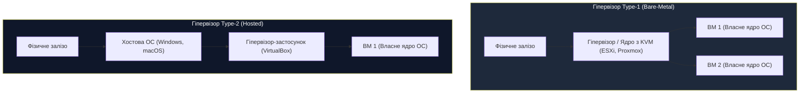
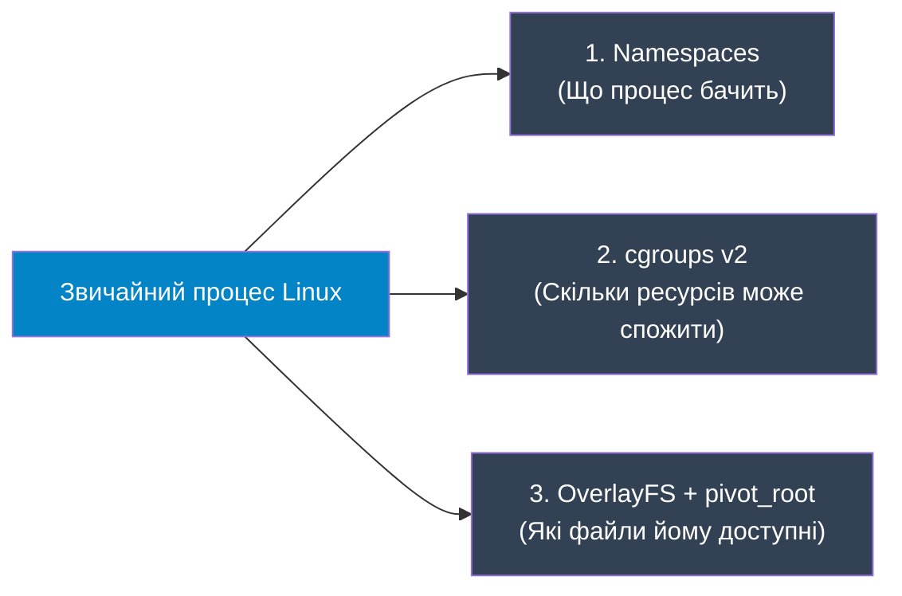
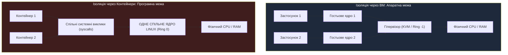

# Лекція 3: Механіка ізоляції — гіпервізори (VM) vs контейнеризація (cgroups & namespaces)

> **Декларація курсу.** Академічна доброчесність та авторство матеріалів — у [DISCLAIMER.md](DISCLAIMER.md).

---

## Рекомендовані першоджерела (Reading)

* **Обов'язкова стаття:** Barham et al., [*Xen and the Art of Virtualization*](https://www.cl.cam.ac.uk/research/srg/netos/papers/2003-xensosp.pdf) (ACM SOSP 2003). 
  * *Фокус під час читання:* Розділи 1–3. Паравіртуалізація (патч гостьового ядра) проти повної віртуалізації до появи Intel VT-x/AMD-V.
  * *Питання для роздумів:* Яким інженерним компромісом автори пояснюють необхідність інформувати гостьову ОС про те, що вона працює у віртуальному середовищі?
* **Додаткова стаття (★):** Agache et al., [*Firecracker: Lightweight Virtualization for Serverless Applications*](https://www.usenix.org/system/files/nsdi20-paper-agache.pdf) (USENIX NSDI 2020).
  * *Фокус під час читання:* Чому традиційні гіпервізори (QEMU/KVM) виявилися занадто важкими для multi-tenant serverless-навантажень і як скорочення емуляції застарілих пристроїв дало холодний старт за 5 мс.

---

## Базові пререквізити

Перед вивченням лекції обов'язково опрацюйте системний фундамент (кільця захисту Ring 3 $\to$ Ring 0, ієрархію кешів L1–L3, системні виклики та життєвий цикл сокетів): [Пререквізити: Системні основи — від кремнію до мережевого сокета](03_isolation_mechanics_prerequisites.md)

---

## Питання для розминки

**Питання 1: фокус із номерами процесів**

Ви запускаєте веб-сервер у контейнері. Всередині контейнера команда `ps aux` показує, що процес має **`PID 1`**. Системний адміністратор хост-сервера відкриває `htop` на фізичній машині і бачить той самий процес під номером **`PID 18452`**. Чому процес має два різні ідентифікатори одночасно і який із них «справжній»?

<details markdown="1">
<summary><b>Дізнатися відповідь</b></summary>

**Обидва PID справжні — у своїй системі відліку.**

Ядро Linux на машині одне. Планувальник хоста бачить процес під глобальним номером `18452`. Проте цей процес поміщений у власний **PID namespace**, де нумерація починається заново з `1`. Ядро створило для процесу персональну таблицю видимості: всередині він бачить лише себе і своїх нащадків.
</details>

**Питання 2: що вбиває швидше — брак пам'яті чи процесора?**

Що відбудеться з контейнером, якщо він спробує спожити **150% від виділеного CPU limit**? А що станеться, якщо він спробує виділити **105% від виділеного Memory limit**? Чому реакція операційної системи на ці дві події кардинально відрізняється?

<details markdown="1">
<summary><b>Дізнатися відповідь</b></summary>

* **CPU — стисливий ресурс (compressible):** процес **лишається живим**. Планувальник ядра сповільнює процес (CFS throttling), обмежуючи мілісекундні кванти процесорного часу. Затримка (latency) зростає, але аварії немає.
* **RAM — нестисливий ресурс (non-compressible):** ядро **негайно вбиває** процес. Фізичну комірку пам'яті неможливо розтягнути в часі. Спрацьовує **OOM Killer**, надсилаючи неперехоплюваний сигнал `SIGKILL` (**Exit Code 137**).
</details>

---

## 1. Проблема: утилізація заліза та «матриця пекла» деплою

Історично сервери в дата-центрах працювали за правилом «один фізичний сервер — один застосунок». Через це дороге залізо 90% часу утилізувалося лише на **5–15%**.

Віртуалізація розв'язала проблему утилізації заліза, нарізавши сервер на віртуальні машини. Проте вона не вирішила другу критичну проблему інженерії — **доставку програмного забезпечення**.

### Як виглядав деплой до появи контейнерів (Onsite-модель)

До появи Docker доставка коду на бойові сервери (Production) була головним джерелом нічних аварій:

1. **Збірка прямо на працюючому сервері (Onsite):**
   Скрипти деплою заходили по SSH і встановлювали системні бібліотеки: `apt install python3-dev libpq-dev`. Якщо сховище пакетів не відповідало або оновило бібліотеку на мінорну версію — реліз падав, залишаючи продакшн у напівробочому стані.
2. **Пекло залежностей (Dependency Hell):**
   Двом сервісам на одному хості були потрібні несумісні версії однієї системної бібліотеки (наприклад, `libssl 1.1` та `libssl 3.0`). Оскільки системні файли ОС були спільними, оновлення одного сервісу неминуче ламало інший.
3. **Розповзання конфігурацій (Configuration Drift):**
   Середовище на лептопі розробника, тестовий сервер (Staging) та бойовий сервер (Production) відрізнялися конфігураціями ядра, версіями компіляторів та локалями. Звідси народилося класичне: *«На моєму комп'ютері все працювало!»*.

### Зміна парадигми: від Onsite до Offsite

Docker зробив революцію не в ізоляції (ізоляцію робить саме ядро Linux), а в **моделі доставки софту**:

```
СТАРИЙ ПІДХІД (Onsite):
[Сирцевий код] ──SSH──> [Бойовий сервер: компіляція + apt install] ──> Високий ризик збою на проді

СУЧАСНИЙ ПІДХІД (Offsite):
[Сирцевий код] ──CI/CD──> [Імутабельний образ (Image)] ──Registry──> [Бойовий сервер: миттєвий запуск]
```

* **Onsite (на сервері):** середовище виконання збиралося на самому сервері під час релізу. Ризик несумісності вибухав у робочому середовищі.
* **Offsite (за межами сервера):** код, інтерпретатор, системні бібліотеки та конфігурація пакуються в **імутабельний (незмінний) контейнерний образ (Image)** на етапі CI-пайплайну. На сервер передається монолітний артефакт, який запускається однаково на будь-якому хості.

> **Головний висновок:**  
> Контейнеризація перенесла ризик збою з **моменту виконання на проді (runtime)** на **етап збірки в CI-репозиторії (build time)**.

---

## 2. Апаратна віртуалізація: проблема Ring 0 та гіпервізори

Як відомо з [пререквізитів](03_isolation_mechanics_prerequisites.md), операційна система очікує монопольного володіння привілейованим режимом **Ring 0** для керування пам'яттю (регістр `CR3`) та апаратурою.

Коли на одному комп'ютері потрібно запустити кілька незалежних операційних систем, виникає конфлікт: **дві ОС не можуть одночасно володіти фізичним Ring 0**.

```
   [ Ring 3: Застосунки користувача ]
               ▲
               │  Системні виклики (syscall)
               ▼
   [ Ring 0: Гостьове ядро ОС (Guest Kernel) ]
               ▲
               │  Апаратні перехоплення (VM-Exit)
               ▼
   [ Ring -1: Гіпервізор (Intel VT-x / AMD-V Root Mode) ]
               ▲
               ▼
   [ Фізичне залізо: процесор та пам'ять ]
```

### Еволюція подолання конфлікту:

1. **Паравіртуалізація (ранній Xen, 2003):**  
   Сирцевий код гостьової ОС змінювали вручну: всі привілейовані команди ядра замінювали на спеціальні виклики гіпервізора (**Hypercalls**). Працювало швидко, але вимагало модифікації ядра; запустити закриті системи на кшталт Windows було неможливо.
2. **Апаратна віртуалізація (Intel VT-x / AMD-V, 2005+):**  
   Виробники процесорів додали апаратний режим **Ring -1 (VMX Root Mode)**:
   * Гіпервізор працює в Ring -1.
   * Гостьова ОС працює у звичайному Ring 0 (Non-Root Mode) і вважає, що керує фізичним комп'ютером.
   * Коли гостьова ОС намагається виконати небезпечну дію із залізом, процесор апаратно зупиняє її та перемикає керування на гіпервізор — подія **`VM-Exit`**.
3. **Апаратна трансляція пам'яті (EPT / NPT):**  
   Дворівневий транслятор адрес у кремнії CPU: `Гостьова віртуальна` $\to$ `Гостьова фізична` $\to$ `Хостова фізична` адреса RAM. Повністю знімає програмне навантаження з гіпервізора на мапінг пам'яті.

### Класифікація гіпервізорів



* **Type-1 (Bare-Metal):** працює безпосередньо на фізичному залізі. Модуль **KVM (Kernel-based Virtual Machine)** у ядрі Linux перетворює сам Linux на повноцінний гіпервізор Type-1.
* **Type-2 (Hosted):** працює як звичайна програма поверх хостової ОС (VirtualBox). Має подвійний оверхед і в хмарах не застосовується.

> **Ціна віртуальних машин:**  
> Кожна ВМ запускає власну копію ядра ОС, емулює диски та шини материнської плати. Це дає залізну безпеку, але спалює гігабайти оперативної пам'яті та змушує чекати запуску десятки секунд.

---

## 3. Контейнеризація під капотом Linux

> [!IMPORTANT]
> **У ядрі Linux немає сутності «контейнер».**  
> Контейнер — це звичайний процес Linux, обмежений трьома механізмами ядра: **Namespaces**, **Cgroups** та **OverlayFS**.



### Примітив 1: Namespaces (Простори імен — ізоляція видимості)

Namespaces відповідають на запитання: **«Що процес бачить?»**. Створюються системним викликом:
```c
clone(..., CLONE_NEWPID | CLONE_NEWNET | CLONE_NEWNS | ...);
```

1. **PID (Process ID):** власне дерево процесів. Процес отримує `PID 1` і не бачить інших програм на хості (відповідь на Розминку 1).
2. **NET (Network):** власний мережевий стек: віртуальний інтерфейс `eth0`, власна таблиця маршрутизації та персональний діапазон портів `1–65535`. Завдяки цьому два сервіси в різних контейнерах одночасно роблять `bind()` на порт `80` без конфлікту `EADDRINUSE`.
3. **MNT (Mount):** ізольована таблиця точок монтування дисків.
4. **UTS:** власний hostname контейнера.
5. **IPC:** ізоляція черг повідомлень та спільної пам'яті (shared memory).
6. **USER:** відображення UID/GID. Дозволяє процесу бути повноправним `root` (UID 0) усередині контейнера, залишаючись безпечним користувачем (наприклад, UID 10001) на фізичному хості.
7. **TIME (Linux 5.6+):** персональне зміщення системного годинника (`CLOCK_MONOTONIC`). Дозволяє тестувати роботу фінансових сервісів при переході на новий місяць без зміни часу на самому фізичному сервері.

---

### Примітив 2: Control Groups (cgroups v2 — обмеження ресурсів)

Якщо простори імен ізолюють видимість, то **cgroups v2** відповідають на запитання: **«Скільки ресурсів дозволено спожити?»**.

Вся конфігурація контролюється ядром через псевдофайлову систему в `/sys/fs/cgroup/`.

```
                  ТИПИ РЕСУРСІВ
          ┌─────────────┴─────────────┐
          ▼                           ▼
    СТИСЛИВІ (CPU)            НЕСТИСЛИВІ (RAM)
    [cpu.max]                 [memory.high / memory.max]
          │                           │
   Перевищення ліміту          Перевищення ліміту
          │                           │
          ▼                           ▼
    CFS Throttling             Reclaim Throttle -> OOM Killer
    (Штучне сповільнення)      (Примусова страта SIGKILL)
```

#### 1. Процесор: стисливий ресурс (`cpu.max`)
* Планувальник ядра **CFS (Completely Fair Scheduler)** нарізає час на періоди (за замовчуванням 100 мс).
* Якщо контейнеру виділено квоту `200000 100000` (2.0 ядра), а він намагається спожити 300 мс процесорного часу, ядро призупиняє виконання його потоків до початку наступного вікна (**CFS Throttling**). Контейнер не падає — він просто сповільнюється.

#### 2. Оперативна пам'ять: нестисливий ресурс (`memory.high` vs `memory.max`)
Фізичні комірки RAM неможливо розтягнути в часі:
* **`memory.high` (Soft Limit):** буфер безпеки. При його перевищенні ядро активує **Reclaim Throttling** — штучно сповільнює системні виклики виділення пам'яті. Це дає рантаймам із Garbage Collector (Java, Go) сотні мілісекунд на проведення повного збирання сміття (Full GC) і повернення в безпечну зону.
* **`memory.max` (Hard Limit):** жорстка стеля. Якщо виділити пам'ять неможливо навіть після очищення кешу, ядро миттєво активує **OOM Killer**.

---

### Сигнали ядра та коди завершення процесів (Exit Codes)

Коли контейнер завершує роботу, причина фіксується кодом повернення. За стандартом POSIX, завершення від сигналу ядра кодується як **`128 + номер сигналу`**:

| Код виходу | Сигнал / Подія | Що сталося на рівні ядра Linux | Реакція інженера |
| :---: | :--- | :--- | :--- |
| **`0`** | `Success` | Процес виконав роботу та викликав `exit(0)` (норма для Batch Jobs). | Штатний стан. |
| **`1`** | `App Error` | Помилка в коді програми (Unhandled Exception, синтаксична помилка). | Читати логи застосунку. |
| **`137`** | **`SIGKILL` (128 + 9)** | **Примусова страта процесу ядром.** У 99% випадків — спрацював **OOM Killer** при перевищенні `memory.max`. Сигнал обробляється виключно ядром; код у блоках `try/catch` виконатися не може. | Збільшити memory limit або шукати витік пам'яті (memory leak). |
| **`139`** | **`SIGSEGV` (128 + 11)** | **Segmentation Fault.** Спроба процесу звернутися до закритої ділянки віртуальної пам'яті (помилка MMU). | Перевірити нативні бібліотеки (C/C++, JNI). |
| **`143`** | **`SIGTERM` (128 + 15)** | **Штатне прохання зупинитися.** Надсилається оркестратором при оновленні (Rolling Update) чи масштабуванні вниз. Дає процесу час (grace period) закрити сокети. | Штатна зупинка системи. |

> **Примітка щодо помилок запуску Docker:**  
> Якщо контейнер взагалі не зміг запуститися, рушій повертає власні коди: **126** (файл `ENTRYPOINT` не має прав на виконання `chmod +x`) або **127** (бінарник чи залежну бібліотеку не знайдено всередині образу).

---

### Примітив 3: Файлова система OverlayFS (Шари та Copy-on-Write)

Як запустити на сервері 50 однакових контейнерів з базовим образом по 1 ГБ і не витратити 50 ГБ диска?

Для цього ядро використовує об'єднану файлову систему **OverlayFS**:

```
[ Віртуальна об'єднана папка, яку бачить контейнер ]
                      ▲
                      │
┌─────────────────────┴──────────────────────────────────────┐
│ Шар запису (upperdir / Read-Write)  : персональні логи     │
├────────────────────────────────────────────────────────────┤
│ Шар коду застосунку (Read-Only)     : JAR/бінарник сервісу │
├────────────────────────────────────────────────────────────┤
│ Базовий шар ОС (lowerdir / Read-Only): системні пакети ОС  │
└────────────────────────────────────────────────────────────┘
```

1. **Шари образу (Read-Only):** імутабельні. Усі 50 контейнерів одночасно читають ті самі фізичні блоки образу з диска.
2. **Шар контейнера (Read-Write):** персональний для кожного екземпляра. При старті контейнера він порожній і займає **0 байтів**.
3. **Механізм Copy-on-Write (CoW):** якщо контейнер модифікує спільний файл, ядро не змінює оригінал, а спочатку копіює його у верхній шар (`upperdir`) конкретного контейнера і там застосовує зміни.

---

## 4. Межа безпеки: спільне ядро хоста та Multi-Tenancy

Головна відмінність архітектури контейнерів від віртуальних машин — **спільне ядро**:



### Ешелонований захист контейнера (Defense in Depth)

Щоб ізолювати звичайні мікросервіси однієї компанії, рушії контейнеризації накладають три фільтри поверх namespaces:
1. **Linux Capabilities:** розбивають права суперкористувача `root` на окремі біти. За замовчуванням у контейнері вимкнено найнебезпечніші привілеї: `CAP_SYS_ADMIN` (керування ядром), `CAP_NET_RAW` (підміна мережевих пакетів).
2. **Seccomp (Secure Computing Mode):** фільтр системних викликів на базі eBPF. Із понад 450 викликів ядра Linux стандартний профіль блокує близько 50 найкритичніших (наприклад, `reboot`, `kexec_load`).
3. **AppArmor / SELinux:** мандатний контроль доступу (MAC). Блокує доступ до службових директорій `/proc` та `/sys` хоста, навіть якщо програма здобула повний root усередині контейнера.

### Чому цього замало для публічних хмар (Public Multi-Tenancy)

Коли на одному сервері запускається код різних клієнтів (як в AWS Lambda або Google Cloud Run), контейнери створюють неприпустимий ризик:

1. **Експлойт спільного ядра (Privilege Escalation):**  
   Будь-яка вразливість нульового дня (0-day) у коді спільного ядра (наприклад, стан гонитви **Dirty COW** чи помилка у верифікаторі **eBPF**) дає зловмиснику права Ring 0 на хості, відкриваючи доступ до пам'яті всіх сусідніх контейнерів.
2. **Апаратні витоки через спільний L3-кеш процесора (Spectre & Meltdown):**  
   Як зазначено в [пререквізитах](03_isolation_mechanics_prerequisites.md#ієрархія-кешів-памяті-чому-ram--це-повільно), L3-кеш є спільним для всіх ядер CPU. Атака **Flush + Reload** за різницею в затримках доступу (15 нс для кешу проти 80 нс для RAM) дозволяє відновити секретні ключі шифрування сусіднього клієнта безпосередньо через залізо процесора.
3. **Прямий доступ до пам'яті:**  
   Помилковий запуск із прапорцем `--privileged` дає доступ до пристрою `/dev/mem`, дозволяючи читати всю фізичну RAM сервера.

---

## 5. MicroVM: Архітектурний компроміс AWS Firecracker

Перед розробниками безсерверних платформ (**AWS Lambda**, **Cloudflare Workers**) постала жорстка інженерна дилема:

| Технологія | Межа безпеки | Холодний старт | Оверхед RAM | Придатність для Multi-Tenant FaaS |
| :--- | :--- | :--- | :--- | :--- |
| **Контейнери (Docker)** | Програмна (спільне ядро) | ~100 мс | Майже 0 | **Непридатні:** ризик зламу спільного ядра клієнтами. |
| **Класичні ВМ (QEMU/KVM)** | Апаратна (власне ядро) | 10–40 секунд | Сотні МБ | **Непридатні:** користувач не чекатиме 20 секунд на відповідь веб-хука. |

### Рішення Amazon: MicroVM Firecracker

Amazon відмовився від компромісів і створив **Firecracker** — мінімалістичний монітор віртуальних машин на мові Rust:

* **Викинули 95% емуляції заліза:** позбулися застарілих компонентів QEMU (емуляції шин PCI, контролерів USB, флоппі-дисководів та графічних адаптерів). Залишили лише процесор, пам'ять і 4 спрощені мережево-блочні драйвери `virtio`.
* **Старт в обхід BIOS/UEFI:** ядро Linux завантажується безпосередньо у віртуальну пам'ять за мікросекунди.
* **Апаратна ізоляція (KVM + EPT):** кожна безсерверна функція запускається у власній персональній **MicroVM** з власним гостьовим ядром. Навіть якщо клієнт виконає шкідливий код і зламає гостьове ядро, апаратна межа Intel VT-x заблокує вихід за межі виділеної пам'яті.

```
+-------------------------------------------------------------------------+
| РЕЗУЛЬТАТ FIRECRACKER:                                                  |
| 1. Холодний старт: ~5 мілісекунд (швидше за старт звичайного Docker)    |
| 2. Оверхед пам'яті: ~5 МБ RAM на екземпляр                             |
| 3. Межа безпеки: 100% апаратна ізоляція KVM                            |
+-------------------------------------------------------------------------+
```

### Еволюція таймаутів у FaaS: від 15 до 90 хвилин

Роками стельовий ліміт виконання AWS Lambda становив **15 хвилин**. Це пояснювалося архітектурою: MicroVM проектувалися під миттєві stateless-запити. 

Збільшення ліміту до **90 хвилин** (Lambda Managed Instances) зафіксувало новий архітектурний зсув:
* **Асинхронний FaaS проти Batch:** тривалі таймаути відкрито для важких черг ETL та ML-інференсу, розмиваючи межу між швидким FaaS і класичними обчислювальними Grid-кластерами.
* **Синхронний API-трафік** залишається обмеженим коротким часом, щоб запобігти блокуванню пулів підключень.

---

## 6. Зведена матриця інженерних компромісів

| Критерій | Фізичний сервер (Bare-Metal) | Віртуальна машина (KVM / ESXi) | MicroVM (Firecracker / Kata) | Контейнер (Docker / containerd) |
| :--- | :--- | :--- | :--- | :--- |
| **Межа ізоляції** | Фізичний кремній | Апаратна (Ring -1, власне ядро) | Апаратна (KVM, мінімальне ядро) | **Програмна (спільне ядро, namespaces)** |
| **Оверхед RAM** | 0% | Сотні мегабайтів | **~5 МБ** | **Майже 0 (структури ядра)** |
| **Холодний старт** | Хвилини (BIOS + boot) | 10–40 секунд | **5–15 мілісекунд** | **50–200 мілісекунд** |
| **Multi-Tenancy** | Абсолютна | Висока | **Висока** | **Низька (лише для довіреного коду)** |
| **Утилізація заліза** | 10–15% | 50–70% | 85–90% | **До 95%+** |
| **Типове застосування** | СУБД екстремальних навантажень | Базова інфраструктура хмар (IaaS) | FaaS (AWS Lambda), безпечні пісочниці | **Мікросервіси, веб-застосунки, воркери** |

---

## Підсумок лекції

1. **Контейнер — це процес Linux**, обмежений **Namespaces** (видимість), **Cgroups v2** (ресурси) та **OverlayFS** (шари дисків). У ядрі немає окремої сутності «контейнер».
2. **CPU дроселюється, RAM карається смертю:** перебір ліміту процесора веде до CFS throttling (затримка); вихід за `memory.max` активує OOM Killer і завершує процес аварійним **Exit Code 137 (`SIGKILL`)**.
3. **Спільне ядро — межа безпеки:** контейнери ідеальні для мікросервісів однієї компанії, але неприпустимі для недовіреного коду в публічному multi-tenancy.
4. **MicroVM (Firecracker) — синтез технологій:** об'єднує швидкість контейнера (~5 мс) із залізною апаратною ізоляцією віртуальної машини (Ring -1 KVM).

---

## Контрольні питання

<details markdown="1">
<summary><b>1. Чому запуск утиліти ping всередині свіжого базового контейнера повертає помилку «Operation not permitted», навіть якщо ви root?</b></summary>

Бути `root` (UID 0) усередині контейнера не означає володіння системними привілеями хоста. 

Для роботи утиліти `ping` потрібен RAW-сокет (протокол ICMP), який контролюється системним бітом **`CAP_NET_RAW`**. Стандартні профілі безпеки контейнеризації скидають цей привілей при старті для запобігання підміні IP-пакетів (IP Spoofing) та скануванню локальної мережі хоста.
</details>

<details markdown="1">
<summary><b>2. Яким чином OverlayFS захищає диск від переповнення при запуску 50 однакових контейнерів з образу розміром 2 ГБ?</b></summary>

Через поділ на спільні незмінні шари **`lowerdir`** (Read-Only) та персональний шар **`upperdir`** (Read-Write). 

Усі 50 контейнерів одночасно читають ті самі фізичні файли базового образу з диска хоста (2 ГБ сумарно на всіх). Персональний дисковий простір витрачається лише тоді, коли конкретний контейнер створює нові файли або модифікує існуючі за механізмом Copy-on-Write.
</details>

<details markdown="1">
<summary><b>3. Що саме робить ядро, коли контейнер завершується з Exit Code 137, і чому Java/Go не можуть перехопити цю помилку в блоці catch/recover?</b></summary>

При перевищенні ліміту `memory.max` підсистема OOM Killer ядра надсилає процесу сигнал **`SIGKILL` (номер сигналу 9)**. Код виходу обчислюється за стандартом POSIX: `128 + 9 = 137`.

Сигнал `SIGKILL` обробляється виключно самим ядром: воно миттєво анулює таблиці сторінок процесу та закриває дескриптори. За стандартом POSIX, процес не може ані перехопити, ані заблокувати `SIGKILL`, тому користувацький код обробки помилок не викликається.
</details>

<details markdown="1">
<summary><b>4. Чому віртуалізація KVM вимагає апаратної підтримки Intel VT-x/AMD-V (Ring -1), тоді як контейнери працюють на будь-якому x86-процесорі?</b></summary>

KVM запускає повноцінне ізольоване гостьове ядро в Ring 0. Щоб хост міг безпечно контролювати спроби гостьового ядра керувати реальними регістрами пам'яті (`CR3`), процесор повинен мати апаратний режим надпривілеїв **Ring -1 (VMX Root Mode)**.

Контейнер не запускає гостьового ядра. Процеси контейнера виконуються безпосередньо на фізичному процесорі хоста у звичайному користувацькому режимі **Ring 3**, спираючись на системні виклики та механізми ізоляції єдиного ядра Linux.
</details>
