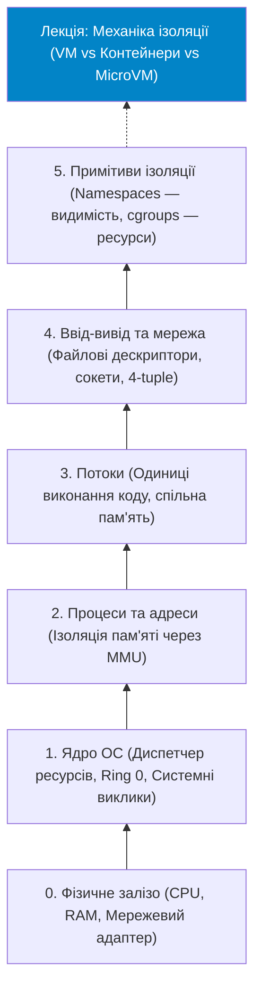
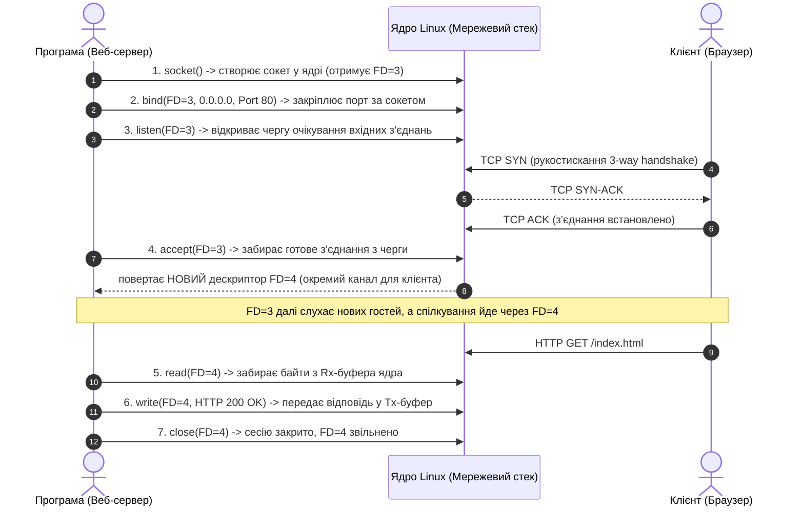

# Пререквізити: Системні основи — від кремнію до мережевого сокета

> **Декларація курсу.** Академічна доброчесність та авторство матеріалів — у [DISCLAIMER.md](DISCLAIMER.md).

---

## Навіщо цей документ

Лекція про механіку ізоляції розбирає, як гіпервізори та ядро Linux обмежують застосунки. Щоб зрозуміти ці механізми, потрібно чітко бачити фундамент: як операційна система керує пам'яттю, процесами та мережевими інтерфейсами.

Цей документ фіксує системні поняття, які вважаються відомими перед початком лекції.



---

## 1. Фізичний комп'ютер: кремній і пам'ять

Фізична машина оперує трьома базовими вузлами:
* **Процесор (CPU):** послідовно виконує машинний код із внутрішніх регістрів за тактами тактового генератора.
* **Оперативна пам'ять (RAM):** лінійний масив байтів із фізичними адресами.
* **Периферія (диски, мережева карта):** апаратні контролери, що обмінюються даними через шини введення-виведення або прямий доступ до пам'яті (DMA).

Прямий доступ застосунків до фізичних адрес пам'яті призвів би до хаосу: один хибний вказівник у коді міг би перетерти дані іншої програми або зависнути сам процесор. Тому взаємодію із залізом монополізує ядро.

### Ієрархія кешів пам’яті: Чому RAM — це повільно?

Оперативна пам’ять (RAM) за мірками сучасного процесора є надзвичайно повільною. Звернення до оперативної пам’яті займає сотні тактів процесора (порядку 50–100 наносекунд). Щоб процесор не простоював в очікуванні даних, на кристалі реалізовано багаторівневу ієрархію надшвидкої кеш-пам’яті (детальніше архітектуру пам'яті та взаємодію з потоками розібрано в матеріалі [06_threads.html](https://vplanto.github.io/java/06_threads.html)):

* **L1 Cache (Кеш першого рівня):** Найшвидший (1–2 наносекунди, кілька тактів) і найменший (зазвичай 32–64 КБ на ядро). Розділений окремо на кеш інструкцій (L1i) та кеш даних (L1d). Індивідуальний для кожного ядра.
* **L2 Cache (Кеш другого рівня):** Трохи більший за об’ємом (512 КБ – 1 МБ), дещо повільніший (3–5 наносекунд). Також переважно виділений під конкретне ядро.
* **L3 Cache (Кеш третього рівня):** Спільний для всіх ядер процесора. Має значний об’єм (від десятків до сотень мегабайтів), доступний усім ядрам за 10–20 наносекунд.

> **Зв'язок із безпекою хмарних систем:**  
> L3-кеш є фізично **спільним для всіх ядер на кристалі**. Як ми побачимо в основній лекції, саме вимірювання затримок кешу (атака Flush + Reload) дозволяє зловмиснику в багатокористувацькому середовищі побітово зчитувати чужі дані через процесорні вразливості на кшталт Spectre.

---

## 2. Кільця захисту процесора та системні виклики (Ring 3 → Ring 0)

Процесори архітектури x86-64 реалізують апаратний захист пам'яті та команд через **кільця привілеїв (Protection Rings)**.

```
       [ Ring 3: Користувацький простір (User Space) ]
         Застосунки, браузери, бази даних, утиліти
                       │          ▲
            syscall    │          │  sysret
       (перехід у Ring 0)         │  (повернення у Ring 3)
                       ▼          │
       [ Ring 0: Простір ядра (Kernel Space / Supervisor) ]
         Ядро Linux: планувальник, драйвери, керування MMU
                       │
                       ▼
       [ Апаратне фізичне залізо: CPU, RAM, контролери ]
```

### 1. Рівні привілеїв (CPL)
Поточний рівень привілеїв процесор зберігає у двох бітах регістра кодового сегмента `CS` — **CPL (Current Privilege Level)**:
* **Ring 0 (Supervisor):** максимальні привілеї. Дозволено виконувати будь-які інструкції процесора: перемикати регістри керування пам'яттю (`CR3`), керувати таблицями переривань, зупиняти процесор (`hlt`) та напряму читати порти вводу-виводу. Тут працює **ядро операційної системи**.
* **Ring 1 та Ring 2:** історично резервувалися Intel для драйверів та системних служб, але в сучасних ОС (Linux, macOS, Windows) **не використовуються** заради швидкості та переносимості на архітектури без проміжних кілець (наприклад, ARM).
* **Ring 3 (User):** мінімальні привілеї. Застосункам заборонено виконувати привілейовані інструкції та звертатися до чужих фізичних адрес.

> **Апаратний блок процесора:**  
> Якщо застосунок у Ring 3 спробує виконати привілейовану інструкцію (наприклад, перезаписати регістр `CR3` для підміни таблиць пам'яті), процесор апаратно відмовляється її виконувати і миттєво генерує виняток **`#GP` (General Protection Fault)**.

---

### 2. Як програма звертається до ядра: механіка Ring 3 → Ring 0

Застосунок не може просто «стрибнути» за адресою ядра в пам'яті. Перехід у Ring 0 відбувається лише через спеціальний «контрольно-пропускний пункт» процесора:

1. **Інструкція `syscall` (x86-64):**
   * Застосунок складає номер потрібного виклику (наприклад, системний виклик `write` — це номер `1`) у регістр `RAX`, параметри — у регістри `RDI`, `RSI`, `RDX`.
   * Застосунок виконує інструкцію **`syscall`**.
2. **Апаратна реакція CPU:**
   * Процесор автоматично зберігає поточний стан виконання (`RIP` та `RFLAGS`).
   * Процесор апаратно перемикає рівень привілеїв **CPL із 3 на 0**.
   * Процесор примусово завантажує адресу точки входу ядра зі спеціального системного регістра **`MSR_LSTAR`** (цей регістр ядро налаштувало ще під час завантаження комп'ютера). Програма не може підробити цю адресу.
3. **Обробка в ядрі:**
   * Ядро перевіряє передані аргументи, перевіряє права доступу і виконує операцію (записує байти в буфер сокета або зчитує блок із диска).
4. **Повернення інструкцією `sysret`:**
   * Ядро викликає команду **`sysret`**.
   * Процесор відновлює стан регістрів, перемикає CPL **назад із 0 на 3** і повертає керування коду застосунку.

Завдяки цьому процеси надійно ізольовані від прямого керування залізом: уся влада зосереджена в ядрі.

---

## 3. Процеси: віртуальний адресний простір

**Програма на диску** — пасивний скомпільований файл.

Коли ядро завантажує цей файл на виконання, створюється **процес**:
* **Віртуальний простір:** ядро створює для процесу ілюзію персональної оперативної пам'яті (від `0x0000...` до межі архітектури). Дві різні програми можуть одночасно читати зі своєї локальної віртуальної адреси `0x00400000` і не знати про існування одна одної.
* **Апаратний перекладач (MMU):** за трансляцію віртуальних адрес у реальні комірки RAM відповідає апаратний блок процесора — **MMU (Memory Management Unit)** через системні таблиці сторінок (**Page Tables**). Те, що для процесу виглядає суцільним масивом, у фізичній пам'яті нарізано на розкидані сторінки по 4 КБ.

### Апаратний бар'єр пам'яті
Спроба звернутися за віртуальну адресу, яка не відображена в таблиці сторінок процесу або захищена від запису, миттєво генерує апаратне переривання процесора (**Page Fault**). 

Ядро фіксує порушення доступу і знищує процес сигналом **`SIGSEGV` (Segmentation Fault)**. Завдяки MMU процеси за замовчуванням жорстко ізольовані один від одного по пам'яті.

---

## 4. Потоки (Threads): одиниці виконання

Усередині процесу код виконують **потоки (threads)**:
* **Процес** — власник ресурсів: пам'яті, дескрипторів файлів, мережевих з'єднань. Сам по собі процес код не рахує.
* **Потік** — найменша одиниця планування процесора: має власний лічильник інструкцій (PC), регістри та окремий стек викликів.

```
ПРОЦЕС (Виділена віртуальна пам'ять, спільний Heap, таблиця FD)
├── Потік 1 (Власні регістри CPU, власний Stack) ──> Виконується на Core 0
└── Потік 2 (Власні регістри CPU, власний Stack) ──> Виконується на Core 1
```

### Принципова відмінність для інженера
* **Між процесами:** пам'ять жорстко розділена. Обмін даними можливий лише через системні виклики міжпроцесної взаємодії (IPC) або спільні файли.
* **Між потоками одного процесу:** пам'ять спільна. Потоки миттєво бачать зміни у спільній динамічній пам'яті (Heap), що дає швидкість, але створює ризики блокувань та станів гонитви (race conditions).

| Властивість | Процес (Process) | Потік (Thread) |
| :--- | :--- | :--- |
| **Адресний простір** | Власний, ізольований через MMU | Спільний із сусідніми потоками процесу |
| **Оверхед на створення** | Помітний (копіювання таблиць сторінок) | Мінімальний (виділення тільки стека) |
| **Наслідок краху** | Падіння процесу не чіпає сусідів | Падіння потоку руйнує весь процес |

---

## 5. Ввід-вивід в ОС: дескриптори, сокети та 4-tuple

Мережа в Linux базується на класичному системному правилі Unix: **«усе є файлом»**. Програма читає з мережі точно так само, як читає файл із жорсткого диска (детально мережеві моделі, рівні стека та протоколи розібрано в матеріалі [Лекція 6: Архітектура Інтернету. OSI, TCP/IP та DNS](https://vplanto.github.io/java_script/06_networking_osi.html)).

### 1. Файлові дескриптори (File Descriptors, FD)
Файловий дескриптор — це ціле невід'ємне число (`0, 1, 2, 3...`), яке слугує індексом у таблиці відкритих файлів процесу.

Кожен новий процес отримує три стандартні дескриптори:
* `0` — **`stdin`** (вхідний потік);
* `1` — **`stdout`** (вихідний потік);
* `2` — **`stderr`** (потік помилок та логів).

Будь-який новий ресурс (файл, канал pipe, мережеве з'єднання) отримує наступний вільний номер: `3`, `4`, `5`.

### 2. Мережевий сокет (Socket)
**Сокет** — це точка входу в мережевий стек ядра. Для застосунку він виглядає як звичайний файловий дескриптор. Усередині ядра сокет тримає два буфери:
* **Rx Buffer (Receive):** сюди драйвер мережевої карти складає вхідні байти з кабелю.
* **Tx Buffer (Transmit):** сюди програма записує байти для відправки в мережу.

### 3. Життєвий цикл TCP-з'єднання на системних викликах

Будь-який сервер (Nginx, Go-сервіс, Node.js) під капотом виконує обов'язковий ланцюг системних викликів:



> **Ключовий факт:**  
> Слухаючий сокет (`FD 3`) не передає корисні дані. Виклик `accept()` створює **новий окремий дескриптор (`FD 4`)**. Завдяки цьому сервер на одному порті одночасно обслуговує десятки тисяч клієнтів.

### 4. Порти та обмеження 4-tuple
* **Порт (1–65535):** 16-бітне число для маршрутизації трафіку конкретному процесу всередині ОС.
* Якщо процес зв'язав порт викликом `bind()`, спроба другого процесу на цьому ж хості зайняти той самий порт поверне помилку **`EADDRINUSE (Address already in use)`**.
* Ядро розрізняє паралельні сесії не за одним портом, а за комбінацією чотирьох параметрів — **4-tuple**:
  $$\text{TCP Session} = \{\text{Source IP},\ \text{Source Port},\ \text{Destination IP},\ \text{Destination Port}\}$$

---

## 6. Базові механізми ізоляції в Linux: Namespaces та Cgroups

Операційна система Linux не має в ядрі спеціальної сутності «контейнер». Замість цього ядро надає два незалежні вбудовані механізми для контролю над звичайними процесами:

### 1. Linux Namespaces (Простори імен) — «Що процес бачить»
Namespaces ізолюють системні таблиці та глобальні ресурси ОС, створюючи для процесу персональну ілюзію окремого комп'ютера:
* **PID Namespace:** власне дерево процесів. Процес отримує номер **`PID 1`** усередині простору, хоча на фізичному хості ядро бачить його під реальним системним номером (наприклад, `PID 18452`).
* **Network Namespace (netns):** власний мережевий стек. Процес отримує власний персональний діапазон портів `1–65535` і власну таблицю сокетів. Завдяки цьому два сервіси в різних просторах імен можуть одночасно займати порт `80` без конфлікту `EADDRINUSE`.

### 2. Control Groups (cgroups) — «Скільки ресурсів дозволено взяти»
Якщо простори імен обмежують **видимість**, то контрольні групи обмежують **споживання апаратних ресурсів**:
* **CPU:** виділення процесорного часу та квот.
* **RAM:** ліміти оперативної пам'яті.
* **I/O:** обмеження швидкості читання/запису на диск.

> **Формула ізоляції в Linux:**  
> **Ізольоване середовище (контейнер) = Звичайний процес + Namespaces (ізоляція видимості) + cgroups (ліміти ресурсів).**

---

## Підсумок: точка старту для лекції

Ми зафіксували системні аксіоми:
1. Застосунки ізольовані в **Ring 3** і не мають прямого доступу до заліза: перехід у привілейований режим **Ring 0** ядра апаратно контролюється процесором через інструкцію `syscall`.
2. Процеси ізольовані за пам'яттю апаратно через **MMU**, але без спеціальних налаштувань ділять спільне дерево PID хоста та спільну таблицю портів.
3. Механізми **Namespaces** та **Cgroups** дозволяють ядру розділяти видимість і ресурси без запуску важких віртуальних машин.

**Головне питання лекції:**  
Де проходить межа між програмною ізоляцією ядра (Namespaces + Cgroups) та апаратною віртуалізацією процесора (Ring -1, VT-x, KVM)? Чому публічні хмари змушені будувати гібридні рішення на кшталт MicroVM (AWS Firecracker)?

Перехід до основної теми: [Лекція 3: Механіка ізоляції — гіпервізори (VM) vs контейнеризація (cgroups & namespaces)](03_isolation_mechanics.md).
