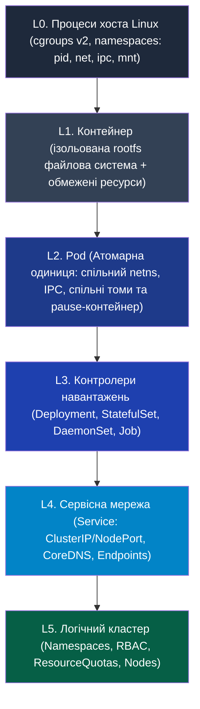
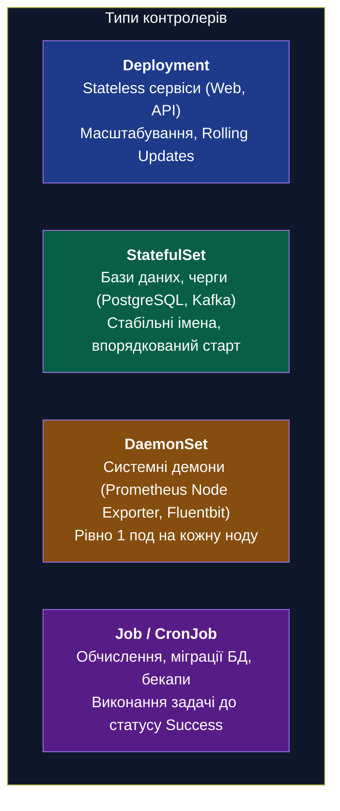
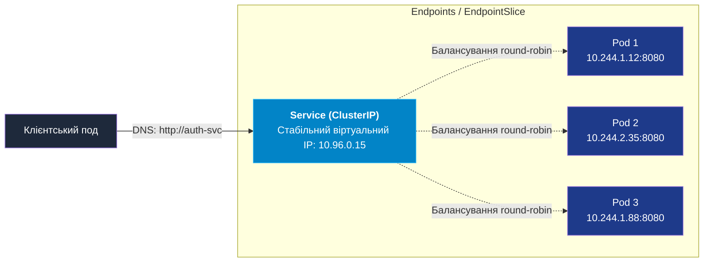

# Пререквізити: Базові об'єкти та піраміда абстракцій Kubernetes

> **Декларація курсу.** Академічна доброчесність та авторство матеріалів — у [DISCLAIMER.md](DISCLAIMER.md).

---

## Піраміда абстракцій Kubernetes: від процесу ядра Linux до кластера

Kubernetes не замінює механізми операційної системи — він організовує процеси Linux у багаторівневу ієрархію абстракцій. Розуміння цієї піраміди усуває плутанину між контейнером, подом, сервісом та контролером розгортання.



Кожен вищий рівень приховує операційну рутину нижчого рівня, перетворюючи розрізнені сервери на єдиний обчислювальний пул.

---

## 1. Анатомія Pod: атомарна одиниця планування

Kubernetes не керує чистими контейнерами напряму. Найменшим неподільним об'єктом розгортання є **Pod (Под)** — група з одного або кількох тісно пов'язаних контейнерів, які завжди запускаються разом на одному фізичному чи віртуальному вузлі.

### Чому контейнер не є одиницею розгортання
Складні застосунки часто потребують допоміжних процесів (збір метрик, ротація логів, синхронізація сертифікатів mTLS). Розміщення цих процесів в одному контейнері порушує принцип єдиної відповідальності та ускладнює моніторинг. Pod дозволяє розділити обов'язки на окремі контейнери, зберігаючи для них спільний контекст виконання.

#### Внутрішня анатомія Pod (на прикладі IP `10.244.1.42`)

Pod об'єднує процеси в спільний контекст на рівні ядра Linux:

* **Фундамент (`pause container`):** невидимий службовий процес, який утримує спільні простори імен (`net`, `ipc`, `uts`). Саме він закріплює за подом IP-адресу.
* **Робочі контейнери:**
  * **Головний контейнер:** бізнес-логіка (наприклад, бекенд на FastAPI, порт `8000`).
  * **Sidecar-контейнер:** допоміжна функція (наприклад, проксі Envoy на порту `15001` або агент збору метрик).
* **Канали зв'язку всередині пода:**
  * **Мережа:** контейнери звертаються один до одного через `localhost` без мережевих затримок і без виходу в зовнішню мережу.
  * **Сховище:** спільний каталог (диск `emptyDir`, наприклад `/var/log/app`) монтується одночасно в обидва контейнери для спільного читання й запису.

### Роль інфраструктурного pause-контейнера
При створенні пода Kubelet першим запускає службовий контейнер `pause`. Його єдине завдання — створити та утримувати простори імен Linux:
* **Мережевий простір (Network Namespace):** Усі контейнери пода отримують одну спільну IP-адресу, спільну таблицю маршрутизації та спілкуються між собою через `localhost`. Контейнери всередині одного пода не можуть займати однакові порти.
* **Міжпроцесна взаємодія (IPC Namespace):** Контейнери можуть використовувати спільні черги повідомлень POSIX або спільну пам'ять.
* **UTS Namespace:** Усі контейнери мають спільне мережеве ім'я хоста (*hostname*).

Якщо головний застосунок аварійно перезапускається, мережевий простір та IP-адреса пода не втрачаються, оскільки процес `pause` продовжує жити.

---

## 2. Контролери робочих навантажень (Workload Controllers)

Створювати поодинокі поди вручну в продакшні заборонено: якщо нода вийде з ладу, сирий под не перенесеться на інший сервер і назавжди зникне. Для керування життєвим циклом та масштабуванням використовуються **контролери**.



### 1. Deployment та ReplicaSet: стандарт для Stateless
* **ReplicaSet:** Гарантує роботу точної кількості реплік пода в будь-який момент часу. Якщо репліка впала — запускає нову; якщо зайва — знищує.
* **Deployment:** Вища абстракція над ReplicaSet, яка керує версіями застосунку. При оновленні образу (`image update`) Deployment створює новий ReplicaSet і плавно перемикає трафік, поступово витісняючи старі поди (*Rolling Update*) без простою сервісу.

### 2. StatefulSet: для систем зі збереженням стану
Застосунки, яким потрібна персистентна ідентичність (Kafka, Cassandra, PostgreSQL):
* Надає стабільні порядкові імена: `db-0`, `db-1`, `db-2`.
* Піднімає та вимикає репліки строго по черзі.
* Автоматично виділяє кожній репліці персональний постійний диск через `volumeClaimTemplates`. При перезапуску репліки `db-1` вона повторно монтує саме свій диск `data-db-1`.

### 3. DaemonSet: системна інфраструктура
Запускає рівно по одній копії пода на кожному робочому вузлі кластера. При додаванні нового фізичного сервера в кластер DaemonSet автоматично розгортає на ньому свій под. Типові сценарії: CNI-агенти (Cilium, Calico), демони збору метрик (node-exporter) та логів (fluentd).

### 4. Job та CronJob: задачі до завершення (Run-to-Completion)
Звичайні поди розраховані на безперервну роботу: якщо контейнер зупинився з кодом 0, Kubelet вважатиме це аварією і перезапустить його. **Job** працює навпаки: под виконує розрахунок або міграцію схеми БД і завершується. Успішне завершення процесу (код 0) переводить Job у фінальний статус `Completed`. **CronJob** запускає такі задачі за розкладом.

| Контролер | Стан (State) | Ідентичність подів | Стратегія життєвого циклу | Типовий сценарій |
| :--- | :--- | :--- | :--- | :--- |
| **Deployment** | Без стану (Stateless) | Випадкові хеші (`app-7bf98c-x9k2`) | RollingUpdate без простою | Веб-сервіси, мікросервіси API |
| **StatefulSet** | Зі станом (Stateful) | Стабільний індекс (`db-0, db-1`) | Послідовний старт і зупинка | Репліковані СУБД, Raft-кластери |
| **DaemonSet** | Системний агент | Прив'язка до ноди | 1 под на кожен вузол | Збір логів, моніторинг, CNI |
| **Job / CronJob** | Пакетна задача | Тимчасовий процес | Зупинка після виходу з кодом 0 | Розрахунки Монте-Карло, міграції БД |

---

## 3. Мережева взаємодія та Service Discovery

IP-адреса будь-якого пода є **ефемерною (непостійною)**. Під час перезапуску чи оновлення deployment старий под знищується, а новий отримує нову довільну IP-адресу з пулу CNI. Звертатися до подів за їхніми прямими IP неможливо.



### Абстракція Service
**Service** — це об'єкт, який визначає стабільну точку входу (IP-адресу та DNS-ім'я) для групи подів, об'єднаних спільними мітками (`selector`).

* **Типи сервісів:**
  1. **ClusterIP (за замовчуванням):** Надає стабільний віртуальний IP, доступний **виключно всередині кластера**. Маршрутизацію та балансування запитів на рівні ядра Linux забезпечує `kube-proxy` (через правила `iptables` або таблиці `IPVS`).
  2. **NodePort:** Відкриває однаковий виділений порт (із діапазону 30000–32767) на **кожному робочому вузлі** кластера. Трафік на `<Node-IP>:<NodePort>` автоматично перенаправляється на відповідні поди.
  3. **LoadBalancer:** Інтегрується з хмарним провайдером (AWS, GCP, Azure, Hetzner) та автоматично замовляє зовнішній апаратний або віртуальний балансувальник навантаження із публічною IP-адресою.
  4. **Headless Service (`clusterIP: None`):** Сервіс без віртуальної IP-адреси. Замість маршрутизації DNS-сервер кластера повертає список прямих A-записів усіх готових подів (використовується для StatefulSet та прямого p2p-зв'язку між нодами БД).

### Endpoints та EndpointSlice
Service сам по собі не містить контейнерів. Він відстежує мітки подів через допоміжний об'єкт **Endpoints** (або масштабований **EndpointSlice**). До списку адрес потрапляють лише ті поди, які успішно пройшли перевірку готовності (**Readiness Probe**). Неготовий або завислий под миттєво вилучається зі списку балансування.

### DNS у кластері (CoreDNS)
Кожен сервіс автоматично отримує внутрішній DNS-запис формату:
```
<service-name>.<namespace>.svc.cluster.local
```
Будь-який под із того самого namespace може звертатися до сервісу просто за коротким ім'ям (наприклад, `http://auth-svc:8080`).

---

## 4. Конфігурації та збереження даних

Згідно з методологією **12-Factor App**, образ контейнера залишається незмінним (immutable). Один і той самий образ запускається в dev-, staging- чи production-середовищах без перезбирання, а всі змінні параметри та диски підключаються ззовні.

> [!NOTE]
> **Що таке 12-Factor App?**  
> Це збірка з 12 архітектурних правил проектування хмарних (cloud-native) додатків, сформульована інженерами Heroku. У контексті оркестрації ключовими є два фактори:  
> * **Factor III (Config):** конфігурація суворо відокремлена від коду. Жодних паролів чи адрес баз даних у коді або всередині образу контейнера — параметри передаються виключно через оточення запуску.  
> * **Factor VI (Processes):** додаток виконується як один або кілька безстатусних (stateless) процесів. Будь-які дані, що мають пережити перезапуск контейнера, виносяться в зовнішнє сховище.

Kubernetes передає контейнерам зовнішній контекст двома ізольованими каналами:

* **Канал конфігурацій (In-Memory):**
  * **ConfigMap** постачає відкриті налаштування (змінні середовища, параметри портів, конфігураційні файли).
  * **Secret** безпечно передає чутливі дані (токени, паролі, TLS-сертифікати) без збереження на диск хоста.
* **Канал сховища (Persistent Storage):**
  * **StorageClass** описує доступні типи сховищ (швидкі NVMe, хмарні диски, мережеві NFS).
  * **PersistentVolumeClaim (PVC)** фіксує запит поду на ресурси (наприклад: *«потрібно 50 GiB диска типу fast-nvme»*).
  * **PersistentVolume (PV)** надає фактичний дисковий том, автоматично виділений і підмонтований до поду.

### ConfigMap та Secret
* **ConfigMap:** Зберігає неконфіденційні дані у форматі ключ-значення. Може передаватися в контейнер як звичайна змінна оточення (`env`) або монтуватися як файл конфігурації у файлову систему (наприклад, `/etc/nginx/nginx.conf`).
* **Secret:** Зберігає конфіденційні дані (паролі, ключі шифрування, токени доступу). Усередині etcd дані зберігаються в кодуванні base64 (або шифруються через Encryption at Rest). При монтуванні в под Secret розміщується у віртуальній пам'яті (`tmpfs`) хоста і ніколи не скидається на фізичний диск ноди.

### Ефемерне vs Постійне сховище
1. **emptyDir:** Тимчасовий каталог на диску хоста. Створюється в момент запуску пода і знищується разом із ним. Використовується як спільний буфер між контейнерами або швидкий локальний кеш.
2. **PersistentVolume (PV) та PersistentVolumeClaim (PVC):**
   * **PVC (Заявка):** Розробник описує свої вимоги до диску в маніфесті (наприклад, «потрібно 20 ГБ у режимі читання-запису ReadWriteOnce»).
   * **StorageClass (Провайдер):** Диспетчер дискових систем. Отримавши PVC, він звертається до хмарного API (AWS EBS, GCP Persistent Disk, Ceph) і автоматично виділяє фізичний диск.
   * **PV (Том):** Представляє фактично створений зовнішній том, який прив'язується до PVC і підключається до ноди в момент старту пода.

---

## 5. Анатомія декларативного YAML-маніфесту

Будь-який ресурс Kubernetes описується через уніфіковану структуру з чотирьох кореневих блоків.

```yaml
apiVersion: apps/v1          # 1. Версія API групи ресурсів
kind: Deployment             # 2. Тип ресурсу, який створюється
metadata:                    # 3. Метадані (ім'я, простір назв, мітки)
  name: reactor-web
  namespace: power-grid
  labels:
    app: reactor-web
spec:                        # 4. Специфікація: бажаний стан системи (Desired State)
  replicas: 3                # Кількість однакових копій
  selector:                  # Селектор: які поди контролює цей Deployment
    matchLabels:
      app: reactor-web
  template:                  # Шаблон, за яким будуть створюватися нові поди
    metadata:
      labels:                # Мітки, які отримає кожен створений под
        app: reactor-web
    spec:
      containers:
      - name: web-server
        image: powergrid/reactor-web:v1.2.0
        ports:
        - containerPort: 8080
```

### Механізм зв'язування через Labels та Selectors
Kubernetes не використовує жорсткі зв'язки за ідентифікаторами. Усі компоненти комунікують через слабку зв'язаність (*Loose Coupling*) за допомогою пар ключ-значення — **міток (Labels)** та **селекторів (Selectors)**:
1. Шаблон пода (`template.metadata.labels`) маркує кожен контейнер міткою `app: reactor-web`.
2. Контролер (`spec.selector.matchLabels`) шукає в кластері поди саме з цією міткою і перевіряє, чи їх рівно 3.
3. Об'єкт `Service` використовує аналогічний селектор, щоб автоматично спрямовувати трафік на всі поди, у яких збігається мітка.

---

## Підсумок: навігаційна карта до Лекції 7

Тепер, коли базову абетку об'єктів зафіксовано, ви готові перейти до архітектурних нутрощів Kubernetes у [Лекції 7 (07_k8s_orchestration_resources.md)](07_k8s_orchestration_resources.md):

* Як **Control Plane** (API Server, etcd, Scheduler) забезпечує консенсус і перетворює декларативний YAML на реальні процеси ядра.
* Чому різниця між `requests` та `limits` визначає планування на рівні CFS-квот планувальника Linux.
* Як класи **QoS** (Guaranteed, Burstable, BestEffort) захищають критичні воркери від аварійного виселення пам'яті (OOM) та каскадного колапсу всього кластера.
