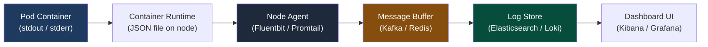

# Лекція 8: Системна спостережуваність (Observability) та траблшутинг розподілених відмов

> **Декларація курсу.** Академічна доброчесність та авторство матеріалів — у [DISCLAIMER.md](DISCLAIMER.md).

---

### Обов'язкове читання (Landmark Papers)
* **Sigelman, B. H. et al. (2010).** *Dapper, a Large-Scale Distributed Systems Tracing Infrastructure*. Google Technical Report. (Фундаментальна праця Google, яка заклала стандарти сучасного розподіленого трасування: OpenTelemetry, W3C Trace Context та Jaeger).
* **Majors, C., Fong-Jones, L., & Miranda, G. (2022).** *Observability Engineering: Achieving Production Excellence*. O'Reilly Media.
* **Фокусне запитання для аналізу:** Чому перехід від середньої затримки (Mean Latency) до перцентилів (P95, P99, P99.9) став базовим інженерним стандартом для хмарних систем, і як утримати баланс між 100% покриттям телеметрією та «податком на спостережуваність» (Observability Tax), здатним споживати до 30% пропускної здатності мережі й процесорного часу?

---

## Питання для розминки

<details markdown="1">
<summary><b>1. Чому вебсервіс зі стабільною середньою затримкою (Mean) у 20 мс здатний водночас змушувати кожного десятого користувача чекати відповіді понад 3 секунди?</b></summary>

Розподіл затримок у мережевих системах має асиметричний **важкий хвіст (Long Tail)**, на відміну від симетричного дзвоноподібного розподілу Гаусса.

Поодинокі важкі запити, паузи збирача сміття (Garbage Collector), мережеві колізії чи очікування блокувань у базі даних розчиняються в масиві мільйонів швидких відповідей. Середнє арифметичне маскує системну деградацію. Об'єктивну оцінку користувацького досвіду дають лише перцентилі: **P95, P99 та P99.9**.
</details>

<details markdown="1">
<summary><b>2. Якщо Pod у Kubernetes перейшов у стан CrashLoopBackOff, чому команда kubectl logs &lt;pod&gt; часто повертає порожній вивід?</b></summary>

За замовчуванням `kubectl logs` читає стандартний вивід **поточного контейнера**, який щойно перезапустився й ще не встиг записати жодного рядка.

Щоб переглянути логи попереднього екземпляра, який зазнав аварії, використовують прапорець `--previous`:
`kubectl logs <pod> --previous`
</details>

---

## Архітектурний кейс: падіння P99 під час пікового розпродажу

О 14:00 під час святкової акції ключовий сервіс оформлення замовлень почав періодично зависати. Моніторинг показував 35% утилізації CPU, запас оперативної пам'яті, а середня затримка (Mean) трималася на рівні 45 мс.

Однак затримка **P99 підскочила до 14 секунд**. Користувачі з великими кошиками не могли завершити оплату.

```
 ┌─────────────────────────────────────────────────────────────┐
 │ АНАТОМІЯ КРИЗИ: РОЗПОДІЛЕНА ПАСТКА МІКРОСЕРВІСІВ            │
 ├─────────────────────────────────────────────────────────────┤
 │ • 100 мікросервісів пишуть логи в розрізнені текстові файли │
 │ • У логах відсутній наскрізний trace_id                     │
 │ • Інженери 2 години вручну зіставляють таймстемпи логів     │
 │ • ПЕРШОПРИЧИНА: другорядний сервіс розрахунку бонусів       │
 │   викликав зовнішній платіжний API, який зависав на 15 с,   │
 │   вичерпуючи спільний пул HTTP-з'єднань                     │
 └─────────────────────────────────────────────────────────────┘
```

**Висновок:** Без наскрізного розподіленого трасування (Distributed Tracing) локалізація ланцюгових затримок у мікросервісній системі перетворюється на здогадки.

---

## 1. Три стовпи спостережуваності (The Three Pillars)

Спостережуваність (**Observability**) — це здатність визначати внутрішній стан системи на основі аналізу її зовнішніх сигналів телеметрії.

```
                  ТРИ СТОВПИ СПОСТЕРЕЖУВАНОСТІ
     ┌──────────────────┬──────────────────┬──────────────────┐
     │     METRICS      │       LOGS       │      TRACES      │
     │   (Prometheus)   │  (Elastic/Loki)  │  (Jaeger/Tempo)  │
     ├──────────────────┼──────────────────┼──────────────────┤
     │ Часові ряди      │ Структуровані    │ Граф проходження │
     │ (Числова         │ записи подій     │ запиту крізь     │
     │ агрегація)       │ (JSON Context)   │ мікросервіси     │
     ├──────────────────┼──────────────────┼──────────────────┤
     │ Сигналізують про │ Пояснюють        │ Локалізують      │
     │ факт аномалії    │ причину збою     │ джерело затримки │
     │ (швидкий алерт)  │                  │ чи обриву        │
     └──────────────────┴──────────────────┴──────────────────┘
```

1. **Метрики (Metrics):**
   * Числові значення, оптимізовані для агрегації та збереження в Time-Series DB.
   * Типи: **Counter** (монотонно зростаючий лічильник), **Gauge** (миттєве значення: використання CPU, пам'ять), **Histogram** (розподіл тривалості запитів за кошиками/buckets).
   * **Перевага:** Мінімальний обсяг збереження; швидка побудова дашбордів і тригерів для сповіщень (Alertmanager).
   * **Вибух кардинальності (Cardinality Explosion):**
     * *Системна природа:* Кожна унікальна комбінація міток (Labels) породжує окремий часовий ряд у пам'яті. Запис динамічного значення (`user_id`, `trace_id` чи сирого URL) у мітку на кшталт `http_requests_total{user_id="12345"}` генерує мільйони унікальних рядів. Результат — вичерпання RAM і падіння сервера моніторингу через OOM.
     * *Архітектурне правило:* Метрики повинні мати лише низьку, фіксовану кардинальність (`http_status`, `method`, `environment`). Усі унікальні ідентифікатори передаються виключно в **структурованих логах або спанах трасування**.
2. **Логи (Logs):**
   * Хронологічний текстовий запис події з точним таймстемпом.
   * **Слабкість звичайного тексту:** Текстовий рядок `User 42 failed to pay` вимагає складного парсингу регулярними виразами.
   * **Стандарт:** **Структуровані JSON-логи** з чіткими полями метаданих (`trace_id`, `user_id`, `http_status`).
   * **Інфраструктурна ціна:** Логи виступають найдорожчим сигналом спостережуваності через збереження неагрегованого контексту та роздування метаданих (детальний аналіз реальної ціни доставки, регуляції Hot/Cold та порівняння ELK vs Graylog наведено в **[Розділі 4](#4-централізоване-збирання-логів-від-контейнера-до-сховища)**).
3. **Трасування (Distributed Traces):**
   * Механізм зв'язування дій користувача в інтерфейсі з ланцюжком викликів бекенд-сервісів, запитів до баз даних і повідомлень у брокерах черг.

### Доставка метрик: Pull проти Push

Збір числових показників у розподіленій інфраструктурі реалізується двома архітектурними підходами:

* **Pull-модель (Prometheus, VictoriaMetrics vmagent):**
  * *Принцип дії:* Сервер моніторингу регулярно опитує HTTP-ендпоінти (`GET /metrics`) цільових застосунків. Перелік цілей динамічно формує **Service Discovery** (Kubernetes API, Consul).
  * *Переваги:*
    * **Централізований Flow Control:** Сервер моніторингу регулює темп збору. Навіть під час запуску тисяч нових воркерів система моніторингу захищена від перевантаження вхідним трафіком.
    * **Нативний контроль доступності (Liveness Detection):** Якщо под завис у дедлоці чи впав, черговий запит скрейпінгу зазнає таймауту. Prometheus фіксує значення `up == 0`, запускаючи сповіщення про аварію без зовнішніх агентів.
    * **Спрощене локальне налагодження:** Інженер інспектує стан метрик застосунку стандартною командою `curl http://localhost:8080/metrics`.
  * *Обмеження:* Вимагає прямої мережевої видимості між сервером моніторингу та кожним подом. **Не пристосований для короткоживучих завдань (Serverless / Batch Jobs / CronJobs)**, оскільки процес може виконатися за лічені секунди й завершитися між циклами скрейпінгу (потребує буферного компонента — **Prometheus Pushgateway**).

* **Push-модель (OpenTelemetry OTLP, StatsD, Datadog):**
  * *Принцип дії:* Застосунок або клієнтська бібліотека самостійно ініціює з'єднання і надсилає пакети метрик через gRPC чи HTTP/UDP на віддалений колектор або TSDB.
  * *Переваги:*
    * **Природна сумісність з ефемерними обчисленнями:** Функції AWS Lambda, скрипти міграцій та воркери пакетної обробки скидають накопичені дані безпосередньо перед завершенням процесу.
    * Працює крізь NAT, корпоративні мережеві екрани та в Edge-середовищах без потреби тримати відкриті порти для вхідних з'єднань.
  * *Обмеження:*
    * **Ризик відмови через Thundering Herd:** Стрибок навантаження, який викликає горизонтальне автоскейлення сервісу з 10 до 500 подів, одночасно породжує шквал Push-запитів до колектора, спричиняючи відмову моніторингу в момент пікової кризи.
    * **Приховані збої (Silent Failures):** Припинення надходження метрик не дозволяє однозначно встановити, чи сервіс впав, чи у нього просто відсутній вхідний трафік.

* **Індустріальний гібридний стандарт:**
  Локальний збір організовують за моделлю **Pull** (легковажний агент **vmagent** або **OpenTelemetry Collector** скрейпить локальні поди на вузлі), після чого агент агрегує батчі та скидає їх через **Push** (протокол **Prometheus Remote Write** або **OTLP**) у віддалене централізоване сховище.

### Зберігання проти візуалізації: TSDB проти Grafana

В індустріальній архітектурі існує суворе розмежування ролей між рівнем візуалізації та базами даних часових рядів (**TSDB**):

* **Grafana — це рушій візуалізації (Visualization Engine), а не база даних:**
  * Grafana виступає виключно аналітичною панеллю представлення даних. Вона не зберігає числові метрики, логи чи трейси.
  * Власна база Grafana (SQLite або PostgreSQL) містить лише конфігурації панелей, облікові записи та правила маршрутизації сповіщень.
  * Під час побудови графіка Grafana діє як транслятор: надсилає запит специфічною мовою (PromQL, LogQL, TraceQL, SQL) до відповідного бекенду (**Data Source**), агрегує отримані дані й візуалізує їх у браузері.

* **Prometheus TSDB (Оперативний Cloud Native стандарт):**
  * Проєкт CNCF, що формує еталон моніторингу контейнерних середовищ Kubernetes.
  * *Особливості архітектури:* Single-node сервер із власною файловою TSDB. Оптимізований для оперативних сповіщень та свіжих даних (глибина збереження зазвичай становить 7–15 днів). Організований 2-годинними блоками: гарячі дані тримаються в Head Block в оперативній пам'яті, скидаючись у Write-Ahead Log (WAL) для надійності.
  * *Системні обмеження:* Відсутнє вбудоване горизонтальне масштабування, кластеризація та довгострокове збереження (вимагає додаткових надбудов на кшталт Thanos чи Cortex).

* **VictoriaMetrics (Високопродуктивна заміна для довготривалого збереження):**
  * Спеціалізована TSDB нового покоління, створена як пряма заміна (drop-in replacement) для екосистеми Prometheus.
  * *Особливості архітектури:* Доступна у формі компактного монолітного демона або горизонтально масштабованого кластера (`vmstorage`, `vminsert`, `vmselect`). Повністю підтримує мову запитів PromQL (з розширенням MetricsQL) та API Prometheus.
  * *Інженерні переваги:* Споживає у 4–7 разів менше RAM за рахунок блокового сортування; алгоритм ZSTD стискає дані на диску у 2–3 рази сильніше за Prometheus; має високу стійкість до вибуху кардинальності міток і забезпечує швидкі агрегаційні запити на часових горизонтах у місяці та роки.

* **ClickHouse (Уніфікована колоночна аналітика):**
  * Швидкодіюча колоночна СУБД загального призначення для масивів даних петабайтного масштабу.
  * Використовується великими технологічними компаніями (Cloudflare, Uber) для зведення всіх видів телеметрії (метрики, структуровані логи та розподілені спани) в єдине сховище.
  * Здійснює векторну обробку мільярдів рядків на секунду, дозволяючи будувати гнучкі аналітичні звіти за будь-яким набором високардинальних міток без обмежень класичних TSDB.

| Критерій | Prometheus | VictoriaMetrics | ClickHouse | Grafana |
| :--- | :--- | :--- | :--- | :--- |
| **Роль в архітектурі** | Локальний збір (Pull) + оперативний TSDB-буфер | Довготривале сховище TSDB (Long-Term Retention) | Аналітична колоночна СУБД для телеметрії | Інтерфейс візуалізації та дашбордів |
| **Модель даних** | Часові ряди (Float64 + Labels) | Часові ряди (PromQL/MetricsQL) | Довільні табличні схеми (OLAP) | Без збереження метрик (Stateless proxy) |
| **Масштабування** | Вертикальне (Single-node) | Горизонтальне (Кластерна версія) | Горизонтальне (Sharding + Replication) | Горизонтальне (із зовнішньою БД конфігів) |
| **Споживання ресурсів** | Вимогливий до RAM під час сплесків кардинальності | **Мінімальне** (у 4–7 разів менше RAM, стиснення ZSTD) | **Оптимальне** для масивних паралельних обчислень | Легковажний вебсервіс |
| **Горизонт збереження** | 7–15 діб | Місяці / роки | Роки (петабайтні архіви) | Не застосовується |

---

## 2. Математика затримки: асиметрія розподілу

Розподіл затримок у хмарних застосунках завжди асиметричний через довгий шлейф аномалій (**Long Tail Latency**):

```
Кількість
запитів
  │       P50 (Медіана: 15 мс)
  │        ▼
  │      ┌───┐
  │     ┌┘   └┐
  │    ┌┘     └┐           P95 (120 мс)     P99 (2.5 с)
  │   ┌┘       └──┐             ▼                ▼
  └───┴───────────┴─────────────┴────────────────┴────────────► Час (мс)
```

### Перцентилі (Quantiles):
* **P50 (Медіана):** 50% запитів обробляються швидше за вказане значення. Відображає базовий стан системи за нормальних умов.
* **P95 / P99:** 95% або 99% запитів виконуються швидше за поріг. Демонструє затримку під час сплесків навантаження та локальних мережевих колізій.
* **P99.9 (Три дев'ятки):** Досвід одного клієнта з тисячі. Зазвичай це найважчі транзакції з найбільшими кошиками чи складною бізнес-логікою.

### Мультиплікація затримок у мікросервісній мережі:
Коли для формування однієї відповіді сервіс паралельно опитує **$N = 50$ мікросервісів**, кожен із яких має ймовірність деградації $P99 = 1\% (0.01)$:

$$P(\text{хоча б один сервіс деградує}) = 1 - (1 - 0.01)^{50} = 1 - (0.99)^{50} \approx \mathbf{39.5\%}$$

**Математична закономірність:** Навіть за індивідуальної надійності 99% для кожного окремого компонента **майже 40% загальних запитів зазнають деградації через очікування найповільнішої гілки**.

---

## 3. Анатомія розподіленого трасування (Distributed Tracing)

Розподілене трасування розбиває життєвий цикл запиту на ієрархічне дерево операцій:

```mermaid
gantt
    title Життєвий шлях запиту (Trace ID: 4bf92f...)
    dateFormat X
    axisFormat %s ms

    section API Gateway
    HTTP POST /order           :0, 100
    section Auth Service
    JWT Validation             :5, 25
    section Order Service
    Create Order Record        :30, 95
    section PostgreSQL
    INSERT INTO orders         :35, 60
    section Payment Service
    Charge Credit Card         :65, 90
```



### Базові поняття:
1. **Trace (Трейс):** Повний шлях запиту крізь розподілену інфраструктуру. Позначається глобальним `TraceID`.
2. **Span (Спан):** Окремий відрізок роботи всередині конкретного сервісу. Містить:
   * Назву операції (наприклад, `SELECT FROM users`).
   * Час старту та тривалість виконання.
   * **Attributes:** Структуровані пари ключ-значення (`http.status_code = 200`, `db.statement = ...`).
   * **Span Events:** Точкові внутрішні події (помилки, винятки).
3. **SpanContext:** Метадані для збереження причинно-наслідкового зв'язку під час передавання запитів мережею:
   * **W3C Trace Context:** Стандартизований заголовок `traceparent`:
     `traceparent: 00-4bf92f3577b34da6a3ce929d0e0e4736-00f067aa0ba902b7-01`
   * **Baggage:** Користувацькі мітки контексту (наприклад, `tenant_id=enterprise_42`), які автоматично транслюються крізь усі спани графа викликів.

### Стратегії семплювання (Sampling Strategies):
Збір 100% трейсів у системі під навантаженням 100 000 RPS створює надмірний оверхед на диски й мережу (**Telemetry Tax**). Для оптимізації застосовують фільтрацію:

* **Head-based Sampling:** Рішення про запис ухвалюється на вході в систему (на рівні API Gateway), наприклад для фіксованих 2% випадкових запитів.
  * *Обмеження:* Рідкісні збої, що виникають глибше в системі на несемпльованих запитах, втрачаються безслідно.
* **Tail-based Sampling:** Дані тимчасово буферизуються в пам'яті колектора (OpenTelemetry Collector). Рішення про збереження ухвалюється **після завершення транзакції**:
  * Запити з помилками `HTTP 5xx` або затримкою понад $2000$ мс зберігаються на 100%.
  * Успішні типові виклики `HTTP 200` зберігаються на рівні 0.1%.

### Аномалія Clock Skew (Дрейф системних годинників):
У розподіленому кластері системні таймери вузлів мають мікророзходження навіть за активного демона NTP (дрейф становить кілька мілісекунд):
* *Сутність проблеми:* Якщо сервіс А (вузол 1) викликає сервіс Б (вузол 2), дочірній спан із вузла 2 може зафіксувати мітку початку раніше, ніж стартував батьківський спан на вузлі 1 (виникає ефект «виклику з минулого»).
* *Вирішення:* Сервери збору трейсів (Jaeger/Tempo) коригують часові зміщення на основі мережевого RTT (Round-Trip Time). Точна синхронізація через NTP/PTP на фізичних хостах залишається обов'язковою вимогою до інфраструктури.

---

## 4. Централізоване збирання логів: від контейнера до сховища

<details markdown="1">
<summary><b>Як ви думаєте, скільки ресурсів інфраструктури насправді витрачається на логування?</b></summary>

**Від 30% до 50% сумарних ресурсів розподіленої системи (CPU, RAM, дисковий I/O та мережевий трафік).**

У навантаженому кластері обслуговування пайплайну логів нерідко споживає більше обчислювальних потужностей, ніж виконання корисної бізнес-логіки застосунків. Причини такого парадоксу:
1. **Повнотекстова індексація (Inverted Index):** Для швидкого пошуку за довільними словами пошукові рушії розбивають кожен рядок на терміни і будують зворотний індекс. Постійний фоновий перерахунок B-Tree/LSM-дерев у пам'яті вимагає до 40% процесорного часу та десятків гігабайтів оперативної пам'яті (JVM Heap).
2. **Роздування метаданих JSON (Metadata Amplification):** Додавання обов'язкового контексту Kubernetes (назва ноди, неймспейс, UID пода, селектори, хеш образу, trace_id) перетворює коротке повідомлення про помилку на 50 байтів у JSON-документ розміром 1.5–2 КБ (збільшення обсягу у 20–40 разів).
3. **Write Amplification (Багаторазовий запис на диск):** Запис процесом у stdout -> запис рантаймом у файл `/var/log/pods/` -> читання агентом збору -> запис у буферну чергу Kafka -> запис у сховище логів -> дублювання в репліках. Один лог-запис фізично скидається на диск від 3 до 5 разів.
</details>



### Архітектура доставки логів у Kubernetes: DaemonSet проти Sidecar

* **Node-level Agent (DaemonSet — Fluent Bit, Vector):**
  * *Принцип дії:* Один агент розгортається на кожен фізичний чи віртуальний вузол кластера. Контейнери направляють логи в `stdout`/`stderr`, рантайм `containerd` зберігає їх у файли `/var/log/pods/`, а DaemonSet хвостово вичитує їх, додає метадані Kubernetes та відправляє у централізовану чергу.
  * *Переваги:* Мінімальні витрати ресурсів (один екземпляр агента на всю ноду), нульовий вплив на маніфести та конфігурацію застосунків.
  * *Обмеження:* Спільний буфер виводу; інтенсивний сплеск логів одного поду може спричинити затримку передачі логів сусідніх сервісів на ноді.

* **Pod-level Agent (Sidecar-контейнер):**
  * *Принцип дії:* Додатковий контейнер з агентом логування монтується всередину кожного пода поруч із основним контейнером застосунку. Застосовується, коли застарілий сервіс пише логи не в stdout, а в локальні файли на спільний том (`emptyDir`), або коли логи потребують складного локального маскування персональних даних (PII) безпосередньо всередині пода.
  * *Переваги:* Повна ізоляція потоку логування та персональні конфігурації фільтрації.
  * *Обмеження:* **Драматичне множення оверхеду.** Запуск 500 подів означає старт 500 окремих процесів агентів, кожен із яких споживає від 50 до 100 МБ оперативної пам'яті.

* **Пряме мережеве надсилання (Application Direct Socket):**
  * Застосунок через вбудовану бібліотеку самостійно транслює логи через TCP/UDP у віддалену чергу (Kafka чи Logstash).
  * *Ризики:* У разі мережевого збою чи перевантаження буфера застосунок або блокує обробку запитів користувачів (Blocking I/O), або безповоротно втрачає критичні логи.

### Гаряче та холодне сховища: життєвий цикл і регуляторні вимоги

Зберігання всіх логів у повнотекстовому пошуковому індексі призводить до вибухового зростання витрат на інфраструктуру. Оптимізація базується на розділенні на рівні зберігання (**Storage Tiering**) відповідно до регуляторних вимог:

* **Регуляторні стандарти (Compliance):**
  * **PCI-DSS:** вимагає зберігати журнали фінансових операцій та аудит доступу щонайменше **1 рік** (із них перші 3 місяці — у режимі негайного пошуку).
  * **GDPR / ISO 27001:** зобов'язує маскувати персональні дані та гарантувати повне видалення логів після завершення встановленого терміну (Right to be Forgotten).
  * **SOC 2 / HIPAA:** вимагає збереження незмінних журналів безпеки та доступу до персональних даних терміном **від 5 до 7 років**.

* **Рівнева модель життєвого циклу логів (Tiered Storage):**
  * **Гаряче сховище (Hot Tier — NVMe SSD / RAM):**
    * Термін: **останні 7–14 діб**.
    * Дані повністю проіндексовані для миттєвого повнотекстового пошуку під час активного траблшутингу аварій. Найвища вартість гігабайта.
  * **Тепле сховище (Warm Tier — Standard SSD / HDD):**
    * Термін: **від 14 до 30 діб**.
    * Індекси переведені в режим лише для читання (Read-only), проводиться примусове об'єднання сегментів (Force Merge) для зменшення фрагментації.
  * **Холодне / Архівне сховище (Cold / Frozen Tier — Object Storage / S3 / Glacier):**
    * Термін: **понад 30 діб (місяці та роки під аудит)**.
    * Повнотекстовий індекс видаляється. Сирі логи стискаються алгоритмами **ZSTD / Gzip** або конвертуються в колоночний формат **Parquet** і переміщуються в хмарні об'єктні сховища.
    * *Економічний ефект:* Вартість зберігання знижується у **15–30 разів**. У разі рідкісного аудиту потрібний діапазон дат повертається в гарячий індекс через процедуру **Rehydration**.

### Битва стеків: ELK (Elasticsearch) проти Graylog

* **ELK / Elastic Stack (Elasticsearch, Logstash, Kibana / OpenSearch):**
  * *Архітектурний фокус:* Потужний універсальний пошуковий рушій на базі бібліотеки **Apache Lucene**.
  * *Сильні сторони:* Глибокий повнотекстовий пошук за будь-яким фрагментом неструктурованого тексту, потужні аналітичні можливості візуалізації в Kibana, величезна екосистема коннекторів Beats.
  * *Слабкі сторони:* Екстремальне споживання RAM (Java Heap) та процесора під час індексації, складне налаштування шардингу у продакшні, високий ризик відмови кластера при стрибках навантаження.

* **Graylog:**
  * *Архітектурний фокус:* Спеціалізована платформа для централізованого лог-менеджменту та безпекового аналізу (SIEM-ready).
  * *Архітектурна модель:* Використовує Elasticsearch/OpenSearch виключно як базу зберігання, MongoDB — для збереження конфігурацій і метаданих, а всю обробку, парсинг і маршрутизацію бере на себе власний оптимізований сервер **Graylog Server**.
  * *Сильні сторони:* Вбудовані **Processing Pipelines** для трансформації та збагачення потоків «з коробки», простіше адміністрування порівняно з ванільним ELK, нативний RBAC (контроль доступу за ролями) та готовий інтерфейс для аудиту безпеки.
  * *Слабкі сторони:* Менша гнучкість побудови кастомних складних графіків порівняно з Kibana; додатковий елемент інфраструктури в особі MongoDB.

| Критерій | ELK Stack (OpenSearch) | Graylog | Grafana Loki |
| :--- | :--- | :--- | :--- |
| **Пошуковий рушій** | Apache Lucene (повний Inverted Index) | Elasticsearch/OpenSearch + Graylog Server | Індексація лише метаданих (LogQL) |
| **Споживання пам'яті** | **Дуже високе** (JVM Heap на кожен вузол) | **Помірне** (ефективний процесинг у Graylog) | **Мінімальне** (збереження стиснених чанків у S3) |
| **Складність адміністрування** | Висока (вимагає окремого інженера) | Середня (простий UI, готові Pipelines та RBAC) | Низька (нативна інтеграція з K8s/Prometheus) |
| **Основне призначення** | Універсальний аналіз неструктурованого тексту | Централізований аудит, SIEM, безпека | Діагностика хмарних мікросервісів у зв'язці з метриками |

### Стандартизація виводу через stdout/stderr:
Згідно з принципами **12-Factor App**, застосунок у контейнері делегує керування логами зовнішньому середовищу:
1. Застосунок спрямовує структуровані логи в потоки `stdout`/`stderr`.
2. Демон `containerd` перехоплює потік і зберігає його в локальний файл ноди (`/var/log/pods/...`).
3. Агент **Fluentbit** (як DaemonSet) зчитує файл, додає метадані Kubernetes (назва пода, неймспейс, мітки) і пакетами надсилає записи до централізованого сховища.

### Ефект «Noisy Neighbor» та Write Backpressure:
Пряме використання stdout несе прихований ризик блокування виконання коду:
* *Механізм:* Виклики на кшталт `print()` у Python або `log.info()` у Java викликають системний виклик ядра `write(1, ...)` до файлового дескриптора stdout. Якщо агент збору логів не встигає спорожняти буфер або нода зазнає дискового перевантаження (`DiskPressure`), буфер сокета чи пайп `containerd` переповнюється.
* *Наслідок:* Системний виклик `write()` переходить у режим **синхронного блокування (Blocking I/O)**. Обчислювальні процеси замість корисної роботи простоюють в очікуванні звільнення буфера виводу.
* *Архітектурне рішення:* У навантажених системах запис логів має відбуватися **асинхронно через неблокуючий кільцевий буфер у пам'яті (Non-blocking Ring Buffer)**. У разі переповнення черги надлишкові записи відкидаються, зберігаючи стабільність бізнес-операцій.

---

## 5. Довідник з діагностики подів у Kubernetes

Аналіз поведінки пода починається з команди детального інспектування: `kubectl describe pod <name>`:

| Стан Pod | Першопричина | Алгоритм діагностики та локалізації |
| :--- | :--- | :--- |
| **ImagePullBackOff** | Kubelet не може завантажити образ контейнера | Перевірити точність назви образу й тегу; перевірити наявність секрету авторизації `imagePullSecrets` для приватного реєстру. |
| **CrashLoopBackOff** | Процес у контейнері завершується аварійно (Exit Code != 0) | Виконати `kubectl logs <pod> --previous`. Перевірити змінні оточення, наявність конфігурацій та доступність бази даних під час ініціалізації. |
| **OOMKilled (Exit 137)** | Споживання оперативної пам'яті перевищило директиву `resources.limits.memory` | Перевірити статус у виводі `kubectl describe pod` (шукати `OOMKilled: true`). Збільшити memory limit або усунути витік пам'яті (Memory Leak) у коді. |
| **Pending** | Планувальник (Kube-Scheduler) не може виділити вузол під под | Перевірити секцію `Events` у виводі `kubectl describe pod`. Причинами зазвичай є нестача CPU/RAM під `requests`, або невідповідність селекторів `NodeSelector`/`Taints`. |
| **Node NotReady** | Kubelet припинив надсилати сигнали доступності до Control Plane | Перевірити мережевий стан хоста, вільне місце на диску (`DiskPressure`) та відгук рантайму containerd. |

---

## 6. Парадигми реагування на інциденти: реактивне, предиктивне, прескриптивне

Зрілість інженерної експлуатації визначається не кількістю графіків на дашбордах, а швидкістю переходу від констатації аварії до її нейтралізації.

```
                  ЕВОЛЮЦІЯ ІНЦИДЕНТ-МЕНЕДЖМЕНТУ
   ┌─────────────────────────────────────────────────────────────┐
   │ 1. РЕАКТИВНЕ (Reactive)                                     │
   │    Аварія сталася ──► Спрацював алерт ──► Ручний дебаг       │
   ├─────────────────────────────────────────────────────────────┤
   │ 2. ПРЕДИКТИВНЕ (Predictive)                                 │
   │    Аналіз трендів ──► Виявлення аномалії ──► Попередження   │
   ├─────────────────────────────────────────────────────────────┤
   │ 3. ПРЕСКРИПТИВНЕ / ПРОАКТИВНЕ (Prescriptive / Self-Healing)  │
   │    Фіксація ризику ──► Автономна дія системи ──► Відновлення│
   └─────────────────────────────────────────────────────────────┘
```

### 1. Реактивне реагування (Reactive Response)
* **Суть:** Дія у відповідь на вже зафіксований факт відмови або порушення статичного порогу (**Static Threshold Alert**).
* **Тригери:** `HTTP 5xx rate > 2%`, `CPU utilization > 90%`, перехід пода в `CrashLoopBackOff`.
* **Робочий процес:** Платформа сповіщень (PagerDuty, Opsgenie) будить чергового інженера. Інженер вручну вивчає дашборди, фільтрує логи й перезапускає сервіси за інструкцією (Runbook).
* **Головні метрики:** **MTTD** (Mean Time to Detect — час до виявлення) та **MTTR** (Mean Time to Resolve — час відновлення).
* **Ціна підходу:** Користувачі вже зіткнулися з деградацією чи недоступністю послуги; бізнес зазнає прямих фінансових та репутаційних втрат.

### 2. Предиктивне реагування (Predictive Response)
* **Суть:** Виявлення деградації задовго до настання збою на основі математичного аналізу трендів і часових рядів (**Trend Analysis & Anomaly Detection**).
* **Інструменти:**
  * **Лінійна екстраполяція:** Функція `predict_linear()` у PromQL прогнозує вичерпання дискового простору чи оперативної пам'яті:
    ```promql
    predict_linear(node_filesystem_free_bytes[4h], 86400) < 0
    ```
    *Сповіщення генерується за 24 години до повного заповнення диска, дозволяючи планово розширити сховище.*
  * **Динамічні пороги з урахуванням сезонності:** Алгоритми враховують добові коливання навантаження (день/ніч, робочі/вихідні) та фіксують відхилення від нормального патерну замість жорстких фіксованих чисел.
* **Результат:** Запобігання інцидентам у робочі години без нічних дзвінків черговим.

### 3. Прескриптивне реагування та самовідновлення (Prescriptive / Self-Healing)
* **Суть:** Автоматизований вплив на інфраструктуру за закритим контуром (**Closed-Loop Remediation**) без участі людини. Система самостійно обирає алгоритм лікування за встановленими правилами.
* **Ключові патерни:**
  * **Автоматичний відкат деплою (Automated Canary Rollback):** Контролери **Argo Rollouts** або **Flagger** аналізують метрики успішності під час канарейкового релізу. У разі стрибка P99 або HTTP 500 трафік миттєво повертається на стабільну версію.
  * **Автоматична ізоляція (Circuit Breaking):** Сервісний шлюз (Envoy) вимикає повільний екземпляр із пулу балансування, запобігаючи вичерпанню сокетів і ланцюговій реакції.
  * **Node Remediation:** Kubelet детектує зависання рантайму або збій ядра через **Node Problem Detector**, автоматично виселяє робочі поди (**Drain**) та перезавантажує проблемний хост.

### 4. Сучасні напрямки інженерії надійності (State of the Art)

* **Топологічний AIOps (Topology-aware Alert Correlation):**
  * Машинне навчання співставляє тисячі розрізнених сповіщень уздовж графа викликів мікросервісів, пригнічуючи шум (Alert Fatigue) та об'єднуючи вторинні симптоми в один кореневий інцидент.
* **Агентські SRE-системи (Agentic AI Remediation):**
  * Автономні мовні агенти (K8sGPT, Robusta Holmes, Datadog Bits) інтегруються з API Kubernetes, Prometheus і сховищем коду.
  * Під час падіння пода агент самостійно збирає `kubectl describe`, читає останні рядки логів, зіставляє diff останнього релізу в Git, формує висновок про першопричину та генерує готовий Pull Request із виправленням конфігурації.
* **Низькорівневе лікування через eBPF:**
  * Перенесення захисних реакцій безпосередньо в ядро Linux. Інструменти на базі eBPF (Cilium, Tetragon) блокують джерела аномального трафіку чи примусово тротлять ресурси «галасливого сусіда» на рівні мережевих сокетів без накладних витрат у просторі користувача.
* **Chaos Engineering як калібрування автономності:**
  * Безперервна ін'єкція штучних збоїв у продакшн (мережеві затримки, відключення дисків через Chaos Mesh) для валідації прескриптивних сценаріїв самовідновлення.

---

## 7. Практичний місток: зв'язок із лабораторним курсом

Матеріали лекції є безпосереднім підґрунтям для виконання **Етапу 5 (Chaos & FinOps)** лабораторного курсу:

* **Впровадження W3C Trace Context у симулятор:**
  * Студенти модифікують воркери Монте-Карло, транслюючи заголовок `traceparent` від API-шлюзу до обчислювальних потоків розрахунку ліній IEEE-118.
  * У **Jaeger UI** візуалізується повний граф виконання: декомпозиція загального часу на генерацію псевдовипадкових чисел, матричні обчислення та серіалізацію результатів.
* **Трасування крізь межу процесів у Python (`multiprocessing.Pool`):**
  * *Системне обмеження:* Для подолання GIL симулятор створює пул процесів через `multiprocessing.Pool`. За замовчуванням OpenTelemetry зберігає `SpanContext` у контекстних змінних потоку (`contextvars`). Під час системного виклику `fork()` пам'ять дублюється, проте прив'язка контексту трасування втрачається.
  * *Реалізація в коді:* Функція воркера `simulate_trials_chunk` приймає `traceparent` як явний параметр у кортежі `args`. Усередині воркера виконується явне відновлення контексту:
    ```python
    from opentelemetry.trace.propagation.tracecontext import TraceContextTextMapPropagator

    # Ручне відновлення контексту в ізольованому процесі воркера
    context = TraceContextTextMapPropagator().extract(carrier={"traceparent": traceparent_str})
    ```
  * Після цього спани, згенеровані воркерами на ядрах CPU, коректно відображаються в Jaeger як нащадки первинного запиту від API Gateway.
* **Бенчмаркінг перцентилів під стрес-тестуванням:**
  * За умов ін'єкції затримок (через **Toxiproxy** або дискове навантаження Noisy Neighbor) студенти фіксують графіки **P50 проти P99 latency** замість усереднених значень.
  * Досліджується прямий вплив важкого хвоста затримок на сумарну пропускну здатність (Throughput) кластера.

---

## 8. Зведена матриця компромісів телеметрії

| Сигнал телеметрії | Ключова перевага | Споживання CPU / RAM | Навантаження на диск і мережу | Цільове призначення |
| :--- | :--- | :--- | :--- | :--- |
| **Метрики (Metrics)** | Швидка агрегація, мінімальний розмір | **Мінімальне (<1%)** | **Мінімальне** (байтові семпли) | Сповіщення (Alerting), моніторинг трендів |
| **Структуровані логи (JSON)** | Повний контекст події | Помірне (2–5%) | **Високе** (терабайти на добу) | Розслідування конкретних помилок та аудит |
| **Трасування (Distributed Traces)** | Візуалізація залежностей між сервісами | Середнє (3–8%) | **Високе** (потребує семплювання) | Пошук вузьких місць і розслідування сплесків P99 |
| **Continuous Profiling (eBPF)** | Аналіз викликів коду на рівні ядра | Низьке (1–2%) | Помірне | Пошук неоптимальних алгоритмів та сплесків CPU |

---

## Підсумок лекції

1. **Середнє арифметичне спотворює реальність:** Реальний стан розподіленої системи з асиметричним розподілом затримок демонструють виключно перцентилі (**P95, P99, P99.9**).
2. **Каскадна деградація:** Затримка одного компонента в ланцюжку з 50 мікросервісів призводить до того, що до 40% користувачів відчувають уповільнення системи.
3. **W3C Trace Context уніфікує телеметрію:** Стандартний заголовок `traceparent` забезпечує наскрізну видимість запиту від користувацького кліку до воркерів на обчислювальних нодах.
4. **Діагностика через Exit Codes:** Точне розуміння кодів завершення контейнерів (Exit Code 137 OOM проти помилок коду 1/2) локалізує проблему за перші секунди інциденту.
5. **Розподіл ролей у моніторингу:** Push-модель забезпечує доставку телеметрії від ефемерних Batch/Serverless-задач, тоді як Pull гарантує надійний захист від перевантаження (Flow Control) та оперативне виявлення аварій сервісів. Grafana виступає виключно аналітичним рушієм візуалізації, делегуючи збереження метрик спеціалізованим TSDB (Prometheus для оперативних сповіщень, VictoriaMetrics для довготривалого аналізу).
6. **Від реакції до автономного лікування (Self-Healing):** Інженерна зрілість передбачає рух від реактивного розбору інцидентів через предиктивне прогнозування вичерпання ресурсів (`predict_linear`) до прескриптивних систем самовідновлення (Argo Rollouts, Circuit Breaking, Agentic SRE).

---

## Контрольні питання

<details markdown="1">
<summary><b>1. Чому Tail-based Sampling у навантажених системах дає якіснішу картину деградацій, ніж Head-based Sampling?</b></summary>

Під час **Head-based Sampling** вибір запису трейсу відбувається на старті (на API Gateway), коли фінальний статус операції ще невідомий. Якщо ймовірність збою становить 0.01%, то за 1% фіксованої вибірки абсолютна більшість критичних помилок пройде повз моніторинг.

**Tail-based Sampling** буферизує спани в пам'яті колектора до повного завершення ланцюжка викликів. Це дозволяє зберегти **100% повільних запитів (P99) та відповідей із помилками (HTTP 5xx)**, відкидаючи до 99.9% одноманітних успішних викликів і зберігаючи ресурси сховища.
</details>

<details markdown="1">
<summary><b>2. Як за системними метриками розрізнити монотонний витік пам'яті (Memory Leak) від короткочасного сплеску навантаження до спрацьовування OOM-killer (Exit Code 137)?</b></summary>

У разі **Memory Leak** метрика використання пам'яті (`container_memory_working_set_bytes`) утворює постійно висхідну лінію або характерну пилкоподібну форму, яка не спадає навіть у години мінімального навантаження.

Під час **раптового сплеску навантаження** рівень пам'яті залишається стабільним аж до моменту різкого вертикального стрибка, який синхронно корелює зі зростанням вхідного трафіку (`http_requests_total`).
</details>

<details markdown="1">
<summary><b>3. Що являють собою Baggage Items у стандарті W3C / OpenTelemetry і які ризики несе їх надмірне використання?</b></summary>

**Baggage** — це пари ключ-значення з контекстною інформацією (`tenant_id=enterprise_42`), які додаються до трейсу та автоматично передаються в мережевих заголовках крізь **усі наступні сервіси графа викликів**.

Збереження в Baggage великих обсягів даних призводить до розростання розміру HTTP-заголовків. Оскільки вони дублюються на кожному міжсервісному запиті, це створює відчутний паразитний трафік у мережі та провокує відмови вебсерверів через переповнення буферів (`HTTP 431 Request Header Fields Too Large`).
</details>

<details markdown="1">
<summary><b>4. Чому під час аналізу CrashLoopBackOff перевірка коду завершення процесу (Exit Code) є першочерговою дією?</b></summary>

Код завершення чітко класифікує категорію збою:
* **Exit Code 0:** Процес завершився штатно (контейнер помилково запустили як довготривалий сервіс без foreground-процесу).
* **Exit Code 1 / 2:** Помилка в прикладному коді (необроблений виняток, синтаксична помилка, збій скрипту запуску).
* **Exit Code 137 ($128 + 9$):** Процес примусово зупинено сигналом SIGKILL через вичерпання ліміту оперативної пам'яті (**OOMKilled**).
* **Exit Code 143 ($128 + 15$):** Процес коректно зупинено сигналом SIGTERM від Kubelet під час планового виселення або оновлення версії.
* **Exit Code 139 ($128 + 11$):** Помилка сегментації пам'яті (**Segmentation Fault** у скомпільованих бінарних модулях).
</details>

<details markdown="1">
<summary><b>5. Чому збір метрик із короткоживучих безсерверних функцій (AWS Lambda) через стандартний Pull-механізм Prometheus зазнає невдачі, і яка архітектура вирішує цю проблему?</b></summary>

Pull-механізм передбачає періодичне опитування цілей за розкладом (наприклад, раз на 15 секунд). Безсерверна функція або пакетний воркер виконує обчислення за лічені секунди й миттєво завершує процес. Якщо життєвий цикл екземпляра коротший за інтервал скрейпінгу, сервер Prometheus фізично не встигає надіслати запит до моменту зупинки поду.

Для таких задач застосовують **Push-модель**: процес безпосередньо перед виходом скидає телеметрію на буферний шлюз (**Prometheus Pushgateway**) або транслює OTLP-пакети в **OpenTelemetry Collector**, який агрегує дані та передає їх у TSDB.
</details>

<details markdown="1">
<summary><b>6. Чим прескриптивне реагування (Self-Healing) відрізняється від предиктивного, і яку роль у ньому відіграють контролери на кшталт Argo Rollouts?</b></summary>

**Предиктивне реагування** лише прогнозує наближення критичного стану (наприклад, заповнення диска чи деградацію пам'яті через екстраполяцію трендів у часових рядах), але саме по собі не виконує дії для усунення.

**Прескриптивне реагування** автоматично реалізує коригувальний вплив у замкненому контурі (**Closed-Loop Remediation**) без залучення людини. Контролери канарейкових релізів (**Argo Rollouts / Flagger**) є класичним прикладом: вони зчитують метрики (P99, Error Rate) у режимі реального часу і, зафіксувавши аномалію, самостійно відкочують реліз (Automated Rollback), не чекаючи, поки інженер зреагує на сповіщення.
</details>
