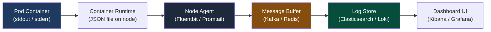

# –õ–µ–∫—Ü—ñ—è 8: –°–∏—Å—Ç–µ–º–Ω–∞ —Å–ø–æ—Å—Ç–µ—Ä–µ–∂—É–≤–∞–Ω—ñ—Å—Ç—å (Observability) —Ç–∞ —Ç—Ä–∞–±–ª—à—É—Ç–∏–Ω–≥ —Ä–æ–∑–ø–æ–¥—ñ–ª–µ–Ω–∏—Ö –≤—ñ–¥–º–æ–≤

> **Декларація курсу.** Академічна доброчесність та авторство матеріалів — у [DISCLAIMER.md](DISCLAIMER.md).

---

### –û–±–æ–≤'—è–∑–∫–æ–≤–µ —á–∏—Ç–∞–Ω–Ω—è (Landmark Papers)
* **Sigelman, B. H. et al. (2010).** *Dapper, a Large-Scale Distributed Systems Tracing Infrastructure*. Google Technical Report. (–§—É–Ω–¥–∞–º–µ–Ω—Ç–∞–ª—å–Ω–∞ –ø—Ä–∞—Ü—è Google, —è–∫–∞ –∑–∞–∫–ª–∞–ª–∞ —Å—Ç–∞–Ω–¥–∞—Ä—Ç–∏ —Å—É—á–∞—Å–Ω–æ–≥–æ —Ä–æ–∑–ø–æ–¥—ñ–ª–µ–Ω–æ–≥–æ —Ç—Ä–∞—Å—É–≤–∞–Ω–Ω—è: OpenTelemetry, W3C Trace Context —Ç–∞ Jaeger).
* **Majors, C., Fong-Jones, L., & Miranda, G. (2022).** *Observability Engineering: Achieving Production Excellence*. O'Reilly Media.
* **Фокусне запитання для аналізу:** Чому перехід від середньої затримки (Mean Latency) до перцентилів (P95, P99, P99.9) став базовим інженерним стандартом для хмарних систем, і як утримати баланс між 100% покриттям телеметрією та «податком на спостережуваність» (Observability Tax), здатним споживати до 30% пропускної здатності мережі й процесорного часу?

---

## –ü–∏—Ç–∞–Ω–Ω—è –¥–ª—è —Ä–æ–∑–º–∏–Ω–∫–∏

<details markdown="1">
<summary><b>1. –ß–æ–º—É –≤–µ–±—Å–µ—Ä–≤—ñ—Å –∑—ñ —Å—Ç–∞–±—ñ–ª—å–Ω–æ—é —Å–µ—Ä–µ–¥–Ω—å–æ—é –∑–∞—Ç—Ä–∏–º–∫–æ—é (Mean) —É 20 –º—Å –∑–¥–∞—Ç–Ω–∏–π –≤–æ–¥–Ω–æ—á–∞—Å –∑–º—É—à—É–≤–∞—Ç–∏ –∫–æ–∂–Ω–æ–≥–æ –¥–µ—Å—è—Ç–æ–≥–æ –∫–æ—Ä–∏—Å—Ç—É–≤–∞—á–∞ —á–µ–∫–∞—Ç–∏ –≤—ñ–¥–ø–æ–≤—ñ–¥—ñ –ø–æ–Ω–∞–¥ 3 —Å–µ–∫—É–Ω–¥–∏?</b></summary>

–†–æ–∑–ø–æ–¥—ñ–ª –∑–∞—Ç—Ä–∏–º–æ–∫ —É –º–µ—Ä–µ–∂–µ–≤–∏—Ö —Å–∏—Å—Ç–µ–º–∞—Ö –º–∞—î –∞—Å–∏–º–µ—Ç—Ä–∏—á–Ω–∏–π **–≤–∞–∂–∫–∏–π —Ö–≤—ñ—Å—Ç (Long Tail)**, –Ω–∞ –≤—ñ–¥–º—ñ–Ω—É –≤—ñ–¥ —Å–∏–º–µ—Ç—Ä–∏—á–Ω–æ–≥–æ –¥–∑–≤–æ–Ω–æ–ø–æ–¥—ñ–±–Ω–æ–≥–æ —Ä–æ–∑–ø–æ–¥—ñ–ª—É –ì–∞—É—Å—Å–∞.

–ü–æ–æ–¥–∏–Ω–æ–∫—ñ –≤–∞–∂–∫—ñ –∑–∞–ø–∏—Ç–∏, –ø–∞—É–∑–∏ –∑–±–∏—Ä–∞—á–∞ —Å–º—ñ—Ç—Ç—è (Garbage Collector), –º–µ—Ä–µ–∂–µ–≤—ñ –∫–æ–ª—ñ–∑—ñ—ó —á–∏ –æ—á—ñ–∫—É–≤–∞–Ω–Ω—è –±–ª–æ–∫—É–≤–∞–Ω—å —É –±–∞–∑—ñ –¥–∞–Ω–∏—Ö —Ä–æ–∑—á–∏–Ω—è—é—Ç—å—Å—è –≤ –º–∞—Å–∏–≤—ñ –º—ñ–ª—å–π–æ–Ω—ñ–≤ —à–≤–∏–¥–∫–∏—Ö –≤—ñ–¥–ø–æ–≤—ñ–¥–µ–π. –°–µ—Ä–µ–¥–Ω—î –∞—Ä–∏—Ñ–º–µ—Ç–∏—á–Ω–µ –º–∞—Å–∫—É—î —Å–∏—Å—Ç–µ–º–Ω—É –¥–µ–≥—Ä–∞–¥–∞—Ü—ñ—é. –û–±'—î–∫—Ç–∏–≤–Ω—É –æ—Ü—ñ–Ω–∫—É –∫–æ—Ä–∏—Å—Ç—É–≤–∞—Ü—å–∫–æ–≥–æ –¥–æ—Å–≤—ñ–¥—É –¥–∞—é—Ç—å –ª–∏—à–µ –ø–µ—Ä—Ü–µ–Ω—Ç–∏–ª—ñ: **P95, P99 —Ç–∞ P99.9**.
</details>

<details markdown="1">
<summary><b>2. –Ø–∫—â–æ Pod —É Kubernetes –ø–µ—Ä–µ–π—à–æ–≤ —É —Å—Ç–∞–Ω CrashLoopBackOff, —á–æ–º—É –∫–æ–º–∞–Ω–¥–∞ kubectl logs &lt;pod&gt; —á–∞—Å—Ç–æ –ø–æ–≤–µ—Ä—Ç–∞—î –ø–æ—Ä–æ–∂–Ω—ñ–π –≤–∏–≤—ñ–¥?</b></summary>

–ó–∞ –∑–∞–º–æ–≤—á—É–≤–∞–Ω–Ω—è–º `kubectl logs` —á–∏—Ç–∞—î —Å—Ç–∞–Ω–¥–∞—Ä—Ç–Ω–∏–π –≤–∏–≤—ñ–¥ **–ø–æ—Ç–æ—á–Ω–æ–≥–æ –∫–æ–Ω—Ç–µ–π–Ω–µ—Ä–∞**, —è–∫–∏–π —â–æ–π–Ω–æ –ø–µ—Ä–µ–∑–∞–ø—É—Å—Ç–∏–≤—Å—è –π —â–µ –Ω–µ –≤—Å—Ç–∏–≥ –∑–∞–ø–∏—Å–∞—Ç–∏ –∂–æ–¥–Ω–æ–≥–æ —Ä—è–¥–∫–∞.

–©–æ–± –ø–µ—Ä–µ–≥–ª—è–Ω—É—Ç–∏ –ª–æ–≥–∏ –ø–æ–ø–µ—Ä–µ–¥–Ω—å–æ–≥–æ –µ–∫–∑–µ–º–ø–ª—è—Ä–∞, —è–∫–∏–π –∑–∞–∑–Ω–∞–≤ –∞–≤–∞—Ä—ñ—ó, –≤–∏–∫–æ—Ä–∏—Å—Ç–æ–≤—É—é—Ç—å –ø—Ä–∞–ø–æ—Ä–µ—Ü—å `--previous`:
`kubectl logs <pod> --previous`
</details>

---

## –ê—Ä—Ö—ñ—Ç–µ–∫—Ç—É—Ä–Ω–∏–π –∫–µ–π—Å: –ø–∞–¥—ñ–Ω–Ω—è P99 –ø—ñ–¥ —á–∞—Å –ø—ñ–∫–æ–≤–æ–≥–æ —Ä–æ–∑–ø—Ä–æ–¥–∞–∂—É

–û 14:00 –ø—ñ–¥ —á–∞—Å —Å–≤—è—Ç–∫–æ–≤–æ—ó –∞–∫—Ü—ñ—ó –∫–ª—é—á–æ–≤–∏–π —Å–µ—Ä–≤—ñ—Å –æ—Ñ–æ—Ä–º–ª–µ–Ω–Ω—è –∑–∞–º–æ–≤–ª–µ–Ω—å –ø–æ—á–∞–≤ –ø–µ—Ä—ñ–æ–¥–∏—á–Ω–æ –∑–∞–≤–∏—Å–∞—Ç–∏. –ú–æ–Ω—ñ—Ç–æ—Ä–∏–Ω–≥ –ø–æ–∫–∞–∑—É–≤–∞–≤ 35% —É—Ç–∏–ª—ñ–∑–∞—Ü—ñ—ó CPU, –∑–∞–ø–∞—Å –æ–ø–µ—Ä–∞—Ç–∏–≤–Ω–æ—ó –ø–∞–º'—è—Ç—ñ, –∞ —Å–µ—Ä–µ–¥–Ω—è –∑–∞—Ç—Ä–∏–º–∫–∞ (Mean) —Ç—Ä–∏–º–∞–ª–∞—Å—è –Ω–∞ —Ä—ñ–≤–Ω—ñ 45 –º—Å.

–û–¥–Ω–∞–∫ –∑–∞—Ç—Ä–∏–º–∫–∞ **P99 –ø—ñ–¥—Å–∫–æ—á–∏–ª–∞ –¥–æ 14 —Å–µ–∫—É–Ω–¥**. –ö–æ—Ä–∏—Å—Ç—É–≤–∞—á—ñ –∑ –≤–µ–ª–∏–∫–∏–º–∏ –∫–æ—à–∏–∫–∞–º–∏ –Ω–µ –º–æ–≥–ª–∏ –∑–∞–≤–µ—Ä—à–∏—Ç–∏ –æ–ø–ª–∞—Ç—É.

```
 ┌─────────────────────────────────────────────────────────────┐
 │ АНАТОМІЯ КРИЗИ: РОЗПОДІЛЕНА ПАСТКА МІКРОСЕРВІСІВ            │
 ├─────────────────────────────────────────────────────────────┤
 │ • 100 мікросервісів пишуть логи в розрізнені текстові файли │
 │ • У логах відсутній наскрізний trace_id                     │
 │ • Інженери 2 години вручну зіставляють таймстемпи логів     │
 │ • ПЕРШОПРИЧИНА: другорядний сервіс розрахунку бонусів       │
 │   викликав зовнішній платіжний API, який зависав на 15 с,   │
 │   вичерпуючи спільний пул HTTP-з'єднань                     │
 └─────────────────────────────────────────────────────────────┘
```

**–í–∏—Å–ª—ñ–¥–æ–∫:** –ë–µ–∑ –Ω–∞—Å–∫—Ä—ñ–∑–Ω–æ–≥–æ —Ä–æ–∑–ø–æ–¥—ñ–ª–µ–Ω–æ–≥–æ —Ç—Ä–∞—Å—É–≤–∞–Ω–Ω—è (Distributed Tracing) –ª–æ–∫–∞–ª—ñ–∑–∞—Ü—ñ—è –ª–∞–Ω—Ü—é–≥–æ–≤–∏—Ö –∑–∞—Ç—Ä–∏–º–æ–∫ —É –º—ñ–∫—Ä–æ—Å–µ—Ä–≤—ñ—Å–Ω—ñ–π —Å–∏—Å—Ç–µ–º—ñ –ø–µ—Ä–µ—Ç–≤–æ—Ä—é—î—Ç—å—Å—è –Ω–∞ –∑–¥–æ–≥–∞–¥–∫–∏.

---

## 1. –¢—Ä–∏ —Å—Ç–æ–≤–ø–∏ —Å–ø–æ—Å—Ç–µ—Ä–µ–∂—É–≤–∞–Ω–æ—Å—Ç—ñ (The Three Pillars)

Спостережуваність (**Observability**) — це здатність визначати внутрішній стан системи на основі аналізу її зовнішніх сигналів телеметрії.

```
                  –¢–†–ò –°–¢–û–í–ü–ò –°–ü–û–°–¢–ï–†–ï–ñ–£–í–ê–ù–û–°–¢–Ü
     ┌──────────────────┬──────────────────┬──────────────────┐
     │     METRICS      │       LOGS       │      TRACES      │
     │   (Prometheus)   │  (Elastic/Loki)  │  (Jaeger/Tempo)  │
     ├──────────────────┼──────────────────┼──────────────────┤
     │ Часові ряди      │ Структуровані    │ Граф проходження │
     │ (Числова         │ записи подій     │ запиту крізь     │
     │ агрегація)       │ (JSON Context)   │ мікросервіси     │
     ├──────────────────┼──────────────────┼──────────────────┤
     │ Сигналізують про │ Пояснюють        │ Локалізують      │
     │ факт аномалії    │ причину збою     │ джерело затримки │
     │ (швидкий алерт)  │                  │ чи обриву        │
     └──────────────────┴──────────────────┴──────────────────┘
```

1. **–ú–µ—Ç—Ä–∏–∫–∏ (Metrics):**
   * –ß–∏—Å–ª–æ–≤—ñ –∑–Ω–∞—á–µ–Ω–Ω—è, –æ–ø—Ç–∏–º—ñ–∑–æ–≤–∞–Ω—ñ –¥–ª—è –∞–≥—Ä–µ–≥–∞—Ü—ñ—ó —Ç–∞ –∑–±–µ—Ä–µ–∂–µ–Ω–Ω—è –≤ Time-Series DB.
   * –¢–∏–ø–∏: **Counter** (–º–æ–Ω–æ—Ç–æ–Ω–Ω–æ –∑—Ä–æ—Å—Ç–∞—é—á–∏–π –ª—ñ—á–∏–ª—å–Ω–∏–∫), **Gauge** (–º–∏—Ç—Ç—î–≤–µ –∑–Ω–∞—á–µ–Ω–Ω—è: –≤–∏–∫–æ—Ä–∏—Å—Ç–∞–Ω–Ω—è CPU, –ø–∞–º'—è—Ç—å), **Histogram** (—Ä–æ–∑–ø–æ–¥—ñ–ª —Ç—Ä–∏–≤–∞–ª–æ—Å—Ç—ñ –∑–∞–ø–∏—Ç—ñ–≤ –∑–∞ –∫–æ—à–∏–∫–∞–º–∏/buckets).
   * **–ü–µ—Ä–µ–≤–∞–≥–∞:** –ú—ñ–Ω—ñ–º–∞–ª—å–Ω–∏–π –æ–±—Å—è–≥ –∑–±–µ—Ä–µ–∂–µ–Ω–Ω—è; —à–≤–∏–¥–∫–∞ –ø–æ–±—É–¥–æ–≤–∞ –¥–∞—à–±–æ—Ä–¥—ñ–≤ —ñ —Ç—Ä–∏–≥–µ—Ä—ñ–≤ –¥–ª—è —Å–ø–æ–≤—ñ—â–µ–Ω—å (Alertmanager).
   * **–í–∏–±—É—Ö –∫–∞—Ä–¥–∏–Ω–∞–ª—å–Ω–æ—Å—Ç—ñ (Cardinality Explosion):**
     * *Системна природа:* Кожна унікальна комбінація міток (Labels) породжує окремий часовий ряд у пам'яті. Запис динамічного значення (`user_id`, `trace_id` чи сирого URL) у мітку на кшталт `http_requests_total{user_id="12345"}` генерує мільйони унікальних рядів. Результат — вичерпання RAM і падіння сервера моніторингу через OOM.
     * *–ê—Ä—Ö—ñ—Ç–µ–∫—Ç—É—Ä–Ω–µ –ø—Ä–∞–≤–∏–ª–æ:* –ú–µ—Ç—Ä–∏–∫–∏ –ø–æ–≤–∏–Ω–Ω—ñ –º–∞—Ç–∏ –ª–∏—à–µ –Ω–∏–∑—å–∫—É, —Ñ—ñ–∫—Å–æ–≤–∞–Ω—É –∫–∞—Ä–¥–∏–Ω–∞–ª—å–Ω—ñ—Å—Ç—å (`http_status`, `method`, `environment`). –£—Å—ñ —É–Ω—ñ–∫–∞–ª—å–Ω—ñ —ñ–¥–µ–Ω—Ç–∏—Ñ—ñ–∫–∞—Ç–æ—Ä–∏ –ø–µ—Ä–µ–¥–∞—é—Ç—å—Å—è –≤–∏–∫–ª—é—á–Ω–æ –≤ **—Å—Ç—Ä—É–∫—Ç—É—Ä–æ–≤–∞–Ω–∏—Ö –ª–æ–≥–∞—Ö –∞–±–æ —Å–ø–∞–Ω–∞—Ö —Ç—Ä–∞—Å—É–≤–∞–Ω–Ω—è**.
2. **–õ–æ–≥–∏ (Logs):**
   * –•—Ä–æ–Ω–æ–ª–æ–≥—ñ—á–Ω–∏–π —Ç–µ–∫—Å—Ç–æ–≤–∏–π –∑–∞–ø–∏—Å –ø–æ–¥—ñ—ó –∑ —Ç–æ—á–Ω–∏–º —Ç–∞–π–º—Å—Ç–µ–º–ø–æ–º.
   * **–°–ª–∞–±–∫—ñ—Å—Ç—å –∑–≤–∏—á–∞–π–Ω–æ–≥–æ —Ç–µ–∫—Å—Ç—É:** –¢–µ–∫—Å—Ç–æ–≤–∏–π —Ä—è–¥–æ–∫ `User 42 failed to pay` –≤–∏–º–∞–≥–∞—î —Å–∫–ª–∞–¥–Ω–æ–≥–æ –ø–∞—Ä—Å–∏–Ω–≥—É —Ä–µ–≥—É–ª—è—Ä–Ω–∏–º–∏ –≤–∏—Ä–∞–∑–∞–º–∏.
   * **–°—Ç–∞–Ω–¥–∞—Ä—Ç:** **–°—Ç—Ä—É–∫—Ç—É—Ä–æ–≤–∞–Ω—ñ JSON-–ª–æ–≥–∏** –∑ —á—ñ—Ç–∫–∏–º–∏ –ø–æ–ª—è–º–∏ –º–µ—Ç–∞–¥–∞–Ω–∏—Ö (`trace_id`, `user_id`, `http_status`).
3. **–¢—Ä–∞—Å—É–≤–∞–Ω–Ω—è (Distributed Traces):**
   * –ú–µ—Ö–∞–Ω—ñ–∑–º –∑–≤'—è–∑—É–≤–∞–Ω–Ω—è –¥—ñ–π –∫–æ—Ä–∏—Å—Ç—É–≤–∞—á–∞ –≤ —ñ–Ω—Ç–µ—Ä—Ñ–µ–π—Å—ñ –∑ –ª–∞–Ω—Ü—é–∂–∫–æ–º –≤–∏–∫–ª–∏–∫—ñ–≤ –±–µ–∫–µ–Ω–¥-—Å–µ—Ä–≤—ñ—Å—ñ–≤, –∑–∞–ø–∏—Ç—ñ–≤ –¥–æ –±–∞–∑ –¥–∞–Ω–∏—Ö —ñ –ø–æ–≤—ñ–¥–æ–º–ª–µ–Ω—å —É –±—Ä–æ–∫–µ—Ä–∞—Ö —á–µ—Ä–≥.

---

## 2. –ú–∞—Ç–µ–º–∞—Ç–∏–∫–∞ –∑–∞—Ç—Ä–∏–º–∫–∏: –∞—Å–∏–º–µ—Ç—Ä—ñ—è —Ä–æ–∑–ø–æ–¥—ñ–ª—É

–†–æ–∑–ø–æ–¥—ñ–ª –∑–∞—Ç—Ä–∏–º–æ–∫ —É —Ö–º–∞—Ä–Ω–∏—Ö –∑–∞—Å—Ç–æ—Å—É–Ω–∫–∞—Ö –∑–∞–≤–∂–¥–∏ –∞—Å–∏–º–µ—Ç—Ä–∏—á–Ω–∏–π —á–µ—Ä–µ–∑ –¥–æ–≤–≥–∏–π —à–ª–µ–π—Ñ –∞–Ω–æ–º–∞–ª—ñ–π (**Long Tail Latency**):

```
–ö—ñ–ª—å–∫—ñ—Å—Ç—å
–∑–∞–ø–∏—Ç—ñ–≤
  │       P50 (Медіана: 15 мс)
  │        ▼
  │      ┌───┐
  │     ┌┘   └┐
  │    ┌┘     └┐           P95 (120 мс)     P99 (2.5 с)
  │   ┌┘       └──┐             ▼                ▼
  └───┴───────────┴─────────────┴────────────────┴────────────► Час (мс)
```

### –ü–µ—Ä—Ü–µ–Ω—Ç–∏–ª—ñ (Quantiles):
* **P50 (–ú–µ–¥—ñ–∞–Ω–∞):** 50% –∑–∞–ø–∏—Ç—ñ–≤ –æ–±—Ä–æ–±–ª—è—é—Ç—å—Å—è —à–≤–∏–¥—à–µ –∑–∞ –≤–∫–∞–∑–∞–Ω–µ –∑–Ω–∞—á–µ–Ω–Ω—è. –í—ñ–¥–æ–±—Ä–∞–∂–∞—î –±–∞–∑–æ–≤–∏–π —Å—Ç–∞–Ω —Å–∏—Å—Ç–µ–º–∏ –∑–∞ –Ω–æ—Ä–º–∞–ª—å–Ω–∏—Ö —É–º–æ–≤.
* **P95 / P99:** 95% –∞–±–æ 99% –∑–∞–ø–∏—Ç—ñ–≤ –≤–∏–∫–æ–Ω—É—é—Ç—å—Å—è —à–≤–∏–¥—à–µ –∑–∞ –ø–æ—Ä—ñ–≥. –î–µ–º–æ–Ω—Å—Ç—Ä—É—î –∑–∞—Ç—Ä–∏–º–∫—É –ø—ñ–¥ —á–∞—Å —Å–ø–ª–µ—Å–∫—ñ–≤ –Ω–∞–≤–∞–Ω—Ç–∞–∂–µ–Ω–Ω—è —Ç–∞ –ª–æ–∫–∞–ª—å–Ω–∏—Ö –º–µ—Ä–µ–∂–µ–≤–∏—Ö –∫–æ–ª—ñ–∑—ñ–π.
* **P99.9 (–¢—Ä–∏ –¥–µ–≤'—è—Ç–∫–∏):** –î–æ—Å–≤—ñ–¥ –æ–¥–Ω–æ–≥–æ –∫–ª—ñ—î–Ω—Ç–∞ –∑ —Ç–∏—Å—è—á—ñ. –ó–∞–∑–≤–∏—á–∞–π —Ü–µ –Ω–∞–π–≤–∞–∂—á—ñ —Ç—Ä–∞–Ω–∑–∞–∫—Ü—ñ—ó –∑ –Ω–∞–π–±—ñ–ª—å—à–∏–º–∏ –∫–æ—à–∏–∫–∞–º–∏ —á–∏ —Å–∫–ª–∞–¥–Ω–æ—é –±—ñ–∑–Ω–µ—Å-–ª–æ–≥—ñ–∫–æ—é.

### –ú—É–ª—å—Ç–∏–ø–ª—ñ–∫–∞—Ü—ñ—è –∑–∞—Ç—Ä–∏–º–æ–∫ —É –º—ñ–∫—Ä–æ—Å–µ—Ä–≤—ñ—Å–Ω—ñ–π –º–µ—Ä–µ–∂—ñ:
–ö–æ–ª–∏ –¥–ª—è —Ñ–æ—Ä–º—É–≤–∞–Ω–Ω—è –æ–¥–Ω—ñ—î—ó –≤—ñ–¥–ø–æ–≤—ñ–¥—ñ —Å–µ—Ä–≤—ñ—Å –ø–∞—Ä–∞–ª–µ–ª—å–Ω–æ –æ–ø–∏—Ç—É—î **$N = 50$ –º—ñ–∫—Ä–æ—Å–µ—Ä–≤—ñ—Å—ñ–≤**, –∫–æ–∂–µ–Ω —ñ–∑ —è–∫–∏—Ö –º–∞—î –π–º–æ–≤—ñ—Ä–Ω—ñ—Å—Ç—å –¥–µ–≥—Ä–∞–¥–∞—Ü—ñ—ó $P99 = 1\% (0.01)$:

$$P(\text{—Ö–æ—á–∞ –± –æ–¥–∏–Ω —Å–µ—Ä–≤—ñ—Å –¥–µ–≥—Ä–∞–¥—É—î}) = 1 - (1 - 0.01)^{50} = 1 - (0.99)^{50} \approx \mathbf{39.5\%}$$

**–ú–∞—Ç–µ–º–∞—Ç–∏—á–Ω–∞ –∑–∞–∫–æ–Ω–æ–º—ñ—Ä–Ω—ñ—Å—Ç—å:** –ù–∞–≤—ñ—Ç—å –∑–∞ —ñ–Ω–¥–∏–≤—ñ–¥—É–∞–ª—å–Ω–æ—ó –Ω–∞–¥—ñ–π–Ω–æ—Å—Ç—ñ 99% –¥–ª—è –∫–æ–∂–Ω–æ–≥–æ –æ–∫—Ä–µ–º–æ–≥–æ –∫–æ–º–ø–æ–Ω–µ–Ω—Ç–∞ **–º–∞–π–∂–µ 40% –∑–∞–≥–∞–ª—å–Ω–∏—Ö –∑–∞–ø–∏—Ç—ñ–≤ –∑–∞–∑–Ω–∞—é—Ç—å –¥–µ–≥—Ä–∞–¥–∞—Ü—ñ—ó —á–µ—Ä–µ–∑ –æ—á—ñ–∫—É–≤–∞–Ω–Ω—è –Ω–∞–π–ø–æ–≤—ñ–ª—å–Ω—ñ—à–æ—ó –≥—ñ–ª–∫–∏**.

---

## 3. –ê–Ω–∞—Ç–æ–º—ñ—è —Ä–æ–∑–ø–æ–¥—ñ–ª–µ–Ω–æ–≥–æ —Ç—Ä–∞—Å—É–≤–∞–Ω–Ω—è (Distributed Tracing)

–†–æ–∑–ø–æ–¥—ñ–ª–µ–Ω–µ —Ç—Ä–∞—Å—É–≤–∞–Ω–Ω—è —Ä–æ–∑–±–∏–≤–∞—î –∂–∏—Ç—Ç—î–≤–∏–π —Ü–∏–∫–ª –∑–∞–ø–∏—Ç—É –Ω–∞ —ñ—î—Ä–∞—Ä—Ö—ñ—á–Ω–µ –¥–µ—Ä–µ–≤–æ –æ–ø–µ—Ä–∞—Ü—ñ–π:

```mermaid
gantt
    title –ñ–∏—Ç—Ç—î–≤–∏–π —à–ª—è—Ö –∑–∞–ø–∏—Ç—É (Trace ID: 4bf92f...)
    dateFormat X
    axisFormat %s ms

    section API Gateway
    HTTP POST /order           :0, 100
    section Auth Service
    JWT Validation             :5, 25
    section Order Service
    Create Order Record        :30, 95
    section PostgreSQL
    INSERT INTO orders         :35, 60
    section Payment Service
    Charge Credit Card         :65, 90
```



### –ë–∞–∑–æ–≤—ñ –ø–æ–Ω—è—Ç—Ç—è:
1. **Trace (–¢—Ä–µ–π—Å):** –ü–æ–≤–Ω–∏–π —à–ª—è—Ö –∑–∞–ø–∏—Ç—É –∫—Ä—ñ–∑—å —Ä–æ–∑–ø–æ–¥—ñ–ª–µ–Ω—É —ñ–Ω—Ñ—Ä–∞—Å—Ç—Ä—É–∫—Ç—É—Ä—É. –ü–æ–∑–Ω–∞—á–∞—î—Ç—å—Å—è –≥–ª–æ–±–∞–ª—å–Ω–∏–º `TraceID`.
2. **Span (–°–ø–∞–Ω):** –û–∫—Ä–µ–º–∏–π –≤—ñ–¥—Ä—ñ–∑–æ–∫ —Ä–æ–±–æ—Ç–∏ –≤—Å–µ—Ä–µ–¥–∏–Ω—ñ –∫–æ–Ω–∫—Ä–µ—Ç–Ω–æ–≥–æ —Å–µ—Ä–≤—ñ—Å—É. –ú—ñ—Å—Ç–∏—Ç—å:
   * –ù–∞–∑–≤—É –æ–ø–µ—Ä–∞—Ü—ñ—ó (–Ω–∞–ø—Ä–∏–∫–ª–∞–¥, `SELECT FROM users`).
   * –ß–∞—Å —Å—Ç–∞—Ä—Ç—É —Ç–∞ —Ç—Ä–∏–≤–∞–ª—ñ—Å—Ç—å –≤–∏–∫–æ–Ω–∞–Ω–Ω—è.
   * **Attributes:** –°—Ç—Ä—É–∫—Ç—É—Ä–æ–≤–∞–Ω—ñ –ø–∞—Ä–∏ –∫–ª—é—á-–∑–Ω–∞—á–µ–Ω–Ω—è (`http.status_code = 200`, `db.statement = ...`).
   * **Span Events:** –¢–æ—á–∫–æ–≤—ñ –≤–Ω—É—Ç—Ä—ñ—à–Ω—ñ –ø–æ–¥—ñ—ó (–ø–æ–º–∏–ª–∫–∏, –≤–∏–Ω—è—Ç–∫–∏).
3. **SpanContext:** –ú–µ—Ç–∞–¥–∞–Ω—ñ –¥–ª—è –∑–±–µ—Ä–µ–∂–µ–Ω–Ω—è –ø—Ä–∏—á–∏–Ω–Ω–æ-–Ω–∞—Å–ª—ñ–¥–∫–æ–≤–æ–≥–æ –∑–≤'—è–∑–∫—É –ø—ñ–¥ —á–∞—Å –ø–µ—Ä–µ–¥–∞–≤–∞–Ω–Ω—è –∑–∞–ø–∏—Ç—ñ–≤ –º–µ—Ä–µ–∂–µ—é:
   * **W3C Trace Context:** –°—Ç–∞–Ω–¥–∞—Ä—Ç–∏–∑–æ–≤–∞–Ω–∏–π –∑–∞–≥–æ–ª–æ–≤–æ–∫ `traceparent`:
     `traceparent: 00-4bf92f3577b34da6a3ce929d0e0e4736-00f067aa0ba902b7-01`
   * **Baggage:** –ö–æ—Ä–∏—Å—Ç—É–≤–∞—Ü—å–∫—ñ –º—ñ—Ç–∫–∏ –∫–æ–Ω—Ç–µ–∫—Å—Ç—É (–Ω–∞–ø—Ä–∏–∫–ª–∞–¥, `tenant_id=enterprise_42`), —è–∫—ñ –∞–≤—Ç–æ–º–∞—Ç–∏—á–Ω–æ —Ç—Ä–∞–Ω—Å–ª—é—é—Ç—å—Å—è –∫—Ä—ñ–∑—å —É—Å—ñ —Å–ø–∞–Ω–∏ –≥—Ä–∞—Ñ–∞ –≤–∏–∫–ª–∏–∫—ñ–≤.

### –°—Ç—Ä–∞—Ç–µ–≥—ñ—ó —Å–µ–º–ø–ª—é–≤–∞–Ω–Ω—è (Sampling Strategies):
–ó–±—ñ—Ä 100% —Ç—Ä–µ–π—Å—ñ–≤ —É —Å–∏—Å—Ç–µ–º—ñ –ø—ñ–¥ –Ω–∞–≤–∞–Ω—Ç–∞–∂–µ–Ω–Ω—è–º 100 000 RPS —Å—Ç–≤–æ—Ä—é—î –Ω–∞–¥–º—ñ—Ä–Ω–∏–π –æ–≤–µ—Ä—Ö–µ–¥ –Ω–∞ –¥–∏—Å–∫–∏ –π –º–µ—Ä–µ–∂—É (**Telemetry Tax**). –î–ª—è –æ–ø—Ç–∏–º—ñ–∑–∞—Ü—ñ—ó –∑–∞—Å—Ç–æ—Å–æ–≤—É—é—Ç—å —Ñ—ñ–ª—å—Ç—Ä–∞—Ü—ñ—é:

* **Head-based Sampling:** –†—ñ—à–µ–Ω–Ω—è –ø—Ä–æ –∑–∞–ø–∏—Å —É—Ö–≤–∞–ª—é—î—Ç—å—Å—è –Ω–∞ –≤—Ö–æ–¥—ñ –≤ —Å–∏—Å—Ç–µ–º—É (–Ω–∞ —Ä—ñ–≤–Ω—ñ API Gateway), –Ω–∞–ø—Ä–∏–∫–ª–∞–¥ –¥–ª—è —Ñ—ñ–∫—Å–æ–≤–∞–Ω–∏—Ö 2% –≤–∏–ø–∞–¥–∫–æ–≤–∏—Ö –∑–∞–ø–∏—Ç—ñ–≤.
  * *–û–±–º–µ–∂–µ–Ω–Ω—è:* –†—ñ–¥–∫—ñ—Å–Ω—ñ –∑–±–æ—ó, —â–æ –≤–∏–Ω–∏–∫–∞—é—Ç—å –≥–ª–∏–±—à–µ –≤ —Å–∏—Å—Ç–µ–º—ñ –Ω–∞ –Ω–µ—Å–µ–º–ø–ª—å–æ–≤–∞–Ω–∏—Ö –∑–∞–ø–∏—Ç–∞—Ö, –≤—Ç—Ä–∞—á–∞—é—Ç—å—Å—è –±–µ–∑—Å–ª—ñ–¥–Ω–æ.
* **Tail-based Sampling:** –î–∞–Ω—ñ —Ç–∏–º—á–∞—Å–æ–≤–æ –±—É—Ñ–µ—Ä–∏–∑—É—é—Ç—å—Å—è –≤ –ø–∞–º'—è—Ç—ñ –∫–æ–ª–µ–∫—Ç–æ—Ä–∞ (OpenTelemetry Collector). –†—ñ—à–µ–Ω–Ω—è –ø—Ä–æ –∑–±–µ—Ä–µ–∂–µ–Ω–Ω—è —É—Ö–≤–∞–ª—é—î—Ç—å—Å—è **–ø—ñ—Å–ª—è –∑–∞–≤–µ—Ä—à–µ–Ω–Ω—è —Ç—Ä–∞–Ω–∑–∞–∫—Ü—ñ—ó**:
  * –ó–∞–ø–∏—Ç–∏ –∑ –ø–æ–º–∏–ª–∫–∞–º–∏ `HTTP 5xx` –∞–±–æ –∑–∞—Ç—Ä–∏–º–∫–æ—é –ø–æ–Ω–∞–¥ $2000$ –º—Å –∑–±–µ—Ä—ñ–≥–∞—é—Ç—å—Å—è –Ω–∞ 100%.
  * –£—Å–ø—ñ—à–Ω—ñ —Ç–∏–ø–æ–≤—ñ –≤–∏–∫–ª–∏–∫–∏ `HTTP 200` –∑–±–µ—Ä—ñ–≥–∞—é—Ç—å—Å—è –Ω–∞ —Ä—ñ–≤–Ω—ñ 0.1%.

### –ê–Ω–æ–º–∞–ª—ñ—è Clock Skew (–î—Ä–µ–π—Ñ —Å–∏—Å—Ç–µ–º–Ω–∏—Ö –≥–æ–¥–∏–Ω–Ω–∏–∫—ñ–≤):
–£ —Ä–æ–∑–ø–æ–¥—ñ–ª–µ–Ω–æ–º—É –∫–ª–∞—Å—Ç–µ—Ä—ñ —Å–∏—Å—Ç–µ–º–Ω—ñ —Ç–∞–π–º–µ—Ä–∏ –≤—É–∑–ª—ñ–≤ –º–∞—é—Ç—å –º—ñ–∫—Ä–æ—Ä–æ–∑—Ö–æ–¥–∂–µ–Ω–Ω—è –Ω–∞–≤—ñ—Ç—å –∑–∞ –∞–∫—Ç–∏–≤–Ω–æ–≥–æ –¥–µ–º–æ–Ω–∞ NTP (–¥—Ä–µ–π—Ñ —Å—Ç–∞–Ω–æ–≤–∏—Ç—å –∫—ñ–ª—å–∫–∞ –º—ñ–ª—ñ—Å–µ–∫—É–Ω–¥):
* *Сутність проблеми:* Якщо сервіс А (вузол 1) викликає сервіс Б (вузол 2), дочірній спан із вузла 2 може зафіксувати мітку початку раніше, ніж стартував батьківський спан на вузлі 1 (виникає ефект «виклику з минулого»).
* *–í–∏—Ä—ñ—à–µ–Ω–Ω—è:* –°–µ—Ä–≤–µ—Ä–∏ –∑–±–æ—Ä—É —Ç—Ä–µ–π—Å—ñ–≤ (Jaeger/Tempo) –∫–æ—Ä–∏–≥—É—é—Ç—å —á–∞—Å–æ–≤—ñ –∑–º—ñ—â–µ–Ω–Ω—è –Ω–∞ –æ—Å–Ω–æ–≤—ñ –º–µ—Ä–µ–∂–µ–≤–æ–≥–æ RTT (Round-Trip Time). –¢–æ—á–Ω–∞ —Å–∏–Ω—Ö—Ä–æ–Ω—ñ–∑–∞—Ü—ñ—è —á–µ—Ä–µ–∑ NTP/PTP –Ω–∞ —Ñ—ñ–∑–∏—á–Ω–∏—Ö —Ö–æ—Å—Ç–∞—Ö –∑–∞–ª–∏—à–∞—î—Ç—å—Å—è –æ–±–æ–≤'—è–∑–∫–æ–≤–æ—é –≤–∏–º–æ–≥–æ—é –¥–æ —ñ–Ω—Ñ—Ä–∞—Å—Ç—Ä—É–∫—Ç—É—Ä–∏.

---

## 4. –¶–µ–Ω—Ç—Ä–∞–ª—ñ–∑–æ–≤–∞–Ω–µ –∑–±–∏—Ä–∞–Ω–Ω—è –ª–æ–≥—ñ–≤: –≤—ñ–¥ –∫–æ–Ω—Ç–µ–π–Ω–µ—Ä–∞ –¥–æ —Å—Ö–æ–≤–∏—â–∞

–õ–æ–≥—É–≤–∞–Ω–Ω—è –≤ –∫–æ–Ω—Ç–µ–π–Ω–µ—Ä–∏–∑–æ–≤–∞–Ω–æ–º—É —Å–µ—Ä–µ–¥–æ–≤–∏—â—ñ –±–∞–∑—É—î—Ç—å—Å—è –Ω–∞ –ø–æ—Ç–æ–∫–æ–≤—ñ–π –º–æ–¥–µ–ª—ñ –ø–µ—Ä–µ–¥–∞–≤–∞–Ω–Ω—è –¥–∞–Ω–∏—Ö:



### –°—Ç–∞–Ω–¥–∞—Ä—Ç–∏–∑–∞—Ü—ñ—è –≤–∏–≤–æ–¥—É —á–µ—Ä–µ–∑ stdout/stderr:
–ó–≥—ñ–¥–Ω–æ –∑ –ø—Ä–∏–Ω—Ü–∏–ø–∞–º–∏ **12-Factor App**, –∑–∞—Å—Ç–æ—Å—É–Ω–æ–∫ —É –∫–æ–Ω—Ç–µ–π–Ω–µ—Ä—ñ –¥–µ–ª–µ–≥—É—î –∫–µ—Ä—É–≤–∞–Ω–Ω—è –ª–æ–≥–∞–º–∏ –∑–æ–≤–Ω—ñ—à–Ω—å–æ–º—É —Å–µ—Ä–µ–¥–æ–≤–∏—â—É:
1. –ó–∞—Å—Ç–æ—Å—É–Ω–æ–∫ —Å–ø—Ä—è–º–æ–≤—É—î —Å—Ç—Ä—É–∫—Ç—É—Ä–æ–≤–∞–Ω—ñ –ª–æ–≥–∏ –≤ –ø–æ—Ç–æ–∫–∏ `stdout`/`stderr`.
2. –î–µ–º–æ–Ω `containerd` –ø–µ—Ä–µ—Ö–æ–ø–ª—é—î –ø–æ—Ç—ñ–∫ —ñ –∑–±–µ—Ä—ñ–≥–∞—î –π–æ–≥–æ –≤ –ª–æ–∫–∞–ª—å–Ω–∏–π —Ñ–∞–π–ª –Ω–æ–¥–∏ (`/var/log/pods/...`).
3. –ê–≥–µ–Ω—Ç **Fluentbit** (—è–∫ DaemonSet) –∑—á–∏—Ç—É—î —Ñ–∞–π–ª, –¥–æ–¥–∞—î –º–µ—Ç–∞–¥–∞–Ω—ñ Kubernetes (–Ω–∞–∑–≤–∞ –ø–æ–¥–∞, –Ω–µ–π–º—Å–ø–µ–π—Å, –º—ñ—Ç–∫–∏) —ñ –ø–∞–∫–µ—Ç–∞–º–∏ –Ω–∞–¥—Å–∏–ª–∞—î –∑–∞–ø–∏—Å–∏ –¥–æ —Ü–µ–Ω—Ç—Ä–∞–ª—ñ–∑–æ–≤–∞–Ω–æ–≥–æ —Å—Ö–æ–≤–∏—â–∞.

### Ефект «Noisy Neighbor» та Write Backpressure:
–ü—Ä—è–º–µ –≤–∏–∫–æ—Ä–∏—Å—Ç–∞–Ω–Ω—è stdout –Ω–µ—Å–µ –ø—Ä–∏—Ö–æ–≤–∞–Ω–∏–π —Ä–∏–∑–∏–∫ –±–ª–æ–∫—É–≤–∞–Ω–Ω—è –≤–∏–∫–æ–Ω–∞–Ω–Ω—è –∫–æ–¥—É:
* *–ú–µ—Ö–∞–Ω—ñ–∑–º:* –í–∏–∫–ª–∏–∫–∏ –Ω–∞ –∫—à—Ç–∞–ª—Ç `print()` —É Python –∞–±–æ `log.info()` —É Java –≤–∏–∫–ª–∏–∫–∞—é—Ç—å —Å–∏—Å—Ç–µ–º–Ω–∏–π –≤–∏–∫–ª–∏–∫ —è–¥—Ä–∞ `write(1, ...)` –¥–æ —Ñ–∞–π–ª–æ–≤–æ–≥–æ –¥–µ—Å–∫—Ä–∏–ø—Ç–æ—Ä–∞ stdout. –Ø–∫—â–æ –∞–≥–µ–Ω—Ç –∑–±–æ—Ä—É –ª–æ–≥—ñ–≤ –Ω–µ –≤—Å—Ç–∏–≥–∞—î —Å–ø–æ—Ä–æ–∂–Ω—è—Ç–∏ –±—É—Ñ–µ—Ä –∞–±–æ –Ω–æ–¥–∞ –∑–∞–∑–Ω–∞—î –¥–∏—Å–∫–æ–≤–æ–≥–æ –ø–µ—Ä–µ–≤–∞–Ω—Ç–∞–∂–µ–Ω–Ω—è (`DiskPressure`), –±—É—Ñ–µ—Ä —Å–æ–∫–µ—Ç–∞ —á–∏ –ø–∞–π–ø `containerd` –ø–µ—Ä–µ–ø–æ–≤–Ω—é—î—Ç—å—Å—è.
* *–ù–∞—Å–ª—ñ–¥–æ–∫:* –°–∏—Å—Ç–µ–º–Ω–∏–π –≤–∏–∫–ª–∏–∫ `write()` –ø–µ—Ä–µ—Ö–æ–¥–∏—Ç—å —É —Ä–µ–∂–∏–º **—Å–∏–Ω—Ö—Ä–æ–Ω–Ω–æ–≥–æ –±–ª–æ–∫—É–≤–∞–Ω–Ω—è (Blocking I/O)**. –û–±—á–∏—Å–ª—é–≤–∞–ª—å–Ω—ñ –ø—Ä–æ—Ü–µ—Å–∏ –∑–∞–º—ñ—Å—Ç—å –∫–æ—Ä–∏—Å–Ω–æ—ó —Ä–æ–±–æ—Ç–∏ –ø—Ä–æ—Å—Ç–æ—é—é—Ç—å –≤ –æ—á—ñ–∫—É–≤–∞–Ω–Ω—ñ –∑–≤—ñ–ª—å–Ω–µ–Ω–Ω—è –±—É—Ñ–µ—Ä–∞ –≤–∏–≤–æ–¥—É.
* *–ê—Ä—Ö—ñ—Ç–µ–∫—Ç—É—Ä–Ω–µ —Ä—ñ—à–µ–Ω–Ω—è:* –£ –Ω–∞–≤–∞–Ω—Ç–∞–∂–µ–Ω–∏—Ö —Å–∏—Å—Ç–µ–º–∞—Ö –∑–∞–ø–∏—Å –ª–æ–≥—ñ–≤ –º–∞—î –≤—ñ–¥–±—É–≤–∞—Ç–∏—Å—è **–∞—Å–∏–Ω—Ö—Ä–æ–Ω–Ω–æ —á–µ—Ä–µ–∑ –Ω–µ–±–ª–æ–∫—É—é—á–∏–π –∫—ñ–ª—å—Ü–µ–≤–∏–π –±—É—Ñ–µ—Ä —É –ø–∞–º'—è—Ç—ñ (Non-blocking Ring Buffer)**. –£ —Ä–∞–∑—ñ –ø–µ—Ä–µ–ø–æ–≤–Ω–µ–Ω–Ω—è —á–µ—Ä–≥–∏ –Ω–∞–¥–ª–∏—à–∫–æ–≤—ñ –∑–∞–ø–∏—Å–∏ –≤—ñ–¥–∫–∏–¥–∞—é—Ç—å—Å—è, –∑–±–µ—Ä—ñ–≥–∞—é—á–∏ —Å—Ç–∞–±—ñ–ª—å–Ω—ñ—Å—Ç—å –±—ñ–∑–Ω–µ—Å-–æ–ø–µ—Ä–∞—Ü—ñ–π.

---

## 5. –î–æ–≤—ñ–¥–Ω–∏–∫ –∑ –¥—ñ–∞–≥–Ω–æ—Å—Ç–∏–∫–∏ –ø–æ–¥—ñ–≤ —É Kubernetes

–ê–Ω–∞–ª—ñ–∑ –ø–æ–≤–µ–¥—ñ–Ω–∫–∏ –ø–æ–¥–∞ –ø–æ—á–∏–Ω–∞—î—Ç—å—Å—è –∑ –∫–æ–º–∞–Ω–¥–∏ –¥–µ—Ç–∞–ª—å–Ω–æ–≥–æ —ñ–Ω—Å–ø–µ–∫—Ç—É–≤–∞–Ω–Ω—è: `kubectl describe pod <name>`:

| –°—Ç–∞–Ω Pod | –ü–µ—Ä—à–æ–ø—Ä–∏—á–∏–Ω–∞ | –ê–ª–≥–æ—Ä–∏—Ç–º –¥—ñ–∞–≥–Ω–æ—Å—Ç–∏–∫–∏ —Ç–∞ –ª–æ–∫–∞–ª—ñ–∑–∞—Ü—ñ—ó |
| :--- | :--- | :--- |
| **ImagePullBackOff** | Kubelet –Ω–µ –º–æ–∂–µ –∑–∞–≤–∞–Ω—Ç–∞–∂–∏—Ç–∏ –æ–±—Ä–∞–∑ –∫–æ–Ω—Ç–µ–π–Ω–µ—Ä–∞ | –ü–µ—Ä–µ–≤—ñ—Ä–∏—Ç–∏ —Ç–æ—á–Ω—ñ—Å—Ç—å –Ω–∞–∑–≤–∏ –æ–±—Ä–∞–∑—É –π —Ç–µ–≥—É; –ø–µ—Ä–µ–≤—ñ—Ä–∏—Ç–∏ –Ω–∞—è–≤–Ω—ñ—Å—Ç—å —Å–µ–∫—Ä–µ—Ç—É –∞–≤—Ç–æ—Ä–∏–∑–∞—Ü—ñ—ó `imagePullSecrets` –¥–ª—è –ø—Ä–∏–≤–∞—Ç–Ω–æ–≥–æ —Ä–µ—î—Å—Ç—Ä—É. |
| **CrashLoopBackOff** | –ü—Ä–æ—Ü–µ—Å —É –∫–æ–Ω—Ç–µ–π–Ω–µ—Ä—ñ –∑–∞–≤–µ—Ä—à—É—î—Ç—å—Å—è –∞–≤–∞—Ä—ñ–π–Ω–æ (Exit Code != 0) | –í–∏–∫–æ–Ω–∞—Ç–∏ `kubectl logs <pod> --previous`. –ü–µ—Ä–µ–≤—ñ—Ä–∏—Ç–∏ –∑–º—ñ–Ω–Ω—ñ –æ—Ç–æ—á–µ–Ω–Ω—è, –Ω–∞—è–≤–Ω—ñ—Å—Ç—å –∫–æ–Ω—Ñ—ñ–≥—É—Ä–∞—Ü—ñ–π —Ç–∞ –¥–æ—Å—Ç—É–ø–Ω—ñ—Å—Ç—å –±–∞–∑–∏ –¥–∞–Ω–∏—Ö –ø—ñ–¥ —á–∞—Å —ñ–Ω—ñ—Ü—ñ–∞–ª—ñ–∑–∞—Ü—ñ—ó. |
| **OOMKilled (Exit 137)** | –°–ø–æ–∂–∏–≤–∞–Ω–Ω—è –æ–ø–µ—Ä–∞—Ç–∏–≤–Ω–æ—ó –ø–∞–º'—è—Ç—ñ –ø–µ—Ä–µ–≤–∏—â–∏–ª–æ –¥–∏—Ä–µ–∫—Ç–∏–≤—É `resources.limits.memory` | –ü–µ—Ä–µ–≤—ñ—Ä–∏—Ç–∏ —Å—Ç–∞—Ç—É—Å —É –≤–∏–≤–æ–¥—ñ `kubectl describe pod` (—à—É–∫–∞—Ç–∏ `OOMKilled: true`). –ó–±—ñ–ª—å—à–∏—Ç–∏ memory limit –∞–±–æ —É—Å—É–Ω—É—Ç–∏ –≤–∏—Ç—ñ–∫ –ø–∞–º'—è—Ç—ñ (Memory Leak) —É –∫–æ–¥—ñ. |
| **Pending** | –ü–ª–∞–Ω—É–≤–∞–ª—å–Ω–∏–∫ (Kube-Scheduler) –Ω–µ –º–æ–∂–µ –≤–∏–¥—ñ–ª–∏—Ç–∏ –≤—É–∑–æ–ª –ø—ñ–¥ –ø–æ–¥ | –ü–µ—Ä–µ–≤—ñ—Ä–∏—Ç–∏ —Å–µ–∫—Ü—ñ—é `Events` —É –≤–∏–≤–æ–¥—ñ `kubectl describe pod`. –ü—Ä–∏—á–∏–Ω–∞–º–∏ –∑–∞–∑–≤–∏—á–∞–π —î –Ω–µ—Å—Ç–∞—á–∞ CPU/RAM –ø—ñ–¥ `requests`, –∞–±–æ –Ω–µ–≤—ñ–¥–ø–æ–≤—ñ–¥–Ω—ñ—Å—Ç—å —Å–µ–ª–µ–∫—Ç–æ—Ä—ñ–≤ `NodeSelector`/`Taints`. |
| **Node NotReady** | Kubelet –ø—Ä–∏–ø–∏–Ω–∏–≤ –Ω–∞–¥—Å–∏–ª–∞—Ç–∏ —Å–∏–≥–Ω–∞–ª–∏ –¥–æ—Å—Ç—É–ø–Ω–æ—Å—Ç—ñ –¥–æ Control Plane | –ü–µ—Ä–µ–≤—ñ—Ä–∏—Ç–∏ –º–µ—Ä–µ–∂–µ–≤–∏–π —Å—Ç–∞–Ω —Ö–æ—Å—Ç–∞, –≤—ñ–ª—å–Ω–µ –º—ñ—Å—Ü–µ –Ω–∞ –¥–∏—Å–∫—É (`DiskPressure`) —Ç–∞ –≤—ñ–¥–≥—É–∫ —Ä–∞–Ω—Ç–∞–π–º—É containerd. |

---

## 6. –ü—Ä–∞–∫—Ç–∏—á–Ω–∏–π –º—ñ—Å—Ç–æ–∫: –∑–≤'—è–∑–æ–∫ —ñ–∑ –ª–∞–±–æ—Ä–∞—Ç–æ—Ä–Ω–∏–º –∫—É—Ä—Å–æ–º

Матеріали лекції є безпосереднім підґрунтям для виконання **Етапу 5 (Chaos & FinOps)** лабораторного курсу:

* **–í–ø—Ä–æ–≤–∞–¥–∂–µ–Ω–Ω—è W3C Trace Context —É —Å–∏–º—É–ª—è—Ç–æ—Ä:**
  * –°—Ç—É–¥–µ–Ω—Ç–∏ –º–æ–¥–∏—Ñ—ñ–∫—É—é—Ç—å –≤–æ—Ä–∫–µ—Ä–∏ –ú–æ–Ω—Ç–µ-–ö–∞—Ä–ª–æ, —Ç—Ä–∞–Ω—Å–ª—é—é—á–∏ –∑–∞–≥–æ–ª–æ–≤–æ–∫ `traceparent` –≤—ñ–¥ API-—à–ª—é–∑—É –¥–æ –æ–±—á–∏—Å–ª—é–≤–∞–ª—å–Ω–∏—Ö –ø–æ—Ç–æ–∫—ñ–≤ —Ä–æ–∑—Ä–∞—Ö—É–Ω–∫—É –ª—ñ–Ω—ñ–π IEEE-118.
  * –£ **Jaeger UI** –≤—ñ–∑—É–∞–ª—ñ–∑—É—î—Ç—å—Å—è –ø–æ–≤–Ω–∏–π –≥—Ä–∞—Ñ –≤–∏–∫–æ–Ω–∞–Ω–Ω—è: –¥–µ–∫–æ–º–ø–æ–∑–∏—Ü—ñ—è –∑–∞–≥–∞–ª—å–Ω–æ–≥–æ —á–∞—Å—É –Ω–∞ –≥–µ–Ω–µ—Ä–∞—Ü—ñ—é –ø—Å–µ–≤–¥–æ–≤–∏–ø–∞–¥–∫–æ–≤–∏—Ö —á–∏—Å–µ–ª, –º–∞—Ç—Ä–∏—á–Ω—ñ –æ–±—á–∏—Å–ª–µ–Ω–Ω—è —Ç–∞ —Å–µ—Ä—ñ–∞–ª—ñ–∑–∞—Ü—ñ—é —Ä–µ–∑—É–ª—å—Ç–∞—Ç—ñ–≤.
* **–¢—Ä–∞—Å—É–≤–∞–Ω–Ω—è –∫—Ä—ñ–∑—å –º–µ–∂—É –ø—Ä–æ—Ü–µ—Å—ñ–≤ —É Python (`multiprocessing.Pool`):**
  * *–°–∏—Å—Ç–µ–º–Ω–µ –æ–±–º–µ–∂–µ–Ω–Ω—è:* –î–ª—è –ø–æ–¥–æ–ª–∞–Ω–Ω—è GIL —Å–∏–º—É–ª—è—Ç–æ—Ä —Å—Ç–≤–æ—Ä—é—î –ø—É–ª –ø—Ä–æ—Ü–µ—Å—ñ–≤ —á–µ—Ä–µ–∑ `multiprocessing.Pool`. –ó–∞ –∑–∞–º–æ–≤—á—É–≤–∞–Ω–Ω—è–º OpenTelemetry –∑–±–µ—Ä—ñ–≥–∞—î `SpanContext` —É –∫–æ–Ω—Ç–µ–∫—Å—Ç–Ω–∏—Ö –∑–º—ñ–Ω–Ω–∏—Ö –ø–æ—Ç–æ–∫—É (`contextvars`). –ü—ñ–¥ —á–∞—Å —Å–∏—Å—Ç–µ–º–Ω–æ–≥–æ –≤–∏–∫–ª–∏–∫—É `fork()` –ø–∞–º'—è—Ç—å –¥—É–±–ª—é—î—Ç—å—Å—è, –ø—Ä–æ—Ç–µ –ø—Ä–∏–≤'—è–∑–∫–∞ –∫–æ–Ω—Ç–µ–∫—Å—Ç—É —Ç—Ä–∞—Å—É–≤–∞–Ω–Ω—è –≤—Ç—Ä–∞—á–∞—î—Ç—å—Å—è.
  * *–†–µ–∞–ª—ñ–∑–∞—Ü—ñ—è –≤ –∫–æ–¥—ñ:* –§—É–Ω–∫—Ü—ñ—è –≤–æ—Ä–∫–µ—Ä–∞ `simulate_trials_chunk` –ø—Ä–∏–π–º–∞—î `traceparent` —è–∫ —è–≤–Ω–∏–π –ø–∞—Ä–∞–º–µ—Ç—Ä —É –∫–æ—Ä—Ç–µ–∂—ñ `args`. –£—Å–µ—Ä–µ–¥–∏–Ω—ñ –≤–æ—Ä–∫–µ—Ä–∞ –≤–∏–∫–æ–Ω—É—î—Ç—å—Å—è —è–≤–Ω–µ –≤—ñ–¥–Ω–æ–≤–ª–µ–Ω–Ω—è –∫–æ–Ω—Ç–µ–∫—Å—Ç—É:
    ```python
    from opentelemetry.trace.propagation.tracecontext import TraceContextTextMapPropagator

    # –†—É—á–Ω–µ –≤—ñ–¥–Ω–æ–≤–ª–µ–Ω–Ω—è –∫–æ–Ω—Ç–µ–∫—Å—Ç—É –≤ —ñ–∑–æ–ª—å–æ–≤–∞–Ω–æ–º—É –ø—Ä–æ—Ü–µ—Å—ñ –≤–æ—Ä–∫–µ—Ä–∞
    context = TraceContextTextMapPropagator().extract(carrier={"traceparent": traceparent_str})
    ```
  * –ü—ñ—Å–ª—è —Ü—å–æ–≥–æ —Å–ø–∞–Ω–∏, –∑–≥–µ–Ω–µ—Ä–æ–≤–∞–Ω—ñ –≤–æ—Ä–∫–µ—Ä–∞–º–∏ –Ω–∞ —è–¥—Ä–∞—Ö CPU, –∫–æ—Ä–µ–∫—Ç–Ω–æ –≤—ñ–¥–æ–±—Ä–∞–∂–∞—é—Ç—å—Å—è –≤ Jaeger —è–∫ –Ω–∞—â–∞–¥–∫–∏ –ø–µ—Ä–≤–∏–Ω–Ω–æ–≥–æ –∑–∞–ø–∏—Ç—É –≤—ñ–¥ API Gateway.
* **–ë–µ–Ω—á–º–∞—Ä–∫—ñ–Ω–≥ –ø–µ—Ä—Ü–µ–Ω—Ç–∏–ª—ñ–≤ –ø—ñ–¥ —Å—Ç—Ä–µ—Å-—Ç–µ—Å—Ç—É–≤–∞–Ω–Ω—è–º:**
  * –ó–∞ —É–º–æ–≤ —ñ–Ω'—î–∫—Ü—ñ—ó –∑–∞—Ç—Ä–∏–º–æ–∫ (—á–µ—Ä–µ–∑ **Toxiproxy** –∞–±–æ –¥–∏—Å–∫–æ–≤–µ –Ω–∞–≤–∞–Ω—Ç–∞–∂–µ–Ω–Ω—è Noisy Neighbor) —Å—Ç—É–¥–µ–Ω—Ç–∏ —Ñ—ñ–∫—Å—É—é—Ç—å –≥—Ä–∞—Ñ—ñ–∫–∏ **P50 –ø—Ä–æ—Ç–∏ P99 latency** –∑–∞–º—ñ—Å—Ç—å —É—Å–µ—Ä–µ–¥–Ω–µ–Ω–∏—Ö –∑–Ω–∞—á–µ–Ω—å.
  * –î–æ—Å–ª—ñ–¥–∂—É—î—Ç—å—Å—è –ø—Ä—è–º–∏–π –≤–ø–ª–∏–≤ –≤–∞–∂–∫–æ–≥–æ —Ö–≤–æ—Å—Ç–∞ –∑–∞—Ç—Ä–∏–º–æ–∫ –Ω–∞ —Å—É–º–∞—Ä–Ω—É –ø—Ä–æ–ø—É—Å–∫–Ω—É –∑–¥–∞—Ç–Ω—ñ—Å—Ç—å (Throughput) –∫–ª–∞—Å—Ç–µ—Ä–∞.

---

## 7. –ó–≤–µ–¥–µ–Ω–∞ –º–∞—Ç—Ä–∏—Ü—è –∫–æ–º–ø—Ä–æ–º—ñ—Å—ñ–≤ —Ç–µ–ª–µ–º–µ—Ç—Ä—ñ—ó

| –°–∏–≥–Ω–∞–ª —Ç–µ–ª–µ–º–µ—Ç—Ä—ñ—ó | –ö–ª—é—á–æ–≤–∞ –ø–µ—Ä–µ–≤–∞–≥–∞ | –°–ø–æ–∂–∏–≤–∞–Ω–Ω—è CPU / RAM | –ù–∞–≤–∞–Ω—Ç–∞–∂–µ–Ω–Ω—è –Ω–∞ –¥–∏—Å–∫ —ñ –º–µ—Ä–µ–∂—É | –¶—ñ–ª—å–æ–≤–µ –ø—Ä–∏–∑–Ω–∞—á–µ–Ω–Ω—è |
| :--- | :--- | :--- | :--- | :--- |
| **–ú–µ—Ç—Ä–∏–∫–∏ (Metrics)** | –®–≤–∏–¥–∫–∞ –∞–≥—Ä–µ–≥–∞—Ü—ñ—è, –º—ñ–Ω—ñ–º–∞–ª—å–Ω–∏–π —Ä–æ–∑–º—ñ—Ä | **–ú—ñ–Ω—ñ–º–∞–ª—å–Ω–µ (<1%)** | **–ú—ñ–Ω—ñ–º–∞–ª—å–Ω–µ** (–±–∞–π—Ç–æ–≤—ñ —Å–µ–º–ø–ª–∏) | –°–ø–æ–≤—ñ—â–µ–Ω–Ω—è (Alerting), –º–æ–Ω—ñ—Ç–æ—Ä–∏–Ω–≥ —Ç—Ä–µ–Ω–¥—ñ–≤ |
| **Структуровані логи (JSON)** | Повний контекст події | Помірне (2–5%) | **Високе** (терабайти на добу) | Розслідування конкретних помилок та аудит |
| **Трасування (Distributed Traces)** | Візуалізація залежностей між сервісами | Середнє (3–8%) | **Високе** (потребує семплювання) | Пошук вузьких місць і розслідування сплесків P99 |
| **Continuous Profiling (eBPF)** | Аналіз викликів коду на рівні ядра | Низьке (1–2%) | Помірне | Пошук неоптимальних алгоритмів та сплесків CPU |

---

## –ü—ñ–¥—Å—É–º–æ–∫ –ª–µ–∫—Ü—ñ—ó

1. **–°–µ—Ä–µ–¥–Ω—î –∞—Ä–∏—Ñ–º–µ—Ç–∏—á–Ω–µ —Å–ø–æ—Ç–≤–æ—Ä—é—î —Ä–µ–∞–ª—å–Ω—ñ—Å—Ç—å:** –†–µ–∞–ª—å–Ω–∏–π —Å—Ç–∞–Ω —Ä–æ–∑–ø–æ–¥—ñ–ª–µ–Ω–æ—ó —Å–∏—Å—Ç–µ–º–∏ –∑ –∞—Å–∏–º–µ—Ç—Ä–∏—á–Ω–∏–º —Ä–æ–∑–ø–æ–¥—ñ–ª–æ–º –∑–∞—Ç—Ä–∏–º–æ–∫ –¥–µ–º–æ–Ω—Å—Ç—Ä—É—é—Ç—å –≤–∏–∫–ª—é—á–Ω–æ –ø–µ—Ä—Ü–µ–Ω—Ç–∏–ª—ñ (**P95, P99, P99.9**).
2. **–ö–∞—Å–∫–∞–¥–Ω–∞ –¥–µ–≥—Ä–∞–¥–∞—Ü—ñ—è:** –ó–∞—Ç—Ä–∏–º–∫–∞ –æ–¥–Ω–æ–≥–æ –∫–æ–º–ø–æ–Ω–µ–Ω—Ç–∞ –≤ –ª–∞–Ω—Ü—é–∂–∫—É –∑ 50 –º—ñ–∫—Ä–æ—Å–µ—Ä–≤—ñ—Å—ñ–≤ –ø—Ä–∏–∑–≤–æ–¥–∏—Ç—å –¥–æ —Ç–æ–≥–æ, —â–æ –¥–æ 40% –∫–æ—Ä–∏—Å—Ç—É–≤–∞—á—ñ–≤ –≤—ñ–¥—á—É–≤–∞—é—Ç—å —É–ø–æ–≤—ñ–ª—å–Ω–µ–Ω–Ω—è —Å–∏—Å—Ç–µ–º–∏.
3. **W3C Trace Context —É–Ω—ñ—Ñ—ñ–∫—É—î —Ç–µ–ª–µ–º–µ—Ç—Ä—ñ—é:** –°—Ç–∞–Ω–¥–∞—Ä—Ç–Ω–∏–π –∑–∞–≥–æ–ª–æ–≤–æ–∫ `traceparent` –∑–∞–±–µ–∑–ø–µ—á—É—î –Ω–∞—Å–∫—Ä—ñ–∑–Ω—É –≤–∏–¥–∏–º—ñ—Å—Ç—å –∑–∞–ø–∏—Ç—É –≤—ñ–¥ –∫–æ—Ä–∏—Å—Ç—É–≤–∞—Ü—å–∫–æ–≥–æ –∫–ª—ñ–∫—É –¥–æ –≤–æ—Ä–∫–µ—Ä—ñ–≤ –Ω–∞ –æ–±—á–∏—Å–ª—é–≤–∞–ª—å–Ω–∏—Ö –Ω–æ–¥–∞—Ö.
4. **–î—ñ–∞–≥–Ω–æ—Å—Ç–∏–∫–∞ —á–µ—Ä–µ–∑ Exit Codes:** –¢–æ—á–Ω–µ —Ä–æ–∑—É–º—ñ–Ω–Ω—è –∫–æ–¥—ñ–≤ –∑–∞–≤–µ—Ä—à–µ–Ω–Ω—è –∫–æ–Ω—Ç–µ–π–Ω–µ—Ä—ñ–≤ (Exit Code 137 OOM –ø—Ä–æ—Ç–∏ –ø–æ–º–∏–ª–æ–∫ –∫–æ–¥—É 1/2) –ª–æ–∫–∞–ª—ñ–∑—É—î –ø—Ä–æ–±–ª–µ–º—É –∑–∞ –ø–µ—Ä—à—ñ —Å–µ–∫—É–Ω–¥–∏ —ñ–Ω—Ü–∏–¥–µ–Ω—Ç—É.

---

## –ö–æ–Ω—Ç—Ä–æ–ª—å–Ω—ñ –ø–∏—Ç–∞–Ω–Ω—è

<details markdown="1">
<summary><b>1. –ß–æ–º—É Tail-based Sampling —É –Ω–∞–≤–∞–Ω—Ç–∞–∂–µ–Ω–∏—Ö —Å–∏—Å—Ç–µ–º–∞—Ö –¥–∞—î —è–∫—ñ—Å–Ω—ñ—à—É –∫–∞—Ä—Ç–∏–Ω—É –¥–µ–≥—Ä–∞–¥–∞—Ü—ñ–π, –Ω—ñ–∂ Head-based Sampling?</b></summary>

–ü—ñ–¥ —á–∞—Å **Head-based Sampling** –≤–∏–±—ñ—Ä –∑–∞–ø–∏—Å—É —Ç—Ä–µ–π—Å—É –≤—ñ–¥–±—É–≤–∞—î—Ç—å—Å—è –Ω–∞ —Å—Ç–∞—Ä—Ç—ñ (–Ω–∞ API Gateway), –∫–æ–ª–∏ —Ñ—ñ–Ω–∞–ª—å–Ω–∏–π —Å—Ç–∞—Ç—É—Å –æ–ø–µ—Ä–∞—Ü—ñ—ó —â–µ –Ω–µ–≤—ñ–¥–æ–º–∏–π. –Ø–∫—â–æ –π–º–æ–≤—ñ—Ä–Ω—ñ—Å—Ç—å –∑–±–æ—é —Å—Ç–∞–Ω–æ–≤–∏—Ç—å 0.01%, —Ç–æ –∑–∞ 1% —Ñ—ñ–∫—Å–æ–≤–∞–Ω–æ—ó –≤–∏–±—ñ—Ä–∫–∏ –∞–±—Å–æ–ª—é—Ç–Ω–∞ –±—ñ–ª—å—à—ñ—Å—Ç—å –∫—Ä–∏—Ç–∏—á–Ω–∏—Ö –ø–æ–º–∏–ª–æ–∫ –ø—Ä–æ–π–¥–µ –ø–æ–≤–∑ –º–æ–Ω—ñ—Ç–æ—Ä–∏–Ω–≥.

**Tail-based Sampling** –±—É—Ñ–µ—Ä–∏–∑—É—î —Å–ø–∞–Ω–∏ –≤ –ø–∞–º'—è—Ç—ñ –∫–æ–ª–µ–∫—Ç–æ—Ä–∞ –¥–æ –ø–æ–≤–Ω–æ–≥–æ –∑–∞–≤–µ—Ä—à–µ–Ω–Ω—è –ª–∞–Ω—Ü—é–∂–∫–∞ –≤–∏–∫–ª–∏–∫—ñ–≤. –¶–µ –¥–æ–∑–≤–æ–ª—è—î –∑–±–µ—Ä–µ–≥—Ç–∏ **100% –ø–æ–≤—ñ–ª—å–Ω–∏—Ö –∑–∞–ø–∏—Ç—ñ–≤ (P99) —Ç–∞ –≤—ñ–¥–ø–æ–≤—ñ–¥–µ–π —ñ–∑ –ø–æ–º–∏–ª–∫–∞–º–∏ (HTTP 5xx)**, –≤—ñ–¥–∫–∏–¥–∞—é—á–∏ –¥–æ 99.9% –æ–¥–Ω–æ–º–∞–Ω—ñ—Ç–Ω–∏—Ö —É—Å–ø—ñ—à–Ω–∏—Ö –≤–∏–∫–ª–∏–∫—ñ–≤ —ñ –∑–±–µ—Ä—ñ–≥–∞—é—á–∏ —Ä–µ—Å—É—Ä—Å–∏ —Å—Ö–æ–≤–∏—â–∞.
</details>

<details markdown="1">
<summary><b>2. –Ø–∫ –∑–∞ —Å–∏—Å—Ç–µ–º–Ω–∏–º–∏ –º–µ—Ç—Ä–∏–∫–∞–º–∏ —Ä–æ–∑—Ä—ñ–∑–Ω–∏—Ç–∏ –º–æ–Ω–æ—Ç–æ–Ω–Ω–∏–π –≤–∏—Ç—ñ–∫ –ø–∞–º'—è—Ç—ñ (Memory Leak) –≤—ñ–¥ –∫–æ—Ä–æ—Ç–∫–æ—á–∞—Å–Ω–æ–≥–æ —Å–ø–ª–µ—Å–∫—É –Ω–∞–≤–∞–Ω—Ç–∞–∂–µ–Ω–Ω—è –¥–æ —Å–ø—Ä–∞—Ü—å–æ–≤—É–≤–∞–Ω–Ω—è OOM-killer (Exit Code 137)?</b></summary>

–£ —Ä–∞–∑—ñ **Memory Leak** –º–µ—Ç—Ä–∏–∫–∞ –≤–∏–∫–æ—Ä–∏—Å—Ç–∞–Ω–Ω—è –ø–∞–º'—è—Ç—ñ (`container_memory_working_set_bytes`) —É—Ç–≤–æ—Ä—é—î –ø–æ—Å—Ç—ñ–π–Ω–æ –≤–∏—Å—Ö—ñ–¥–Ω—É –ª—ñ–Ω—ñ—é –∞–±–æ —Ö–∞—Ä–∞–∫—Ç–µ—Ä–Ω—É –ø–∏–ª–∫–æ–ø–æ–¥—ñ–±–Ω—É —Ñ–æ—Ä–º—É, —è–∫–∞ –Ω–µ —Å–ø–∞–¥–∞—î –Ω–∞–≤—ñ—Ç—å —É –≥–æ–¥–∏–Ω–∏ –º—ñ–Ω—ñ–º–∞–ª—å–Ω–æ–≥–æ –Ω–∞–≤–∞–Ω—Ç–∞–∂–µ–Ω–Ω—è.

–ü—ñ–¥ —á–∞—Å **—Ä–∞–ø—Ç–æ–≤–æ–≥–æ —Å–ø–ª–µ—Å–∫—É –Ω–∞–≤–∞–Ω—Ç–∞–∂–µ–Ω–Ω—è** —Ä—ñ–≤–µ–Ω—å –ø–∞–º'—è—Ç—ñ –∑–∞–ª–∏—à–∞—î—Ç—å—Å—è —Å—Ç–∞–±—ñ–ª—å–Ω–∏–º –∞–∂ –¥–æ –º–æ–º–µ–Ω—Ç—É —Ä—ñ–∑–∫–æ–≥–æ –≤–µ—Ä—Ç–∏–∫–∞–ª—å–Ω–æ–≥–æ —Å—Ç—Ä–∏–±–∫–∞, —è–∫–∏–π —Å–∏–Ω—Ö—Ä–æ–Ω–Ω–æ –∫–æ—Ä–µ–ª—é—î –∑—ñ –∑—Ä–æ—Å—Ç–∞–Ω–Ω—è–º –≤—Ö—ñ–¥–Ω–æ–≥–æ —Ç—Ä–∞—Ñ—ñ–∫—É (`http_requests_total`).
</details>

<details markdown="1">
<summary><b>3. –©–æ —è–≤–ª—è—é—Ç—å —Å–æ–±–æ—é Baggage Items —É —Å—Ç–∞–Ω–¥–∞—Ä—Ç—ñ W3C / OpenTelemetry —ñ —è–∫—ñ —Ä–∏–∑–∏–∫–∏ –Ω–µ—Å–µ —ó—Ö –Ω–∞–¥–º—ñ—Ä–Ω–µ –≤–∏–∫–æ—Ä–∏—Å—Ç–∞–Ω–Ω—è?</b></summary>

**Baggage** — це пари ключ-значення з контекстною інформацією (`tenant_id=enterprise_42`), які додаються до трейсу та автоматично передаються в мережевих заголовках крізь **усі наступні сервіси графа викликів**.

–ó–±–µ—Ä–µ–∂–µ–Ω–Ω—è –≤ Baggage –≤–µ–ª–∏–∫–∏—Ö –æ–±—Å—è–≥—ñ–≤ –¥–∞–Ω–∏—Ö –ø—Ä–∏–∑–≤–æ–¥–∏—Ç—å –¥–æ —Ä–æ–∑—Ä–æ—Å—Ç–∞–Ω–Ω—è —Ä–æ–∑–º—ñ—Ä—É HTTP-–∑–∞–≥–æ–ª–æ–≤–∫—ñ–≤. –û—Å–∫—ñ–ª—å–∫–∏ –≤–æ–Ω–∏ –¥—É–±–ª—é—é—Ç—å—Å—è –Ω–∞ –∫–æ–∂–Ω–æ–º—É –º—ñ–∂—Å–µ—Ä–≤—ñ—Å–Ω–æ–º—É –∑–∞–ø–∏—Ç—ñ, —Ü–µ —Å—Ç–≤–æ—Ä—é—î –≤—ñ–¥—á—É—Ç–Ω–∏–π –ø–∞—Ä–∞–∑–∏—Ç–Ω–∏–π —Ç—Ä–∞—Ñ—ñ–∫ —É –º–µ—Ä–µ–∂—ñ —Ç–∞ –ø—Ä–æ–≤–æ–∫—É—î –≤—ñ–¥–º–æ–≤–∏ –≤–µ–±—Å–µ—Ä–≤–µ—Ä—ñ–≤ —á–µ—Ä–µ–∑ –ø–µ—Ä–µ–ø–æ–≤–Ω–µ–Ω–Ω—è –±—É—Ñ–µ—Ä—ñ–≤ (`HTTP 431 Request Header Fields Too Large`).
</details>

<details markdown="1">
<summary><b>4. –ß–æ–º—É –ø—ñ–¥ —á–∞—Å –∞–Ω–∞–ª—ñ–∑—É CrashLoopBackOff –ø–µ—Ä–µ–≤—ñ—Ä–∫–∞ –∫–æ–¥—É –∑–∞–≤–µ—Ä—à–µ–Ω–Ω—è –ø—Ä–æ—Ü–µ—Å—É (Exit Code) —î –ø–µ—Ä—à–æ—á–µ—Ä–≥–æ–≤–æ—é –¥—ñ—î—é?</b></summary>

–ö–æ–¥ –∑–∞–≤–µ—Ä—à–µ–Ω–Ω—è —á—ñ—Ç–∫–æ –∫–ª–∞—Å–∏—Ñ—ñ–∫—É—î –∫–∞—Ç–µ–≥–æ—Ä—ñ—é –∑–±–æ—é:
* **Exit Code 0:** –ü—Ä–æ—Ü–µ—Å –∑–∞–≤–µ—Ä—à–∏–≤—Å—è —à—Ç–∞—Ç–Ω–æ (–∫–æ–Ω—Ç–µ–π–Ω–µ—Ä –ø–æ–º–∏–ª–∫–æ–≤–æ –∑–∞–ø—É—Å—Ç–∏–ª–∏ —è–∫ –¥–æ–≤–≥–æ—Ç—Ä–∏–≤–∞–ª–∏–π —Å–µ—Ä–≤—ñ—Å –±–µ–∑ foreground-–ø—Ä–æ—Ü–µ—Å—É).
* **Exit Code 1 / 2:** –ü–æ–º–∏–ª–∫–∞ –≤ –ø—Ä–∏–∫–ª–∞–¥–Ω–æ–º—É –∫–æ–¥—ñ (–Ω–µ–æ–±—Ä–æ–±–ª–µ–Ω–∏–π –≤–∏–Ω—è—Ç–æ–∫, —Å–∏–Ω—Ç–∞–∫—Å–∏—á–Ω–∞ –ø–æ–º–∏–ª–∫–∞, –∑–±—ñ–π —Å–∫—Ä–∏–ø—Ç—É –∑–∞–ø—É—Å–∫—É).
* **Exit Code 137 ($128 + 9$):** –ü—Ä–æ—Ü–µ—Å –ø—Ä–∏–º—É—Å–æ–≤–æ –∑—É–ø–∏–Ω–µ–Ω–æ —Å–∏–≥–Ω–∞–ª–æ–º SIGKILL —á–µ—Ä–µ–∑ –≤–∏—á–µ—Ä–ø–∞–Ω–Ω—è –ª—ñ–º—ñ—Ç—É –æ–ø–µ—Ä–∞—Ç–∏–≤–Ω–æ—ó –ø–∞–º'—è—Ç—ñ (**OOMKilled**).
* **Exit Code 143 ($128 + 15$):** –ü—Ä–æ—Ü–µ—Å –∫–æ—Ä–µ–∫—Ç–Ω–æ –∑—É–ø–∏–Ω–µ–Ω–æ —Å–∏–≥–Ω–∞–ª–æ–º SIGTERM –≤—ñ–¥ Kubelet –ø—ñ–¥ —á–∞—Å –ø–ª–∞–Ω–æ–≤–æ–≥–æ –≤–∏—Å–µ–ª–µ–Ω–Ω—è –∞–±–æ –æ–Ω–æ–≤–ª–µ–Ω–Ω—è –≤–µ—Ä—Å—ñ—ó.
* **Exit Code 139 ($128 + 11$):** –ü–æ–º–∏–ª–∫–∞ —Å–µ–≥–º–µ–Ω—Ç–∞—Ü—ñ—ó –ø–∞–º'—è—Ç—ñ (**Segmentation Fault** —É —Å–∫–æ–º–ø—ñ–ª—å–æ–≤–∞–Ω–∏—Ö –±—ñ–Ω–∞—Ä–Ω–∏—Ö –º–æ–¥—É–ª—è—Ö).
</details>
É–∫–∞—Ä—Å—å–∫—ñ –ø–æ–º–∏–ª–∫–∏ –≤ —Ç–µ–∑—ñ; –ø–µ—Ä–µ–≤—ñ—Ä–∏—Ç–∏ –Ω–∞—è–≤–Ω—ñ—Å—Ç—å —Å–µ–∫—Ä–µ—Ç—É –∞–≤—Ç–æ—Ä–∏–∑–∞—Ü—ñ—ó `imagePullSecrets` –¥–ª—è –ø—Ä–∏–≤–∞—Ç–Ω–æ–≥–æ Docker Registry. |
| **CrashLoopBackOff** | –ü—Ä–æ—Ü–µ—Å —É—Å–µ—Ä–µ–¥–∏–Ω—ñ –∫–æ–Ω—Ç–µ–π–Ω–µ—Ä–∞ –∑–∞–≤–µ—Ä—à—É—î—Ç—å—Å—è –∞–≤–∞—Ä—ñ–π–Ω–æ (Exit Code != 0) | –ó–∞–ø—É—Å—Ç–∏—Ç–∏ `kubectl logs <pod> --previous`. –ü–µ—Ä–µ–≤—ñ—Ä–∏—Ç–∏ –∑–º—ñ–Ω–Ω—ñ –æ—Ç–æ—á–µ–Ω–Ω—è, –≤—ñ–¥—Å—É—Ç–Ω—ñ –∫–æ–Ω—Ñ—ñ–≥—É—Ä–∞—Ü—ñ–π–Ω—ñ —Ñ–∞–π–ª–∏ –∞–±–æ –ø–∞–¥—ñ–Ω–Ω—è –ø—ñ–¥–∫–ª—é—á–µ–Ω–Ω—è –¥–æ –±–∞–∑–∏ –¥–∞–Ω–∏—Ö –ø—Ä–∏ —Å—Ç–∞—Ä—Ç—ñ. |
| **OOMKilled (Exit 137)** | –°–ø–æ–∂–∏–≤–∞–Ω–Ω—è RAM –ø–µ—Ä–µ–≤–∏—â–∏–ª–æ –¥–∏—Ä–µ–∫—Ç–∏–≤—É `resources.limits.memory` | –ü–µ—Ä–µ–≤—ñ—Ä–∏—Ç–∏ `kubectl describe pod` (—à—É–∫–∞—Ç–∏ —Å—Ç–∞—Ç—É—Å `OOMKilled: true`). –ó–±—ñ–ª—å—à–∏—Ç–∏ memory limit –∞–±–æ –∑–Ω–∞–π—Ç–∏ –≤–∏—Ç—ñ–∫ –ø–∞–º'—è—Ç—ñ (Memory Leak) —É –∫–æ–¥—ñ. |
| **Pending** | Kube-Scheduler –Ω–µ –º–æ–∂–µ –∑–Ω–∞–π—Ç–∏ –Ω–æ–¥—É –¥–ª—è —Ä–æ–∑–º—ñ—â–µ–Ω–Ω—è –ø–æ–¥–∞ | –ó–∞–ø—É—Å—Ç–∏—Ç–∏ `kubectl describe pod` —ñ –¥–∏–≤–∏—Ç–∏—Å—è –±–ª–æ–∫ `Events`. –ó–∞–∑–≤–∏—á–∞–π –±—Ä–∞–∫—É—î –≤—ñ–ª—å–Ω–∏—Ö CPU/RAM –Ω–∞ –Ω–æ–¥–∞—Ö –ø—ñ–¥ `requests`, –∞–±–æ —î –∫–æ–Ω—Ñ–ª—ñ–∫—Ç `NodeSelector`/`Taints`. |
| **Node NotReady** | Kubelet –ø–µ—Ä–µ—Å—Ç–∞–≤ –≤—ñ–¥–ø—Ä–∞–≤–ª—è—Ç–∏ —Å–µ—Ä—Ü–µ–±–∏—Ç—Ç—è (heartbeats) Control Plane | –ü–µ—Ä–µ–≤—ñ—Ä–∏—Ç–∏ —Ñ—ñ–∑–∏—á–Ω—É –¥–æ—Å—Ç—É–ø–Ω—ñ—Å—Ç—å –Ω–æ–¥–∏. –ü–µ—Ä–µ–≤—ñ—Ä–∏—Ç–∏, —á–∏ –Ω–µ –∑–∞–±–∏—Ç–∏–π –¥–∏—Å–∫ (`DiskPressure`) –∞–±–æ —á–∏ –Ω–µ –∑–∞–≤–∏—Å PLEG —á–µ—Ä–µ–∑ –ø–µ—Ä–µ–≤–∞–Ω—Ç–∞–∂–µ–Ω–Ω—è —Å–æ–∫–µ—Ç–∞ containerd. |

---

## 6. –ü—Ä–∞–∫—Ç–∏—á–Ω–∏–π –º—ñ—Å—Ç–æ–∫: –ó–≤'—è–∑–æ–∫ —ñ–∑ –ª–∞–±–æ—Ä–∞—Ç–æ—Ä–Ω–∏–º –∫—É—Ä—Å–æ–º

–ú–∞—Ç–µ—Ä—ñ–∞–ª–∏ —Ü—ñ—î—ó –ª–µ–∫—Ü—ñ—ó —î –ø—Ä—è–º–æ—é —ñ–Ω—Å—Ç—Ä—É–∫—Ü—ñ—î—é –¥–æ –≤–∏–∫–æ–Ω–∞–Ω–Ω—è **–ï—Ç–∞–ø—É 5 (Chaos & FinOps)** –Ω–∞—à–æ–≥–æ –∫—É—Ä—Å—É:

* **–í–ø—Ä–æ–≤–∞–¥–∂–µ–Ω–Ω—è OpenTracing / W3C Headers —É —Å–∏–º—É–ª—è—Ç–æ—Ä:**
  * –°—Ç—É–¥–µ–Ω—Ç–∏ –º–æ–¥–∏—Ñ—ñ–∫—É—é—Ç—å –≤–æ—Ä–∫–µ—Ä–∏ –ú–æ–Ω—Ç–µ-–ö–∞—Ä–ª–æ, –ø—Ä–æ–∫–∏–¥–∞—é—á–∏ `traceparent` –∑–∞–≥–æ–ª–æ–≤–æ–∫ –≤—ñ–¥ API-—à–ª—é–∑—É –¥–æ –æ–±—á–∏—Å–ª—é–≤–∞–ª—å–Ω–∏—Ö –ø–æ—Ç–æ–∫—ñ–≤ —Ä–µ–∞–∫—Ç–æ—Ä–∞ —Ç–∞ —Ä–æ–∑—Ä–∞—Ö—É–Ω–∫—ñ–≤ –ª—ñ–Ω—ñ–π IEEE-118.
  * –£ **Jaeger UI** –≤—ñ–∑—É–∞–ª—ñ–∑—É—î—Ç—å—Å—è –ø–æ–≤–Ω–∏–π –≥—Ä–∞—Ñ: —Ä–æ–∑–±–∏—Ç—Ç—è –∑–∞–≥–∞–ª—å–Ω–æ–≥–æ —á–∞—Å—É —Å–∏–º—É–ª—è—Ü—ñ—ó –Ω–∞ –≥–µ–Ω–µ—Ä–∞—Ü—ñ—é –≤–∏–ø–∞–¥–∫–æ–≤–∏—Ö —á–∏—Å–µ–ª, —Ä–æ–∑—Ä–∞—Ö—É–Ω–æ–∫ –º–∞—Ç—Ä–∏—Ü—å —Ç–∞ —Å–µ—Ä—ñ–∞–ª—ñ–∑–∞—Ü—ñ—é —Ä–µ–∑—É–ª—å—Ç–∞—Ç—ñ–≤.
* **–¢—Ä–∞—Å—É–≤–∞–Ω–Ω—è –∫—Ä—ñ–∑—å –ø—Ä–æ—Ü–µ—Å–æ—Ä–Ω—É –º–µ–∂—É –≤ Python (`multiprocessing.Pool`):**
  * *–°–∏—Å—Ç–µ–º–Ω–∏–π –±–∞—Ä'—î—Ä:* –î–ª—è –æ–±—Ö–æ–¥—É GIL —Å–∏–º—É–ª—è—Ç–æ—Ä –≤–∏–∫–æ—Ä–∏—Å—Ç–æ–≤—É—î –ø—Ä–æ—Ü–µ—Å–∏ (`multiprocessing.Pool`). –ë—ñ–±–ª—ñ–æ—Ç–µ–∫–∏ OpenTelemetry –∑–∞ –∑–∞–º–æ–≤—á—É–≤–∞–Ω–Ω—è–º —Ç—Ä–∏–º–∞—é—Ç—å `SpanContext` —É –∫–æ–Ω—Ç–µ–∫—Å—Ç–Ω–∏—Ö –∑–º—ñ–Ω–Ω–∏—Ö (`contextvars` / ThreadLocal). –ü—Ä–∏ –≤–∏–∫–ª–∏–∫—É `Pool.map` –Ω–æ–≤—ñ –ø—Ä–æ—Ü–µ—Å–∏ –û–° —Å—Ç–≤–æ—Ä—é—é—Ç—å—Å—è —á–µ—Ä–µ–∑ `fork()`: –ø–∞–º'—è—Ç—å –∫–æ–ø—ñ—é—î—Ç—å—Å—è, –ø—Ä–æ—Ç–µ –∑–≤'—è–∑–æ–∫ —Ç—Ä–∞—Å—É–≤–∞–Ω–Ω—è –≤—Ç—Ä–∞—á–∞—î—Ç—å—Å—è –∞–≤—Ç–æ–º–∞—Ç–∏—á–Ω–æ.
  * *–†—ñ—à–µ–Ω–Ω—è –¥–ª—è –ª–∞–±–æ—Ä–∞—Ç–æ—Ä–Ω–æ–≥–æ –∫–æ–¥—É:* –§—É–Ω–∫—Ü—ñ—è –≤–æ—Ä–∫–µ—Ä–∞ `simulate_trials_chunk` –ø–æ–≤–∏–Ω–Ω–∞ –ø—Ä–∏–π–º–∞—Ç–∏ `traceparent` —è–∫ —è–≤–Ω–∏–π —Å—Ç—Ä–æ–∫–æ–≤–∏–π –∞—Ä–≥—É–º–µ–Ω—Ç —É –∫–æ—Ä—Ç–µ–∂—ñ `args`. –í—Å–µ—Ä–µ–¥–∏–Ω—ñ –≤–æ—Ä–∫–µ—Ä–∞ –≤–∏–∫–æ–Ω—É—î—Ç—å—Å—è —Ä—É—á–Ω–µ –≤—ñ–¥–Ω–æ–≤–ª–µ–Ω–Ω—è –∫–æ–Ω—Ç–µ–∫—Å—Ç—É:
    ```python
    from opentelemetry.trace.propagation.tracecontext import TraceContextTextMapPropagator

    # –†—É—á–Ω–∞ –¥–µ—Å–µ—Ä—ñ–∞–ª—ñ–∑–∞—Ü—ñ—è –∫–æ–Ω—Ç–µ–∫—Å—Ç—É –≤ —ñ–∑–æ–ª—å–æ–≤–∞–Ω–æ–º—É –ø—Ä–æ—Ü–µ—Å—ñ –≤–æ—Ä–∫–µ—Ä–∞
    context = TraceContextTextMapPropagator().extract(carrier={"traceparent": traceparent_str})
    ```
  * –¢—ñ–ª—å–∫–∏ –ø—ñ—Å–ª—è —Ü—å–æ–≥–æ —Å–ø–∞–Ω–∏, —Å—Ç–≤–æ—Ä–µ–Ω—ñ –≤–æ—Ä–∫–µ—Ä–∞–º–∏ –Ω–∞ —è–¥—Ä–∞—Ö CPU, –≤—ñ–¥–æ–±—Ä–∞–∑—è—Ç—å—Å—è –≤ Jaeger —è–∫ –¥–æ—á—ñ—Ä–Ω—ñ –≤—É–∑–ª–∏ –≥–æ–ª–æ–≤–Ω–æ–≥–æ –∑–∞–ø–∏—Ç—É –≤—ñ–¥ API Gateway.
* **–ë–µ–Ω—á–º–∞—Ä–∫—ñ–Ω–≥ –ø–µ—Ä—Ü–µ–Ω—Ç–∏–ª—ñ–≤ —É —Å—Ç—Ä–µ—Å-—Ç–µ—Å—Ç–∞—Ö:**
  * –ü—Ä–∏ —ñ–Ω'—î–∫—Ü—ñ—ó –∑–±–æ—ó–≤ (—á–µ—Ä–µ–∑ **Toxiproxy** –∞–±–æ –≥–µ–Ω–µ—Ä–∞—Ü—ñ—é –≤–∏—Å–æ–∫–æ–≥–æ I/O –Ω–∞–≤–∞–Ω—Ç–∞–∂–µ–Ω–Ω—è Noisy Neighbor) —Å—Ç—É–¥–µ–Ω—Ç–∏ —Ñ—ñ–∫—Å—É—é—Ç—å –Ω–µ —Å–µ—Ä–µ–¥–Ω—ñ–π —á–∞—Å —Ä–æ–∑—Ä–∞—Ö—É–Ω–∫—É, –∞ –≥—Ä–∞—Ñ—ñ–∫–∏ **P50 vs P99 latency**.
  * Оцінюється ефект впливу «важкого хвоста» на загальну пропускну здатність (Throughput) кластера.

---

## 7. –ó–≤–µ–¥–µ–Ω–∞ —ñ–Ω–∂–µ–Ω–µ—Ä–Ω–∞ –º–∞—Ç—Ä–∏—Ü—è –∫–æ–º–ø—Ä–æ–º—ñ—Å—ñ–≤

| –°–∏–≥–Ω–∞–ª —Ç–µ–ª–µ–º–µ—Ç—Ä—ñ—ó | –ì–æ–ª–æ–≤–Ω–∞ –ø–µ—Ä–µ–≤–∞–≥–∞ | –û–≤–µ—Ä—Ö–µ–¥ –Ω–∞ CPU / RAM | –ù–∞–≤–∞–Ω—Ç–∞–∂–µ–Ω–Ω—è –Ω–∞ –¥–∏—Å–∫ —ñ –º–µ—Ä–µ–∂—É | –î–ª—è —á–æ–≥–æ –Ω–µ–∑–∞–º—ñ–Ω–Ω–∏–π? |
| :--- | :--- | :--- | :--- | :--- |
| **–ú–µ—Ç—Ä–∏–∫–∏ (Metrics)** | –ê–≥—Ä–µ–≥–∞—Ü—ñ—è, –≤–∏—Å–æ–∫–∞ —à–≤–∏–¥–∫—ñ—Å—Ç—å | **–ú—ñ–Ω—ñ–º–∞–ª—å–Ω–∏–π (<1%)** | **–ú—ñ–Ω—ñ–º–∞–ª—å–Ω–µ** (–∫—ñ–ª—å–∫–∞ –±–∞–π—Ç –Ω–∞ —Å–µ–º–ø–ª) | –°–ø–æ–≤—ñ—â–µ–Ω–Ω—è (Alerting), –º–æ–Ω—ñ—Ç–æ—Ä–∏–Ω–≥ —Ç—Ä–µ–Ω–¥—ñ–≤ |
| **Структуровані логи (JSON)** | Повний текстовий контекст | Низький (2–5%) | **Високе** (терабайти на добу) | Розбір конкретних помилок та аудит |
| **Трасування (Distributed Tracing)** | Видимість зв'язків між сервісами | Середній (3–8%) | **Високе** (вимагає семплювання) | Пошук вузьких місць і розслідування P99 |
| **Continuous Profiling (eBPF)** | Аналіз стеку викликів коду в ядрі | Низький (1–2%) | Помірне | Пошук неоптимальних функцій та CPU/RAM спайків |

---

## –ü—ñ–¥—Å—É–º–æ–∫ –ª–µ–∫—Ü—ñ—ó

1. **–°–µ—Ä–µ–¥–Ω—î –∞—Ä–∏—Ñ–º–µ—Ç–∏—á–Ω–µ –±—Ä–µ—à–µ:** –¢—ñ–ª—å–∫–∏ –∞–Ω–∞–ª—ñ–∑ –ø–µ—Ä—Ü–µ–Ω—Ç–∏–ª—ñ–≤ (**P95, P99, P99.9**) –≤—ñ–¥–æ–±—Ä–∞–∂–∞—î —Ä–µ–∞–ª—å–Ω–∏–π –±—ñ–ª—å –∫–æ—Ä–∏—Å—Ç—É–≤–∞—á—ñ–≤ —É —Ä–æ–∑–ø–æ–¥—ñ–ª–µ–Ω–∏—Ö —Å–∏—Å—Ç–µ–º–∞—Ö —ñ–∑ –¥–æ–≤–≥–∏–º —Ö–≤–æ—Å—Ç–æ–º –∑–∞—Ç—Ä–∏–º–æ–∫.
2. **–û–¥–∏–Ω –ø–æ–≤—ñ–ª—å–Ω–∏–π —Å–µ—Ä–≤—ñ—Å —É–ø–æ–≤—ñ–ª—å–Ω—é—î –≤—Å—ñ—Ö:** –ß–µ—Ä–µ–∑ –µ—Ñ–µ–∫—Ç –ª–∞–Ω—Ü—é–∂–∫–∞ –∑ 50 –º—ñ–∫—Ä–æ—Å–µ—Ä–≤—ñ—Å—ñ–≤ –∫–ª—ñ—î–Ω—Ç –∑—ñ—Ç–∫–Ω–µ—Ç—å—Å—è –∑ P99 –∑–∞—Ç—Ä–∏–º–∫–æ—é —É –º–∞–π–∂–µ 40% –≤–∏–ø–∞–¥–∫—ñ–≤.
3. **W3C Trace Context –æ–±'—î–¥–Ω—É—î –ø–æ–ª—ñ–≥–ª–æ—Ç–Ω–∏–π —Å—Ç–µ–∫:** –°—Ç–∞–Ω–¥–∞—Ä—Ç–∏–∑–æ–≤–∞–Ω–∏–π –∑–∞–≥–æ–ª–æ–≤–æ–∫ `traceparent` –¥–æ–∑–≤–æ–ª—è—î –∑–≤'—è–∑–∞—Ç–∏ –∫–ª—ñ–∫–∏ –∫–æ—Ä–∏—Å—Ç—É–≤–∞—á–∞ —É –≤–µ–±-–±—Ä–∞—É–∑–µ—Ä—ñ –∑ —Ñ–æ–Ω–æ–≤–∏–º–∏ –ø–æ—Ç–æ–∫–∞–º–∏ –æ–±—á–∏—Å–ª—é–≤–∞–ª—å–Ω–∏—Ö –≤–æ—Ä–∫–µ—Ä—ñ–≤.
4. **–¢—Ä–∞–±–ª—à—É—Ç–∏–Ω–≥ –ø–æ—á–∏–Ω–∞—î—Ç—å—Å—è –∑ describe:** –†–æ–∑—É–º—ñ–Ω–Ω—è –∂–∏—Ç—Ç—î–≤–æ–≥–æ —Ü–∏–∫–ª—É –∫–æ–Ω—Ç–µ–π–Ω–µ—Ä–∞ —Ç–∞ –∫–æ–¥—ñ–≤ –∑–∞–≤–µ—Ä—à–µ–Ω–Ω—è (Exit Code 137 OOM vs CrashLoopBackOff) —É—Å—É–≤–∞—î 90% –ø–∞–Ω—ñ–∫–∏ –ø—ñ–¥ —á–∞—Å –ø—Ä–æ–¥–∞–∫—à–Ω-—ñ–Ω—Ü–∏–¥–µ–Ω—Ç—ñ–≤.

---

## –ö–æ–Ω—Ç—Ä–æ–ª—å–Ω—ñ –ø–∏—Ç–∞–Ω–Ω—è

<details markdown="1">
<summary><b>1. –ß–æ–º—É –≤–∏–∫–æ—Ä–∏—Å—Ç–∞–Ω–Ω—è Tail-based Sampling —É –≤–µ–ª–∏–∫–∏—Ö —Å–∏—Å—Ç–µ–º–∞—Ö –≤–≤–∞–∂–∞—î—Ç—å—Å—è –∑–Ω–∞—á–Ω–æ –µ—Ñ–µ–∫—Ç–∏–≤–Ω—ñ—à–∏–º –∑–∞ Head-based Sampling?</b></summary>

–ü—Ä–∏ **Head-based Sampling** —Å–∏—Å—Ç–µ–º–∞ –æ–±–∏—Ä–∞—î, —á–∏ –∑–∞–ø–∏—Å—É–≤–∞—Ç–∏ —Ç—Ä–µ–π—Å, –Ω–∞ —Å–∞–º–æ–º—É –ø–æ—á–∞—Ç–∫—É (–Ω–∞ —Ä—ñ–≤–Ω—ñ API Gateway), –∫–æ–ª–∏ —â–µ –Ω–µ–≤—ñ–¥–æ–º–æ, —á–∏ –∑–∞–≤–µ—Ä—à–∏—Ç—å—Å—è –∑–∞–ø–∏—Ç —É—Å–ø—ñ—à–Ω–æ. –Ø–∫—â–æ –π–º–æ–≤—ñ—Ä–Ω—ñ—Å—Ç—å –∑–±–æ—é —Å—Ç–∞–Ω–æ–≤–∏—Ç—å 0.01%, –ø—Ä–∏ 1% –≤–∏–±—ñ—Ä—Ü—ñ –±—ñ–ª—å—à—ñ—Å—Ç—å –∫—Ä–∏—Ç–∏—á–Ω–∏—Ö –ø–æ–º–∏–ª–æ–∫ –Ω—ñ–∫–æ–ª–∏ –Ω–µ –ø–æ—Ç—Ä–∞–ø–∏—Ç—å —É –º–æ–Ω—ñ—Ç–æ—Ä–∏–Ω–≥. 

**Tail-based Sampling** —Ç–∏–º—á–∞—Å–æ–≤–æ —Ç—Ä–∏–º–∞—î —Å–ø–∞–Ω–∏ –≤ –æ–ø–µ—Ä–∞—Ç–∏–≤–Ω—ñ–π –ø–∞–º'—è—Ç—ñ –∫–æ–ª–µ–∫—Ç–æ—Ä–∞ –¥–æ –ø–æ–≤–Ω–æ–≥–æ –∑–∞–≤–µ—Ä—à–µ–Ω–Ω—è –ª–∞–Ω—Ü—é–∂–∫–∞ –≤–∏–∫–ª–∏–∫—ñ–≤. –¶–µ –¥–æ–∑–≤–æ–ª—è—î –∑–±–µ—Ä–µ–≥—Ç–∏ **100% —É—Å—ñ—Ö –ø–æ–≤—ñ–ª—å–Ω–∏—Ö –∑–∞–ø–∏—Ç—ñ–≤ (P99) —Ç–∞ –∑–∞–ø–∏—Ç—ñ–≤ —ñ–∑ –ø–æ–º–∏–ª–∫–∞–º–∏ (HTTP 500)**, –æ–¥–Ω–æ—á–∞—Å–Ω–æ –≤—ñ–¥–∫–∏–¥–∞—é—á–∏ 99.9% –æ–¥–Ω–æ–º–∞–Ω—ñ—Ç–Ω–∏—Ö —É—Å–ø—ñ—à–Ω–∏—Ö –≤–∏–∫–ª–∏–∫—ñ–≤, –º—ñ–Ω—ñ–º—ñ–∑—É—é—á–∏ –Ω–∞–≤–∞–Ω—Ç–∞–∂–µ–Ω–Ω—è –Ω–∞ —Å—Ö–æ–≤–∏—â–µ.
</details>

<details markdown="1">
<summary><b>2. –Ø–∫ –≤—ñ–¥—Ä—ñ–∑–Ω–∏—Ç–∏ –∑–∞ —Å–∏—Å—Ç–µ–º–Ω–∏–º–∏ –º–µ—Ç—Ä–∏–∫–∞–º–∏ –ø–æ—Å—Ç—É–ø–æ–≤–∏–π –≤–∏—Ç—ñ–∫ –ø–∞–º'—è—Ç—ñ (Memory Leak) –≤—ñ–¥ —Ä–∞–ø—Ç–æ–≤–æ–≥–æ –∫–æ—Ä–æ—Ç–∫–æ—á–∞—Å–Ω–æ–≥–æ —Å–ø–ª–µ—Å–∫—É –Ω–∞–≤–∞–Ω—Ç–∞–∂–µ–Ω–Ω—è –ø–µ—Ä–µ–¥ —Ç–∏–º, —è–∫ –∫–æ–Ω—Ç–µ–π–Ω–µ—Ä –≤–±'—î OOM-killer (Exit Code 137)?</b></summary>

При **Memory Leak** графік споживання пам'яті (`container_memory_working_set_bytes`) формує характерну монотонно зростаючу «пилкоподібну» криву (Sawtooth pattern), яка не повертається до базового рівня навіть у періоди нічного спаду активності користувачів. 

–ü—Ä–∏ **—Ä–∞–ø—Ç–æ–≤–æ–º—É —Å–ø–ª–µ—Å–∫—É –Ω–∞–≤–∞–Ω—Ç–∞–∂–µ–Ω–Ω—è** –ª—ñ–Ω—ñ—è –ø–∞–º'—è—Ç—ñ —î —Ä—ñ–≤–Ω–æ—é —ñ —Å—Ç–∞–±—ñ–ª—å–Ω–æ—é, –ø—ñ—Å–ª—è —á–æ–≥–æ –≤–∏–Ω–∏–∫–∞—î –ø—Ä–∞–∫—Ç–∏—á–Ω–æ –≤–µ—Ä—Ç–∏–∫–∞–ª—å–Ω–∏–π —Å—Ç—Ä–∏–±–æ–∫ –∑–∞ –∫—ñ–ª—å–∫–∞ —Å–µ–∫—É–Ω–¥, —â–æ –∫–æ—Ä–µ–ª—é—î –∑ –æ–¥–Ω–æ—á–∞—Å–Ω–∏–º –∑—Ä–æ—Å—Ç–∞–Ω–Ω—è–º –ª—ñ—á–∏–ª—å–Ω–∏–∫–∞ –≤—Ö—ñ–¥–Ω–∏—Ö –∑–∞–ø–∏—Ç—ñ–≤ (`http_requests_total`).
</details>

<details markdown="1">
<summary><b>3. –©–æ —è–≤–ª—è—é—Ç—å —Å–æ–±–æ—é Baggage Items —É —Å—Ç–∞–Ω–¥–∞—Ä—Ç—ñ OpenTelemetry / W3C —ñ —á–æ–º—É –±–µ–∑–∫–æ–Ω—Ç—Ä–æ–ª—å–Ω–µ —ó—Ö –≤–∏–∫–æ—Ä–∏—Å—Ç–∞–Ω–Ω—è –º–æ–∂–µ –ø—Ä–∏–∑–≤–µ—Å—Ç–∏ –¥–æ –¥–µ–≥—Ä–∞–¥–∞—Ü—ñ—ó –º–µ—Ä–µ–∂—ñ?</b></summary>

**Baggage** — це пари ключ-значення (контекстні дані, наприклад `account_type=vip`), які прикріплюються до трейсу і автоматично прокидаються в HTTP/gRPC-заголовках крізь **усі наступні мікросервіси в ланцюжку**. 

–Ø–∫—â–æ —Ä–æ–∑—Ä–æ–±–Ω–∏–∫–∏ –ø–æ—á–∏–Ω–∞—é—Ç—å –∑–∞–ø–∏—Ö–∞—Ç–∏ –≤ Baggage –≤–µ–ª–∏–∫—ñ —Å—Ç—Ä—É–∫—Ç—É—Ä–∏ –¥–∞–Ω–∏—Ö (–Ω–∞–ø—Ä–∏–∫–ª–∞–¥, —Ç–æ–∫–µ–Ω–∏ –∫–æ—Ä–∏—Å—Ç—É–≤–∞—á–∞, –∫–æ—à–∏–∫–∏ —Ç–æ–≤–∞—Ä—ñ–≤ —á–∏ –≤–∞–∂–∫—ñ –∫–æ–Ω—Ç–µ–∫—Å—Ç–∏), —Ä–æ–∑–º—ñ—Ä HTTP-–∑–∞–≥–æ–ª–æ–≤–∫—ñ–≤ –∑—Ä–æ—Å—Ç–∞—î –¥–æ –¥–µ—Å—è—Ç–∫—ñ–≤ –∫—ñ–ª–æ–±–∞–π—Ç—ñ–≤. –û—Å–∫—ñ–ª—å–∫–∏ —Ü—ñ –∑–∞–≥–æ–ª–æ–≤–∫–∏ –ø–µ—Ä–µ–¥–∞—é—Ç—å—Å—è –Ω–∞ –∫–æ–∂–Ω–æ–º—É –º—ñ–∂—Å–µ—Ä–≤—ñ—Å–Ω–æ–º—É –≤–∏–∫–ª–∏–∫—É, –º–µ—Ä–µ–∂–µ–≤–∏–π –æ–≤–µ—Ä—Ö–µ–¥ –º—É–ª—å—Ç–∏–ø–ª—ñ–∫—É—î—Ç—å—Å—è, –≤–∏–∫–ª–∏–∫–∞—é—á–∏ –ø–∞–¥—ñ–Ω–Ω—è –ø—Ä–æ–ø—É—Å–∫–Ω–æ—ó –∑–¥–∞—Ç–Ω–æ—Å—Ç—ñ —Ç–∞ –ø–æ–º–∏–ª–∫–∏ –ø–µ—Ä–µ–ø–æ–≤–Ω–µ–Ω–Ω—è –±—É—Ñ–µ—Ä—ñ–≤ —Å–µ—Ä–≤–µ—Ä—ñ–≤ (`HTTP 431 Request Header Fields Too Large`).
</details>

<details markdown="1">
<summary><b>4. –ß–æ–º—É –ø—Ä–∏ –≤–∏–Ω–∏–∫–Ω–µ–Ω–Ω—ñ CrashLoopBackOff –ø–µ—Ä–µ–≤—ñ—Ä–∫–∞ –∫–æ–¥—É –ø–æ–≤–µ—Ä–Ω–µ–Ω–Ω—è –ø—Ä–æ—Ü–µ—Å—É (Exit Code) —î –Ω–∞–π—à–≤–∏–¥—à–∏–º —Å–ø–æ—Å–æ–±–æ–º –≤–∏–∑–Ω–∞—á–∏—Ç–∏ –Ω–∞–ø—Ä—è–º –ø–æ—à—É–∫—É –ø—Ä–æ–±–ª–µ–º–∏?</b></summary>

–¢–æ–º—É —â–æ Exit Code —á—ñ—Ç–∫–æ —Ä–æ–∑–º–µ–∂–æ–≤—É—î –∞–ø–∞—Ä–∞—Ç–Ω—ñ, —Å–∏—Å—Ç–µ–º–Ω—ñ —Ç–∞ –ø—Ä–∏–∫–ª–∞–¥–Ω—ñ –ø–æ–º–∏–ª–∫–∏:
* **Exit Code 0:** –ü—Ä–æ—Ü–µ—Å —É—Å–ø—ñ—à–Ω–æ –∑–∞–≤–µ—Ä—à–∏–≤ —Ä–æ–±–æ—Ç—É (–∫–æ–Ω—Ç–µ–π–Ω–µ—Ä –±—É–≤ —Å—Ç–≤–æ—Ä–µ–Ω–∏–π —è–∫ Job –∑–∞–º—ñ—Å—Ç—å Deployment, –∞–±–æ –∑–∞–≤–µ—Ä—à–∏–≤—Å—è —á–µ—Ä–µ–∑ –≤—ñ–¥—Å—É—Ç–Ω—ñ—Å—Ç—å foreground-–ø—Ä–æ—Ü–µ—Å—É).
* **Exit Code 1 / 2:** –ü–æ–º–∏–ª–∫–∞ –≤ –ø—Ä–∏–∫–ª–∞–¥–Ω–æ–º—É –∫–æ–¥—ñ (–Ω–µ–ø–µ—Ä–µ—Ö–æ–ø–ª–µ–Ω–∏–π Exception, —Å–∏–Ω—Ç–∞–∫—Å–∏—á–Ω–∞ –ø–æ–º–∏–ª–∫–∞, –ø–∞–¥—ñ–Ω–Ω—è —Å–∫—Ä–∏–ø—Ç—É —ñ–Ω—ñ—Ü—ñ–∞–ª—ñ–∑–∞—Ü—ñ—ó).
* **Exit Code 137 ($128 + 9$):** –ü—Ä–æ—Ü–µ—Å –≤–±–∏—Ç–æ —Å–∏–≥–Ω–∞–ª–æ–º SIGKILL —á–µ—Ä–µ–∑ –≤–∏—á–µ—Ä–ø–∞–Ω–Ω—è –ª—ñ–º—ñ—Ç—É –ø–∞–º'—è—Ç—ñ (**OOMKilled**).
* **Exit Code 143 ($128 + 15$):** –ü—Ä–æ—Ü–µ—Å —à—Ç–∞—Ç–Ω–æ –ø—Ä–∏–±–∏—Ç–æ —Å–∏–≥–Ω–∞–ª–æ–º SIGTERM –≤—ñ–¥ Kubelet –ø—ñ–¥ —á–∞—Å –≤–∏—Å–µ–ª–µ–Ω–Ω—è —á–∏ –¥–µ–ø–ª–æ—é.
* **Exit Code 139 ($128 + 11$):** –ü–æ–º–∏–ª–∫–∞ —Å–µ–≥–º–µ–Ω—Ç–∞—Ü—ñ—ó –ø–∞–º'—è—Ç—ñ (**Segmentation Fault** —É –±—ñ–Ω–∞—Ä–Ω–æ–º—É C/C++ –∫–æ–¥—ñ).
</details>
