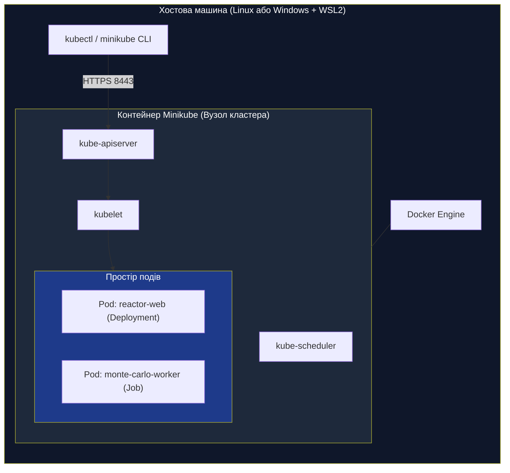

# Практична робота 4: Оркестрація Kubernetes — Job/Deployment, Probes (Liveness/Readiness), Retries та розрахунки IEEE-118 (Етап 4)

> **Декларація курсу.** Академічна доброчесність та авторство матеріалів — у [DISCLAIMER.md](DISCLAIMER.md).

**Передумови:**
- [Практика 3 — Контейнеризація у Dockerfile та WebGL Dashboard / API](./p03_docker_web.md) (створення образу `reactor-web:latest`).
- [Лекція 7 — Декларативна оркестрація (Kubernetes Control Plane) & ресурсна модель](./07_k8s_orchestration_resources.md).
- [Пререквізити лекції 7 — Піраміда абстракцій Kubernetes](./07_k8s_orchestration_prerequisites.md).

---

## Питання для розминки

**Питання 1: Чому директива `restart: always` у Docker Compose не захищає систему при падінні фізичного сервера?**

Ви розгорнули розрахунковий комплекс через `docker compose up -d` на віртуальній машині й прописали в конфігурації `restart: always`. О другій годині ночі на сервері виходить з ладу планка оперативної пам'яті, або хостинг-провайдер вимикає гіпервізор на регламентне обслуговування. Що станеться з вашим сервісом?

<details markdown="1">
<summary><b>Дізнатися відповідь</b></summary>

Сервіс залишиться недоступним доти, доки людина не втрутиться вручну.

Директива `restart: always` діє виключно в межах локального демона Docker Engine на конкретній машині. Якщо ядро операційної системи впало або сервер знеструмлено, локальний демон не працює і не здатний запустити процес на сусідньому живому комп'ютері.

Оркестратор Kubernetes функціонує на рівні **всього пулу серверів (кластера)**. Спеціальний компонент Control Plane (Node Controller) безперервно відстежує пульс кожної ноди (Heartbeats). Якщо нода перестає відповідати, контролер автоматично планує перенесення подів на інші здорові машини кластера.

</details>

**Питання 2: Що трапиться, якщо запустити пакетний розрахунок Монте-Карло всередині об'єкта `Deployment` замість `Job`?**

Студент упакував розрахунковий скрипт Монте-Карло в образ і створив маніфест `Deployment`. Скрипт успішно обчислив 50 000 траєкторій, надрукував підсумкову статистику і штатно завершив роботу з кодом виходу `0` (`sys.exit(0)`). Що зробить Kubernetes далі?

<details markdown="1">
<summary><b>Дізнатися відповідь</b></summary>

Kubernetes негайно запустить под знову, зацикливши виконання розрахунку до нескінченності.

Контролер `Deployment` спроєктований для **безперервних довгоживучих сервісів** (веб-сервери, бази даних, брокери повідомлень). Його цільовий стан (Desired State) — тримати задану кількість запущених реплік у статусі `Running`. Завершення процесу навіть із кодом `0` розцінюється як збій цільового стану.

Для пакетних обчислень, які повинні виконатися один раз і звільнити ресурси, використовується об'єкт **`Job`**. Він чекає успішного завершення контейнера з кодом `0` і переводить под у термінальний стан `Completed`.

</details>

---

## Контекст індустрії: від статичних контейнерів до оркестрованого кластера

У практиці 3 ми зв'язали воркери та веб-сервіс за допомогою `docker-compose.yml`. Це надійний інструмент для локальної розробки на одному комп'ютері. Проте в індустріальних середовищах (High-Performance Computing, Cloud Batch, аналіз енергомереж) задачі виконуються на десятках і сотнях фізичних серверів.

| Критерій | Docker Compose (Single-Host) | Kubernetes Cluster (Multi-Node) |
| :--- | :--- | :--- |
| **Масштаб інфраструктури** | Один фізичний сервер або локальний комп'ютер | Пул із десятків або сотень незалежних вузлів |
| **Реакція на аварію заліза** | Падіння хоста повністю вимикає всі сервіси | Control Plane автоматично переносить поди на здорові ноди |
| **Розподіл ресурсів** | Усі сервіси конкурують за ресурси одного ядра/ОС | Kube-Scheduler розподіляє задачі за доступними квотами вузлів |
| **Мережева адресація** | Локальний bridge на хості; порти прокидаються вручну | Єдина плоска мережа CNI, сервісні віртуальні IP та CoreDNS |
| **Керування навантаженням** | Статичний запуск контейнерів | Long-running (`Deployment`), паралельні розрахунки (`Job`, `CronJob`) |

Kubernetes бере на себе чотири критичні задачі хмарного інженера:
1. **Автоматичне планування (Scheduling):** пошук вузлів із достатньою кількістю вільних CPU та RAM під розмір задачі.
2. **Самовідновлення (Self-Healing):** перезапуск завислих процесів через probes та перепідняття подів при виході ноди з ладу.
3. **Еластичне балансування:** розподіл клієнтського трафіку між репліками через внутрішній DNS та віртуальні IP-адреси (`Service`).
4. **Керування життєвим циклом пакетних задач:** паралельний запуск розрахункових чанків із контролем спроб виконання (`Retries / BackoffLimit`).

---

## 1. Мета роботи

1. Розгорнути локальний кластер Kubernetes (Minikube або k3s/k3d) та налаштувати робочий контекст `kubectl`.
2. Опанувати механізм дистрибуції локальних OCI-образів без завантаження у публічний реєстр (Docker Hub).
3. Спроєктувати декларативний маніфест `Deployment` для довгоживучого сервісу симуляції з контролем ресурсів (`requests` / `limits`).
4. Налаштувати багаторівневі проби здоров'я контейнера: `startupProbe`, `livenessProbe` (heartbeats) та `readinessProbe`.
5. Створити та налаштувати мережевий шар `Service` (типи `ClusterIP` та `NodePort`) для доступу до сервісу.
6. Спроєктувати та запустити пакетний розрахунок Монте-Карло через об'єкт `Job` із контролем паралелізму (`parallelism`, `completions`, `backoffLimit`, `activeDeadlineSeconds`).
7. Провести інженерні стрес-тести відмовостійкості: примусове вбивство подів, імітація зависання коду та спостереження за експоненційним відкочуванням (Exponential Backoff).

---

## 2. Робоче середовище: демонстрація на Linux vs розробка на Windows / WSL2

Під час демонстрації викладач запускає команди у рідному середовищі **Linux**. Студенти виконують усі завдання безпосередньо у терміналі підсистеми **WSL2** (Ubuntu/Debian), де всі інструменти (`docker`, `minikube`, `kubectl`) працюють нативно в Linux-оточенні.

### 2.1. Локальні рушії Kubernetes: розробники, архітектура та вибір інструменту

Для локальної розробки та навчання не розгортають важкі хмарні кластери (GKE, EKS) з десятками окремих серверів. Натомість використовують спеціальні **локальні рушії (Single-Node дистрибутиви)**, які пакують усі компоненти Control Plane та Worker Node у компактний бінарник або контейнер.

В індустрії хмарної розробки домінують три основні рушії:
1. **Minikube** — офіційний інструмент спільноти **Kubernetes SIGs (Special Interest Groups)** під егідою фонду **CNCF (Cloud Native Computing Foundation)** за первинної підтримки **Google**. Це золотий стандарт для академічного навчання та локального налагодження завдяки багатій екосистемі вбудованих аддонів (Dashboard, Ingress, Metrics-Server).
2. **k3s / k3d** — проєкт компанії **Rancher Labs (нині частина корпорації SUSE)**, переданий у статус офіційного проєкту **CNCF Sandbox/Incubating**. Розробники прибрали з кодової бази застарілі драйвери хмар, замінили важкий `etcd` на легку вбудовану базу даних SQLite і скомпілювали весь Kubernetes в один бінарний файл розміром менше 100 МБ. Утиліта **k3d** запускає цей легкий рушій всередині звичайних Docker-контейнерів.
3. **Kind (Kubernetes in Docker)** — офіційний інструмент команди **Kubernetes SIG-Testing**. Його створено для автоматизованого CI/CD-тестування самого коду Kubernetes. Kind піднімає вузли як звичайні Docker-контейнери без зайвих абстракцій, але не містить графічного інтерфейсу та потребує ручного прокидання портів у конфігураційному файлі.

| Критерій | Minikube (Рекомендовано для курсу) | k3s / k3d | Kind |
| :--- | :--- | :--- | :--- |
| **Розробник / Вендор** | **Kubernetes SIGs / CNCF** (підтримка Google) | **Rancher Labs / SUSE** (CNCF Project) | **Kubernetes SIG-Testing** |
| **Основна ніша** | Навчання, локальне налагодження, аддони | Edge-обчислення, IoT, легкий CI/CD | Автоматизоване тестування, CI/CD |
| **Сховище стану** | Повноцінний `etcd` (як у production) | Вбудований `SQLite` (або зовнішній etcd) | Повноцінний `etcd` |
| **Драйвер запуску** | Docker container (`--driver=docker`) | Окремий процес ОС або Docker (`k3d`) | Тільки Docker-контейнери |
| **Робота у WSL2** | Нативно через Docker-демон у WSL2 | Нативно як легкий демон або через k3d | Нативно через Docker у WSL2 |
| **Вбудований Dashboard** | Вмикається однією командою (`minikube dashboard`) | Відсутній (потребує встановлення Helm) | Відсутній |
| **Споживання RAM** | ~1.5–2.0 ГБ | **~500–800 МБ** | ~1.0–1.2 ГБ |

Для нашого практикуму рекомендується **Minikube з драйвером Docker**: він забезпечує 100% сумісність із production-поведінкою Kubernetes (`etcd`, ресурсна модель) і дає зручний вебінтерфейс для візуального контролю стану подів. Якщо ваш комп'ютер має менше 8 ГБ оперативної пам'яті, обирайте **k3s/k3d**.



### 2.2. Запуск кластера

#### Варіант А: Minikube (універсально для Linux та Windows)

```bash
# Запуск кластера з драйвером Docker (виділяємо 2 CPU та 3 ГБ RAM)
minikube start --driver=docker --cpus=2 --memory=3072

# Якщо окремий бінарник kubectl не встановлено, створюємо аліаси до вбудованого в Minikube клієнта:
alias kubectl="minikube kubectl --"
alias k="minikube kubectl --"

# Перевірка працездатності вузла кластера
minikube kubectl -- get nodes -o wide
# або через аліас: k get nodes -o wide

# Smoke-тест: запуск еталонного інфраструктурного контейнера (pause важить ~700 КБ)
minikube kubectl -- run test-smoke --image=registry.k8s.io/pause:3.9

# Перевірка готовності поду (стан Running)
minikube kubectl -- get pods

# Видалення тестового поду після перевірки
minikube kubectl -- delete pod test-smoke
```

#### Варіант Б: k3s / k3d (для користувачів з обмеженою пам'яттю)

```bash
# Встановлення k3d (k3s всередині Docker)
curl -s https://raw.githubusercontent.com/k3d-io/k3d/main/install.sh | bash

# Створення кластера на один вузол
k3d cluster create cloud-grid --servers 1 --agents 1 -p "30080:30080@agent:0"
```

### 2.3. Мережева пастка Windows/WSL2: доступ до NodePort

На чистому Linux IP-адреса кластера (`minikube ip`) доступна безпосередньо з хостової системи через маршрутизацію віртуального мосту Docker.

На Windows підсистема WSL2 працює за внутрішнім віртуальним комутатором Hyper-V / vSwitch. Спроба відкрити адресу `http://<minikube-ip>:30080` у браузері Windows часто завершується помилкою таймауту.

**Як гарантовано отримати доступ на Windows/WSL2:**

1. **Команда port-forward (Найнадійніший інженерний спосіб):**
   ```bash
   kubectl port-forward svc/reactor-web-service 8080:8080
   ```
   Після цього сервіс відкривається за адресою `http://localhost:8080`.
2. **Команда тунелювання Minikube:**
   ```bash
   minikube service reactor-web-service
   ```
   Утиліта автоматично відкриє браузер хоста та створить маршрут через проксі-міст.

---

## 3. Імпорт локального образу в кластер

На Етапі 3 ми зібрали образ `reactor-web:latest`. Коли Kubelet отримує команду запустити под, він за замовчуванням намагається завантажити вказаний образ із публічного реєстру Docker Hub. Оскільки нашого образу в інтернеті немає, под зависає у помилці **`ErrImagePull`** або **`ImagePullBackOff`**.

Щоб передати локальний образ усередину кластера без завантаження в мережу, виконайте імпорт:

### 3.1. Збірка образу (якщо ще не виконано)

```bash
cd source/docker-web
docker build -t reactor-web:latest .
```

### 3.2. Завантаження образу в середовище кластера

```bash
# Для Minikube:
minikube image load reactor-web:latest

# Перевірка наявності образу всередині Minikube:
minikube image ls | grep reactor-web
```

```bash
# Для k3s:
docker save reactor-web:latest | sudo k3s ctr images import -

# Для k3d:
k3d image import reactor-web:latest -c cloud-grid
```

> [!IMPORTANT]
> **Пастка тегу `:latest`:** Якщо в маніфесті вказано тег `:latest`, Kubernetes за замовчуванням виставляє політику завантаження `imagePullPolicy: Always`. У маніфестах обов'язково вказуйте `imagePullPolicy: IfNotPresent`, інакше Kubelet ігноруватиме імпортований локальний образ і спробує піти на Docker Hub!

---

## 4. Довгоживучий сервіс: Deployment та Service

Усі маніфести підготовлено у підкаталозі проєкту `source/k8s/`.

### 4.1. Маніфест Deployment (`source/k8s/deployment.yaml`)

Розглянемо ключові блоки маніфесту довгоживучого сервісу:

```yaml
apiVersion: apps/v1
kind: Deployment
metadata:
  name: reactor-web-deployment
  labels:
    app: reactor-web
spec:
  replicas: 2
  strategy:
    type: RollingUpdate
    rollingUpdate:
      maxSurge: 1
      maxUnavailable: 0
  selector:
    matchLabels:
      app: reactor-web
  template:
    metadata:
      labels:
        app: reactor-web
    spec:
      containers:
        - name: reactor-service
          image: reactor-web:latest
          imagePullPolicy: IfNotPresent
          ports:
            - containerPort: 8080
          env:
            - name: PORT
              value: "8080"
            - name: SIM_WORKERS
              value: "2"
          resources:
            requests:
              cpu: "250m"
              memory: "256Mi"
            limits:
              cpu: "1000m"
              memory: "512Mi"  # Початковий ліміт (у 4.6 дослідимо кейс аварії OOMKilled)
          # 1. Startup Probe: захист від передчасного вбивства під час прогріву
          startupProbe:
            httpGet:
              path: /api/health
              port: 8080
            initialDelaySeconds: 2
            periodSeconds: 3
            failureThreshold: 10
          # 2. Liveness Probe (Heartbeats): перезапуск завислих процесів (deadlock)
          livenessProbe:
            httpGet:
              path: /api/health
              port: 8080
            initialDelaySeconds: 5
            periodSeconds: 10
            timeoutSeconds: 2
            failureThreshold: 3
          # 3. Readiness Probe: підключення до трафіку лише готових контейнерів
          readinessProbe:
            httpGet:
              path: /api/health
              port: 8080
            initialDelaySeconds: 2
            periodSeconds: 5
            failureThreshold: 2
```

### 4.2. Механізми контролю здоров'я: три рівні Probes

```
Часова шкала старту контейнера:
─────────────────────────────────────────────────────────────────────────────►
[Старт процесу] ──► [Startup Probe перевіряє] ──► [Readiness Probe: успіх] ──► [Liveness Probe пульсує]
                     (Liveness спить)               (Под бере трафік)            (Кожні 10 секунд)
```

1. **`startupProbe`:** діє лише під час ініціалізації процесу. Якщо застосунок завантажує важкі вагові коефіцієнти або будує графі в пам'яті протягом 20 секунд, звичайна Liveness-проба вбила б його на десятій секунді. Startup Probe блокує дію Liveness до першого успішного відгуку.
2. **`livenessProbe` (Heartbeat):** періодичний запит кожні `periodSeconds`. Якщо процес завис у нескінченному циклі або зламався HTTP-сервер, після 3 невдалих спроб (`failureThreshold: 3`) Kubelet перезапускає контейнер.
3. **`readinessProbe`:** визначає, чи готовий под приймати запити клієнтів. Якщо воркер зайнятий важким розрахунком і тимчасово повертає HTTP 503 або не встигає відповідати, Kubelet вилучає його IP-адресу зі списку активних балансувальника `Service`. Трафік іде на сусідні вільні репліки.

### 4.3. Маніфест мережевого сервісу (`source/k8s/service.yaml`)

```yaml
apiVersion: v1
kind: Service
metadata:
  name: reactor-web-service
spec:
  type: NodePort
  selector:
    app: reactor-web
  ports:
    - name: http
      port: 8080        # Внутрішній порт сервісу (http://reactor-web-service:8080)
      targetPort: 8080  # Порт контейнера всередині пода
      nodePort: 30080   # Зовнішній порт на кожному вузлі кластера
```

### 4.4. Застосування та перевірка розгортання

Застосуйте декларативні маніфести до кластера:

```bash
cd source/k8s
kubectl apply -f deployment.yaml
kubectl apply -f service.yaml
```

Перевірте стан створених ресурсів:

1. **Стан розгортання (Deployment):**
   ```bash
   kubectl get deployments -o wide
   ```
   Очікуваний вивід:
   ```text
   NAME                     READY   UP-TO-DATE   AVAILABLE   AGE   CONTAINERS        IMAGES               SELECTOR
   reactor-web-deployment   2/2     2            2           23s   reactor-service   reactor-web:latest   app=reactor-web
   ```

2. **Запущені поди та їхні внутрішні IP-адреси:**
   ```bash
   kubectl get pods -l app=reactor-web -o wide
   ```
   Очікуваний вивід:
   ```text
   NAME                                      READY   STATUS    RESTARTS   AGE   IP           NODE       NOMINATED NODE   READINESS GATES
   reactor-web-deployment-6c6869b45f-dn7fr   1/1     Running   0          29s   10.244.0.4   minikube   <none>           <none>
   reactor-web-deployment-6c6869b45f-v76mj   1/1     Running   0          29s   10.244.0.5   minikube   <none>           <none>
   ```

3. **Мережевий сервіс та мапінг портів:**
   ```bash
   kubectl get svc reactor-web-service
   ```
   Очікуваний вивід:
   ```text
   NAME                  TYPE       CLUSTER-IP      EXTERNAL-IP   PORT(S)          AGE
   reactor-web-service   NodePort   10.111.127.48   <none>        8080:30080/TCP   29s
   ```

### 4.5. Перевірка доступу до сервісу

Відкрийте тунель до веб-сервісу:

```bash
kubectl port-forward svc/reactor-web-service 8080:8080
```

У сусідньому терміналі виконайте тестові запити:

```bash
# Перевірка ендпоінту здоров'я (Health check)
curl -s http://localhost:8080/api/health | jq .

# Перевірка метрик сервісу
curl -s http://localhost:8080/api/metrics | jq .
```

Відкрийте в браузері адресу `http://localhost:8080`: перед вами з'явиться інтерактивний WebGL-дашборд симулятора реактора, запущений у відмовостійкому кластері Kubernetes з двома активними репліками.

### 4.6. Інженерний кейс: Аварія OOMKilled (Exit Code 137) та Rolling Update

Під час взаємодії з дашбордом у браузері або надсилання запитів розрахунку тунель `port-forward` може раптово обірватися:

```text
Handling connection for 8080
Handling connection for 8080
...
E1014 22:11:02.705505   97440 portforward.go:549] "An error occurred forwarding" err="... connect: connection refused" localPort=8080 remotePort=8080
error: lost connection to pod
```

#### 1. Діагностика інциденту

Перевірте стан подів у кластері:
```bash
kubectl get pods -l app=reactor-web
```

Зверніть увагу на лічильник `RESTARTS`:
```text
NAME                                      READY   STATUS    RESTARTS      AGE
reactor-web-deployment-6c6869b45f-dn7fr   1/1     Running   1 (48s ago)   2m26s
```

Дізнайтеся точну причину завершення контейнера через системний опис:
```bash
kubectl describe pod -l app=reactor-web | grep -A 8 "Last State:"
```

Очікуваний вивід діагностики:
```text
Last State:     Terminated
  Reason:       OOMKilled
  Exit Code:    137
```

#### 2. Аналіз першопричини (Root Cause Analysis)

- **Код виходу 137 (`128 + 9 = SIGKILL`):** Процес не впав через внутрішній виняток (Exception), а був **примусово ліквідований ядром Linux** через перевищення пам'яті (Out Of Memory).
- **Причина переповнення:** За замовчуванням у веб-симуляторі генерується **500 000 частинок** (350k швидких + 150k повільних). Пул процесів `multiprocessing.Pool` під час розрахунку серіалізує об'єкти між воркерами через `pickle`. Сумарне споживання пам'яті контейнера сягає ~600 МБ, пробиваючи встановлений у `deployment.yaml` ліміт `512Mi`.

#### 3. Виправлення: перехід на `deployment-fixed.yaml`

У каталозі `source/k8s/` підготовлено виправлений маніфест `deployment-fixed.yaml` зі збільшеним лімітом `memory: 1Gi`:

```yaml
          resources:
            requests:
              cpu: "250m"
              memory: "256Mi"
            limits:
              cpu: "1000m"
              memory: "1Gi"   # Збільшено з 512Mi до 1Gi для ліквідації OOMKilled
```

Застосуйте виправлення до кластера без простою сервісу (Zero-Downtime Rolling Update):

```bash
kubectl apply -f deployment-fixed.yaml

# Спостереження за плавним переходом на нові поди
kubectl rollout status deployment/reactor-web-deployment
```

Завдяки стратегії `RollingUpdate` (`maxSurge: 1`, `maxUnavailable: 0`), контролер Kubernetes спочатку запускає новий под із пам'яттю 1Gi, очікує успішного проходження `readinessProbe`, і лише потім безпечно виводить з експлуатації старий под. Сервіс залишається доступним без жодної секунди downtime.

---

## 5. Пакетні обчислення: паралельний Monte Carlo Job

Stateless-сервіс відповідає на швидкі HTTP-запити. Для масштабного наукового моделювання або аналізу тисяч аварійних ситуацій енергомережі потрібні **пакетні обчислення (Batch Computing)**.

### 5.1. Маніфест Job (`source/k8s/job-batch.yaml`)

```yaml
apiVersion: batch/v1
kind: Job
metadata:
  name: reactor-batch-monte-carlo
  labels:
    workload: monte-carlo-trial
spec:
  completions: 4            # Потрібно виконати 4 успішні задачі сумарно
  parallelism: 2            # Одночасно рахують максимум 2 поди
  backoffLimit: 3           # Максимум 3 повторні спроби у разі збою
  activeDeadlineSeconds: 600 # Жорсткий ліміт на виконання всього завдання (10 хв)
  template:
    metadata:
      labels:
        workload: monte-carlo-trial
    spec:
      restartPolicy: OnFailure # Політика перезапуску для Job (OnFailure або Never)
      containers:
        - name: monte-carlo-worker
          image: reactor-web:latest
          imagePullPolicy: IfNotPresent
          env:
            - name: SIM_WORKERS
              value: "2"
            - name: SIM_STEPS
              value: "20"
            - name: PYTHONUNBUFFERED
              value: "1"
          resources:
            requests:
              cpu: "500m"
              memory: "256Mi"
            limits:
              cpu: "1500m"
              memory: "512Mi"
          command: ["python", "-c"]
          args:
            - |
              import os, sys, time
              from app import ReactorSimulationEngine

              workers = int(os.environ.get("SIM_WORKERS", 2))
              steps = int(os.environ.get("SIM_STEPS", 20))
              pod_name = os.environ.get("HOSTNAME", "pod-unknown")

              print(f"[{pod_name}] 🚀 Воркер стартував. Cores={workers}, Steps={steps}")
              engine = ReactorSimulationEngine(num_workers=workers)

              t0 = time.perf_counter()
              for s in range(1, steps + 1):
                  st = engine.step()
                  if s % 5 == 0 or s == steps:
                      print(f"[{pod_name}] Крок {s:02d}/{steps}: k_eff={st['k']:.4f}, Поділів={st['fissions']}, dt={st['step_time_ms']:.1f}мс")

              total_sec = time.perf_counter() - t0
              print(f"[{pod_name}] ✅ Пакетний прогін успішно завершено за {total_sec:.2f}с!")
              sys.exit(0)
```

```
Схема виконання Job (completions: 4, parallelism: 2):
Час ─────────────────────────────────────────────────────────────────────────►
Воркер 1 (Pod A): [=== Розрахунок 1 ===]  [=== Розрахунок 3 ===]
Воркер 2 (Pod B): [=== Розрахунок 2 ===]  [=== Розрахунок 4 ===]
                                                                ▲ Всі 4 завершено!
                                                                  Статус: Completed
```

### 5.2. Запуск та спостереження за обчисленнями

Запустіть маніфест пакетного розрахунку:

```bash
kubectl apply -f source/k8s/job-batch.yaml
```

Відстежуйте стан виконання в режимі реального часу:

```bash
# Спостереження за прогресом виконання Job
kubectl get jobs -w
```

Ви побачите, як лічильник `COMPLETIONS` поступово збільшується:
```
NAME                         COMPLETIONS   DURATION   AGE
reactor-batch-monte-carlo    0/4           5s         5s
reactor-batch-monte-carlo    1/4           18s        18s
reactor-batch-monte-carlo    2/4           19s        19s
reactor-batch-monte-carlo    4/4           36s        36s
```

Перевірте логи паралельних обчислювальних воркерів:

```bash
kubectl logs -l workload=monte-carlo-trial --tail=30 --max-log-requests=6
```

Зверніть увагу: поди, які завершили розрахунок, переходять у стан `Completed`, звільняючи ресурси процесора хоста, але зберігаючи свої логи для подальшого аналізу.

---

## 6. SRE-практикум: тестування відмовостійкості (Chaos Engineering)

### 6.1. Тест 1: Самовідновлення подів (Reconciliation Loop)

Перевіримо роботу циклу узгодження Kubernetes при раптовій загибелі репліки сервісу:

```bash
# Отримуємо назву одного з працюючих подів Deployment
POD_TO_KILL=$(kubectl get pods -l app=reactor-web -o jsonpath='{.items[0].metadata.name}')
echo "Знищуємо под: $POD_TO_KILL"

# Примусово видаляємо под (імітуємо краш процесу)
kubectl delete pod $POD_TO_KILL --grace-period=0 --force

# Миттєво перевіряємо список подів
kubectl get pods -l app=reactor-web
```

**Що відбувається під капотом:**
1. Клієнт надіслав сигнал видалення в API Server.
2. Deployment Controller у циклі узгодження помітив розбіжність: у маніфесті прописано `replicas: 2`, а доступний лише `1`.
3. Контролер негайно звернувся до Kube-Scheduler і дав команду створити новий под на заміну знищеного. Час реакції складає сотні мілісекунд.

---

### 6.2. Тест 2: Спрацювання Liveness Probe при зависанні контейнера

Що станеться, якщо процес не помер фізично, але завис у Deadlock або перестає відповідати на системні запити?

Підключимося всередину одного з подів і штучно покладемо веб-сервер, відправивши йому сигнал зупинки:

```bash
POD_NAME=$(kubectl get pods -l app=reactor-web -o jsonpath='{.items[0].metadata.name}')

# Примусово зупиняємо процес всередині контейнера через сигнал SIGSTOP
kubectl exec -it $POD_NAME -- kill -STOP 1

# Спостерігаємо за подіями пода
kubectl describe pod $POD_NAME
```

Через 15–20 секунд у розділі `Events` з'явиться повідомлення:
```
Warning  Unhealthy  10s   kubelet  Liveness probe failed: HTTP probe failed with statuscode: 503 (or connection refused)
Normal   Killing    10s   kubelet  Container reactor-service failed liveness probe, will be restarted
Normal   Pulled     8s    kubelet  Container image "reactor-web:latest" already present on machine
Normal   Created    8s    kubelet  Created container reactor-service
Normal   Started    7s    kubelet  Started container reactor-service
```

Kubelet самостійно ліквідував завислий контейнер і підняв свіжу копію. Лічильник `RESTARTS` у команді `kubectl get pods` збільшиться на `1`.

---

### 6.3. Тест 3: Механізм ретраїв та Exponential Backoff у Job

Застосуємо експериментальний маніфест `job-chaos-retry.yaml`, у якому код воркера штучно падає з кодом виходу `1`:

```bash
kubectl apply -f source/k8s/job-chaos-retry.yaml

# Спостерігаємо за спробами перезапуску
kubectl get pods -l experiment=failure-injection -w
```

Зверніть увагу на час між повторними запусками:
- Спроба 1: негайний перезапуск (0 с).
- Спроба 2: затримка 10 с.
- Спроба 3: затримка 20 с.
- Спроба 4: затримка 40 с.

Цей механізм називається **експоненційним відкочуванням (Exponential Backoff)**. Він захищає кластер від колапсу: якби 1000 поламаних подів перезапускалися щомілісекунди, вони спалили б процесори планувальника та перевантажили базу даних `etcd`.

Після досягнення ліміту спроб `backoffLimit: 4` Kubernetes припиняє перезапуски й маркує Job як `Failed`.

Видаліть тестовий збійний job:
```bash
kubectl delete -f source/k8s/job-chaos-retry.yaml
```

---

## 7. Завдання для курсового проєкту (IEEE-118 Power Grid, Етап 4)

Студенти, які виконують наскрізний курсовий проєкт моделювання енергосистеми ([n01_power_grid_project.md](./n01_power_grid_project.md)), на Етапі 4 переносять розрахунки стійкості у Kubernetes:

1. **Створення маніфесту `source/grid-k8s/grid-deployment.yaml`:**
   - Розгортання образу веб-сервісу енергомережі (`grid-web:latest`).
   - Налаштування `livenessProbe` на ендпоінт перевірки здоров'я (`/api/health`).
   - Встановлення лімітів ресурсів: `limits.cpu: "2"`, `limits.memory: "1Gi"`.
2. **Створення маніфесту пакетного розрахунку `source/grid-k8s/grid-job.yaml`:**
   - Запуск масової паралельної генерації аварійних сценаріїв $N-k$ (відключення ліній електропередач та підстанцій).
   - Налаштування паралелізму: `parallelism: 4`, `completions: 8`.
   - Збереження результатів розрахунку (список топ-критичних ліній за ризиком каскадного блекауту).
3. **Порівняльний бенчмарк (Bare-Metal vs Docker Compose vs Kubernetes):**
   - Замір пропускної здатності (кількість обчислених станів за секунду).
   - Оцінка накладних витрат оркестрації (час старту подів, утилізація CPU).

---

## 8. Контрольні запитання для захисту Етапу 4 (КТ 3)

**Питання 1: Чому використання тегу `:latest` без явної вказівки `imagePullPolicy: IfNotPresent` викликає статус `ImagePullBackOff` у локальному кластері?**

<details markdown="1">
<summary><b>Еталонна відповідь</b></summary>

За специфікацією Kubernetes для образів із тегом `:latest` (або без вказання тегу взагалі) автоматично призначається політика завантаження `imagePullPolicy: Always`. 

У такому режимі Kubelet ігнорує будь-які локально імпортовані образи на вузлі та обов'язково надсилає запит до зовнішнього OCI Registry (Docker Hub). Оскільки навчального локального образу на публічному хабі не існує, запит завершується мережевою помилкою `ErrImagePull`, а Kubernetes вмикає експоненційну паузу повторних спроб `ImagePullBackOff`. 

Щоб змусити Kubelet спочатку шукати локально завантажений образ, необхідно явно зафіксувати `imagePullPolicy: IfNotPresent`.

</details>

**Питання 2: У чому різниця між призначенням `livenessProbe` та `readinessProbe` під час пікових обчислювальних сплесків?**

<details markdown="1">
<summary><b>Еталонна відповідь</b></summary>

- **`livenessProbe`** відповідає на питання: *«Чи живий процес взагалі?»*. Її невдача свідчить про фатальний стан (Deadlock, зациклення, зависання пам'яті). Реакція Kubelet — **жорстке примусове вбивство контейнера та його перезапуск**. Якщо під час важкого розрахунку помилково спрацює Liveness-проба, процес буде вбито на середині обчислення.
- **`readinessProbe`** відповідає на питання: *«Чи готовий контейнер обслуговувати клієнтів просто зараз?»*. Її невдача свідчить про те, що контейнер зайнятий або тимчасово перевантажений. Реакція Kubelet — **тимчасове вилучення IP-адреси пода з пулу балансувальника Service**. Контейнер не перезапускається, не втрачає стан і продовжує обчислення, а клієнтські запити автоматично перенаправляються на інші вільні поди.

</details>

**Питання 3: Чому перевищення ліміту пам'яті викликає аварійне завершення пода (OOMKilled, Exit Code 137), тоді як перевищення ліміту CPU викликає лише тротлінг?**

<details markdown="1">
<summary><b>Еталонна відповідь</b></summary>

Оперативна пам'ять — це **нестисливий ресурс (non-compressible resource)**, а процесорний час — **стисливий (compressible resource)**.

Ядро Linux не може розтягнути байти пам'яті у часі. Якщо процес запитує виділення сторінки пам'яті понад встановлену стелю `cgroups` (`memory.max`), ядро вимушене викликати механізм `OOM Killer` (Out Of Memory) і негайно знищити процес сигналом `SIGKILL` (код $128 + 9 = 137$).

Процесорний ресурс вимірюється квантами часу планувальника CFS (Completely Fair Scheduler). Якщо контейнер вичерпує свою квоту (наприклад, 250 мс за період 1000 мс), ядро не вбиває процес, а просто затримує його виконання (CPU Throttling) до початку наступного часового вікна. Процес продовжує жити, але його швидкість сповільнюється.

</details>

**Питання 4: Як параметр `backoffLimit` у `Job` захищає розподілену систему від каскадного колапсу при помилках у розрахунковому коді?**

<details markdown="1">
<summary><b>Еталонна відповідь</b></summary>

Якщо у розрахунковому алгоритмі є дефект (наприклад, `ZeroDivisionError` або синтаксична помилка парсингу топології), контейнер аварійно завершуватиметься одразу після старту з ненульовим кодом.

Без обмеження `backoffLimit` контролер завдань генерував би нові поди нескінченно. Це призвело б до вичерпання дискового простору логами, засмічення таблиці станів у `etcd` та марного спалювання 100% ресурсів процесора. 

Параметр `backoffLimit` задає граничну кількість спроб. Після кожної невдачі контролер подвоює час очікування (10s, 20s, 40s...). Якщо помилка не зникає, Job переводиться у стан `Failed`, система зупиняє генерацію подів і сигналізує інженерам про системну проблему.

</details>

**Питання 5: Як Kubernetes забезпечує доступність подів через стабільне доменне ім'я сервісу, якщо IP-адреси самих подів постійно змінюються?**

<details markdown="1">
<summary><b>Еталонна відповідь</b></summary>

Поди в Kubernetes є ефемерними: при кожному перезапуску под отримує нову динамічну IP-адресу.

Стабільність забезпечується об'єктом **`Service`**:
1. Сервіс отримує фіксовану віртуальну адресу **ClusterIP**, яка не змінюється протягом усього життя сервісу.
2. Внутрішній DNS-сервер кластера (**CoreDNS**) автоматично реєструє запис типу `<service-name>.<namespace>.svc.cluster.local`, прив'язуючи його до цієї ClusterIP.
3. Системний агент **`kube-proxy`** на кожному вузлі кластера конфігурує правила ядра Linux (`iptables` або `IPVS`). Коли клієнт звертається до імені або ClusterIP, правила ядра перехоплюють пакети і прозоро розподіляють трафік між реальними поточними IP-адресами здорових подів, відібраних за селектором міток (`selector: app=reactor-web`).

</details>

---

## Резюме та зв'язок з наступними темами

У цій практичній роботі ми перейшли від поодиноких контейнерів до повноцінної декларативної оркестрації:
- Реалізували самовідновлення веб-сервісу через трирівневу систему Probes.
- Побудували паралельний обчислювальний пайплайн Монте-Карло за допомогою Kubernetes Job із контролем спроб та лімітів часу.
- Захистили систему від каскадних відмов через ресурсні квоти та експоненційне відкочування.

У наступній практичній роботі ми зануримося у **Chaos Engineering та FinOps**: навчимося відстежувати розподілені запити через Jaeger OpenTracing, досліджувати затримки P99 та розраховувати реальну вартість володіння хмарним кластером.

---

**[⬅️ Практична робота 3: Docker & Web](./p03_docker_web.md)** | **[Практична робота 5: Chaos & FinOps ➡️](./p05_chaos_finops.md)**

**[⬅️ Повернутися до змісту курсу](./index.md)**
