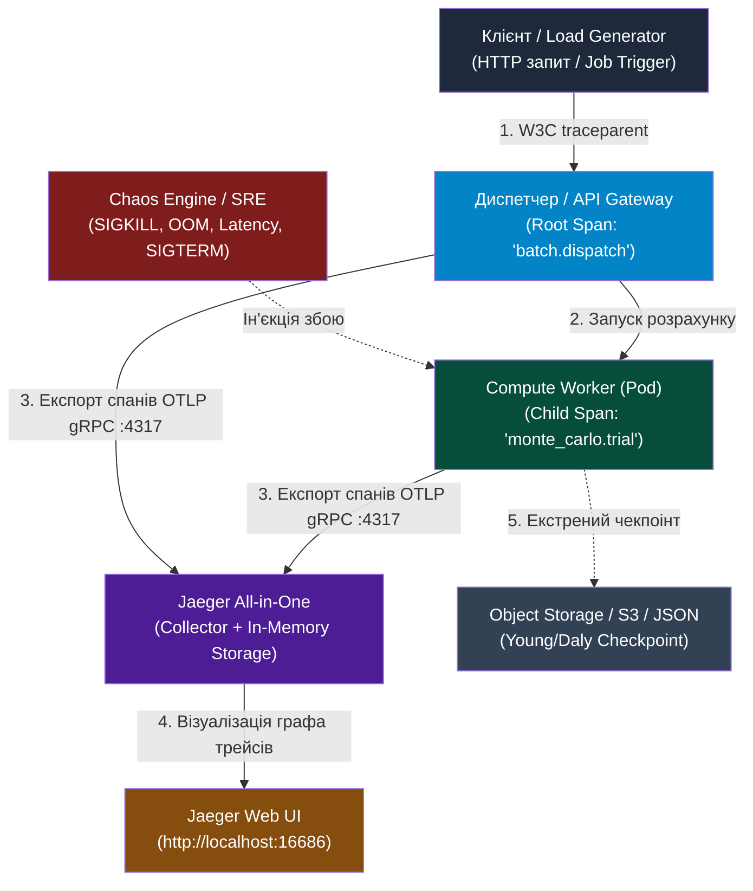

# Практична робота 5: Chaos Engineering & FinOps — симуляція аварій (SIGKILL воркерів, OOM / Exit Code 137), Jaeger OpenTracing та аналіз P99 (Етап 5)

> **Декларація курсу.** Академічна доброчесність та авторство матеріалів — у [DISCLAIMER.md](DISCLAIMER.md).

**Передумови:**
- [Практика 4 — Оркестрація Kubernetes: Job/Deployment, Probes та Retries](./p04_k8s_orchestration.md).
- [Лекція 8 — Системна спостережуваність (Observability) & troubleshooting розподілених відмов](./08_observability_troubleshooting.md).
- [Лекція 10 — FinOps, Resilience Engineering (Chaos) & підсумковий архітектурний синтез](./10_finops_resilience_synthesis.md).

---

## Питання для розминки

**Питання 1: Чому ієрархія Parent-Child руйнується при пакетній обробці в чергах (Kafka / Redis Streams / Celery), і як проблему вирішують Span Links?**

Клієнт відправляє HTTP-запит на запуск симуляції, а бекенд розбиває його на 500 дрібних задач і відправляє в брокер повідомлень. Воркер бере з черги пачку з 50 задач, де змішані обчислення від різних користувачів. Якщо створити один спан воркера, хто є його "батьком"?

<details markdown="1">
<summary><b>Дізнатися відповідь</b></summary>

Класична модель **Parent-Child (ChildOf)** вимагає наявності **одного прямого предка**. В асинхронній пакетній обробці ця концепція заводить у глухий кут: воркер не може бути дочірнім процесом для 50 клієнтів одночасно.

Якщо обрати довільного клієнта як батька, граф викликів покаже хибну картину залежностей. Якщо створити новий трейс без предка, втратиться зв'язок із клієнтським запитом.

В OpenTelemetry рішенням є **Span Links (зв'язки між спанами)**. Воркер створює незалежний спан виконання батчу і додає до нього масив посилань (`links`) на `SpanContext` кожної вхідної задачі. Це зберігає причинно-наслідкові зв'язки в Jaeger без спотворення топології викликів.

</details>

**Питання 2: Чому класичний Exponential Backoff без випадкового відхилення (Jitter) гарантовано добиває сервіс, який щойно почав відновлюватися?**

Бекенд відчув короткочасне перевантаження і почав повертати помилки HTTP 503. Сто паралельних воркерів налаштовані на детермінований Exponential Backoff із паузами $1\text{ с}, 2\text{ с}, 4\text{ с}, 8\text{ с}$. Що станеться на другій та четвертій секундах?

<details markdown="1">
<summary><b>Дізнатися відповідь</b></summary>

Виникає ефект **Thundering Herd (шторм синхронних повторних спроб)**.

Оскільки всі воркери отримали відмову практично одночасно і чекають фіксовані часові інтервали, їхні наступні спроби знову прийдуть на сервер одночасно — рівно через 1, 2, 4 та 8 секунд. Замість рівномірного згасання трафіку виникає резонансна хвиля ударного навантаження.

Для запобігання резонансу використовують **Full Jitter**:

$$t_{\text{sleep}} = \text{random}(0, 2^{\text{attempt}} \times \text{base\_delay})$$

Випадковий розподіл часу очікування розбиває синхронну групу запитів на плавний шум, дозволяючи базі даних або сервісу піднятися.

</details>

**Питання 3: Як неправильний розрахунок `terminationGracePeriodSeconds` у Kubernetes призводить до втрати даних при масштабуванні Spot-нод?**

Воркери пакетних обчислень працюють на Spot-нодах у кластері з активним KEDA. Хмарний провайдер надіслав сигнал про вилучення машини за 30 секунд. У маніфесті Pod за замовчуванням залишилося значення `terminationGracePeriodSeconds: 30`, а час збереження повної матриці стану на диск триває 35 секунд. Які наслідки для розрахунку?

<details markdown="1">
<summary><b>Дізнатися відповідь</b></summary>

Розрахунок буде пошкоджено або втрачено.

Після надсилання сигналу `SIGTERM` Kubernetes чекає рівно вказаний ліміт `terminationGracePeriodSeconds`. На 31-й секунді kubelet надсилає процесу `SIGKILL`, перериваючи операцію запису файлу чекпоінта на середині. 

На диску залишається битий JSON-файл. Новий воркер, піднятий на іншій ноді, впаде під час спроби десеріалізації пошкодженого стану. 

Налаштування відмовостійкості вимагає:
1. Запас часу: `terminationGracePeriodSeconds` встановлюється меншим за вікно виселення хмари (наприклад, 25 с).
2. Атомарний запис чекпоінта: запис у тимчасовий файл із наступним атомарним перейменуванням (`os.replace`).

</details>

---

## Контекст індустрії: Від наївного коду до стійкої хмарної системи

Розподілена система ніколи не перебуває в ідеальному стані. У великому кластері щохвилини відмовляють мережеві інтерфейси, перезавантажуються Spot-сервери або з'являються задачі-диверсанти, які здатні покласти весь пул воркерів.

```
                  КЛАСИЧНИЙ ПІДХІД VS CHAOS & FINOPS
    ┌─────────────────────────────────┬─────────────────────────────────┐
    │     НАЇВНА РОЗРОБКА (DEV)       │    ХМАРНИЙ SRE & FINOPS (PROD)  │
    ├─────────────────────────────────┼─────────────────────────────────┤
    │ Збій воркера — це рідкість      │ Воркери постійно гинуть і рвуться│
    │ Повтори роблять за фіксованим t │ Full Jitter + Circuit Breaker   │
    │ Черга нескінченно повторює батч │ Dead Letter Queue ізолює збій   │
    │ On-Demand сервери за 100% ціни  │ Spot-ноди (80% знижка) + чекпоінт│
    │ Логи читають вручну через grep  │ Наскрізне трасування (Jaeger UI)│
    └─────────────────────────────────┴─────────────────────────────────┘
```

**Chaos Engineering** — це дисципліна перевірки гіпотез стійкості через контрольовану ін'єкцію відмов у систему.

---

## 1. Мета роботи

1. Розгорнути повноцінний бекенд розподіленого трасування **Jaeger** у Kubernetes (Minikube / k3s) або через Docker Compose.
2. Інструментувати код воркерів та черги за допомогою стандарту **OpenTelemetry** (W3C TraceContext, Span Links, Attributes).
3. Дослідити феномен **"отруйної пігулки" (Poison Pill Task)** у розподіленій черзі, локалізувати збійний спан у Jaeger та налаштувати ізоляцію через **Dead Letter Queue (DLQ)**.
4. Змоделювати шторм ретраїв (**Retry Storm / Thundering Herd**) при падінні залежності та ліквідувати резонанс за допомогою **Circuit Breaker та Full Jitter**.
5. Реалізувати та протестувати механізм **Graceful Checkpointing** при симуляції виселення Spot-інстансу за сигналом `SIGTERM`.
6. Змоделювати мережевий джитер, розрахувати перцентилі затримки **P50, P90, P95, P99** та знайти аномальні спани в інтерфейсі Jaeger.
7. Провести повний **FinOps-розрахунок TCO** для $10^6$ та $10^7$ траєкторій симулятора Монте-Карло, порівнявши On-Demand, Reserved та Spot моделі із застосуванням формули Янга/Дейлі.

---

## 2. Архітектура стенду спостережуваності та хаосу

Стенд складається з обчислювального воркера, генератора хаосу та бекенду збору телеметрії.



### Формат контексту W3C TraceContext
Для зв'язування викликів між різними процесами та контейнерами використовується стандартний заголовок HTTP або метаданих:

$$\texttt{traceparent: 00-4bf92f3577b34da6a3ce929d0e0e4736-00f067aa0ba902b7-01}$$

- `00` — версія стандарту.
- `4bf92f3577b34da6a3ce929d0e0e4736` — глобальний **Trace ID** (16 байтів), спільний для всього ланцюжка.
- `00f067aa0ba902b7` — ідентифікатор батьківського спану **Parent Span ID** (8 байтів).
- `01` — прапорець трасування (семпльований запит).

---

## 3. Розгортання стеку Jaeger OpenTracing

### 3.1. Варіант А: Розгортання у Kubernetes (Minikube / k3s)

Маніфест `source/chaos-finops/jaeger.yaml` розгортає контейнер Jaeger All-in-One з активованим OTLP gRPC приймачем на порту `4317` та веб-інтерфейсом на порту `16686`.

```bash
# 1. Застосувати маніфест Jaeger
kubectl apply -f source/chaos-finops/jaeger.yaml

# 2. Перевірити готовність пода
kubectl get pods -l app=jaeger -w
```

Очікуваний вивід:
```text
NAME                      READY   STATUS    RESTARTS   AGE
jaeger-67df9c8b74-x9q4z   1/1     Running   0          18s
```

Прокидання порту до вебінтерфейсу:
```bash
# Прокидання порту UI у фоновому режимі
kubectl port-forward svc/jaeger-service 16686:16686 4317:4317 &
```

Тепер інтерфейс доступний у браузері за адресою: **`http://localhost:16686`**.

### 3.2. Варіант Б: Запуск через Docker Compose

Якщо кластер Kubernetes не запущено, підніміть сервіс трасування за допомогою Docker Compose:

```bash
cd source/chaos-finops
docker compose up -d jaeger
```

Перевірте доступність API Jaeger:
```bash
curl -s http://localhost:16686/ | head -n 5
```

---

## 4. Інструментування коду через OpenTelemetry

Усі експерименти спираються на модуль [`source/chaos-finops/tracer.py`](file:///home/pvv/projects/onu/cloud_grid/source/chaos-finops/tracer.py). Він інкапсулює роботу з бібліотеками OpenTelemetry та містить захисний fallback-режим на випадок відсутності сторонніх пакетів.

### Встановлення залежностей (за потреби)
```bash
pip install -r source/chaos-finops/requirements.txt
```

### Патерн створення вкладених спанів у коді

```python
from tracer import get_tracer, start_span, inject_trace_context

# 1. Ініціалізація трейсера для поточного сервісу
tracer = get_tracer("power-grid-worker")

# 2. Створення батьківського спану для всієї пачки задач
with start_span("batch.process", {"batch.size": 1000, "grid.model": "ieee118"}) as root_span:
    for trial_id in range(10):
        # 3. Створення дочірнього спану для конкретної траєкторії
        with start_span("trial.simulate", {"trial.id": trial_id}) as child_span:
            # Обчислення каскаду
            run_matrix_math()
```

У разі виникнення винятку метод `record_exception()` автоматично фіксує стек помилки у спані та встановлює статус `StatusCode.ERROR`.

---

## 5. SRE-практикум Chaos Engineering: Ін'єкція відмов

Лабораторний скрипт [`source/chaos-finops/chaos_experiment.py`](file:///home/pvv/projects/onu/cloud_grid/source/chaos-finops/chaos_experiment.py) реалізує чотири контрольовані сценарії хаосу.

### 5.1. Експеримент 1: "Отруйна пігулка" (Poison Pill Task) та каскадний OOM воркерів

У продакшн-чергу обчислень потрапляє задача з пошкодженими даними або екстремальним розміром вибірки (`poison_matrix_ieee118`), яка вимагає більше пам'яті, ніж ліміт cgroups (`512Mi`).

#### Крок 1. Запуск у наївній черзі (без захисту):
```bash
python3 source/chaos-finops/chaos_experiment.py poison-pill
```

Результат у терміналі:
```text
===========================================================================
СЦЕНАРІЙ 1: 'Отруйна пігулка' (Poison Pill) та каскадний збій воркерів
===========================================================================
Захист черги через Dead Letter Queue (DLQ): ВИМКНЕНО (Наївна черга)
---------------------------------------------------------------------------
[Воркер 1] Взято в обробку: 'batch_1'... [OK]
[Воркер 1] Взято в обробку: 'batch_2'... [OK]
[Воркер 1] Взято в обробку: 'poison_matrix_ieee118'...
  [CRASH!] Воркер 1 перевищив ліміт cgroups memory.max!
  [ЯДРО LINUX] OOM Killer ліквідував воркер (Exit Code 137 / SIGKILL)!
  [НАЇВНА ЧЕРГА] Необроблена задача повертається в чергу. Піднімаємо новий воркер...
[Воркер 2] Взято в обробку: 'poison_matrix_ieee118'... [CRASH! OOM 137]
[Воркер 3] Взято в обробку: 'poison_matrix_ieee118'... [CRASH! OOM 137]
...
[КАТАСТРОФА: CrashLoopBackOff кластера!]
Одна отруйна задача по черзі вбила 5 воркерів поспіль!
Решта валідних задач черги заблоковані назавжди (Head-of-Line Blocking)!
```

#### Крок 2. Локалізація в Jaeger UI та захист через Dead Letter Queue (DLQ):
1. Відкрийте **Jaeger UI** (`http://localhost:16686`).
2. Знайдіть червоний спан `worker.process_task` із тегом `error=true` та атрибутом `exception.type="OOMKilled_ExitCode_137"`. Зверніть увагу на `task.id: "poison_matrix_ieee118"`.
3. Запустіть чергу із захисним механізмом ліміту повторів (Max Retries = 2) та відправкою у карантин:

```bash
python3 source/chaos-finops/chaos_experiment.py poison-pill --protect
```

Результат:
```text
[Воркер 1] Взято в обробку: 'poison_matrix_ieee118' (Спроба 1)... [CRASH! OOM 137]
  [RETRY] Відкат спроби. Задачу посунуто в кінець черги.
[Воркер 1] Взято в обробку: 'batch_3'... [OK]
...
[Воркер 1] Взято в обробку: 'poison_matrix_ieee118' (Спроба 2)... [CRASH! OOM 137]
  [DLQ ЗАХИСТ] Задачу 'poison_matrix_ieee118' вичерпано (2 невдачі).
  [QUARANTINE] Задачу ізольовано у Dead Letter Queue!

===========================================================================
ПІДСУМОК РОБОТИ ЧЕРГИ З DLQ:
  Успішно обчислено задач : 8 / 8
  Ізольовано в DLQ        : 1 (задача: ['poison_matrix_ieee118'])
Кластер вижив, каскадного падіння уникнуто!
===========================================================================
```

---

### 5.2. Експеримент 2: Шторм ретраїв (Retry Storm) vs Full Jitter & Circuit Breaker

Зовнішня залежність (сервіс топології мережі або база даних) зазнає короткочасної аварії (відмовляє впродовж перших 1.2 секунди тесту). 10 паралельних воркерів намагаються отримати дані.

#### Крок 1. Наївна стратегія (детермінований Exponential Backoff):
```bash
python3 source/chaos-finops/chaos_experiment.py retry-storm --strategy naive
```

Результат:
```text
РЕЗУЛЬТАТИ ВИТРИВАЛОСТІ БЕКЕНДУ:
  Сумарна кількість ударів по бекенду (HTTP Hits) : 34
  [АНАЛІЗ SRE] Синхронні повтори без Jitter створили Thundering Herd!
  Бекенд отримав надмірний шквал ударів у пік відновлення.
```

#### Крок 2. Стійка стратегія (Full Jitter + Circuit Breaker):
```bash
python3 source/chaos-finops/chaos_experiment.py retry-storm --strategy jitter-breaker
```

Результат:
```text
РЕЗУЛЬТАТИ ВИТРИВАЛОСТІ БЕКЕНДУ:
  Сумарна кількість ударів по бекенду (HTTP Hits) : 19
  [АНАЛІЗ SRE] Circuit Breaker скинув навантаження, а Full Jitter згладив піки.
  Кількість запитів скоротилася майже вдвічі без втрати якості!
```

**Висновки для SRE:** Circuit Breaker негайно розмикає коло при трьох помилках поспіль, повертаючи клієнту швидку помилку без звернення до мертвого сервера. Формула Full Jitter розкидає повторні спроби у часі, виключаючи синхронний резонанс.

---

### 5.3. Експеримент 3: Виселення Spot-вузла та Graceful Checkpointing

Провайдери хмар надсилають сигнал `SIGTERM` за 30–120 секунд до примусового вимкнення Spot-машини. Задача коду — перехопити сигнал, оперативно серіалізувати поточний прогрес і вийти зі статусом `0`.

Запустіть експеримент у першому терміналі:
```bash
python3 source/chaos-finops/chaos_experiment.py spot --trials 1000 --checkpoint-interval 200
```

Під час виконання розрахунків відкрийте другий термінал та імітуйте виселення ноди хмарою, надіславши сигнал `SIGTERM`:
```bash
kill -TERM $(pgrep -f "chaos_experiment.py spot")
```

Результат у першому терміналі:
```text
[Крок  200/1000] Збереження планового чекпоінта у spot_checkpoint.json...
[Крок  342/1000] Виконання розрахунків...

[SPOT NOTICE] Отримано сигнал SIGTERM! Хмара забирає Spot-ноду через 30 секунд!
[CHECKPOINT] Екстрене збереження стану на кроці 343/1000 перед загибеллю ноди...
[SHUTDOWN] Чекпоінт збережено у spot_checkpoint.json. Штатний вихід із кодом 0.
```

Повторно запустіть ту саму команду:
```bash
python3 source/chaos-finops/chaos_experiment.py spot --trials 1000 --checkpoint-interval 200
```

Результат відновлення:
```text
[RECOVERY] Знайдено збережений чекпоінт! Відновлення з ітерації 343/1000.
[Крок  400/1000] Збереження планового чекпоінта у spot_checkpoint.json...
...
[SUCCESS] Усі 1000 траєкторій обчислено успішно!
[CLEANUP] Тимчасовий файл чекпоінта видалено.
```

**Архітектурний результат:** Жодна секунда обчислень не була втрачена. Новий воркер підхопив розрахунок рівно з того місця, де попередній був примусово зупинений.

---

### 5.4. Експеримент 4: Мережевий джитер та профілювання P50/P90/P99

Запустіть тест генерації навантаження зі штучною ін'єкцією затримок:

```bash
python3 source/chaos-finops/chaos_experiment.py latency --samples 200 --chaos-pct 2.5
```

Зверніть увагу на підсумкову статистику:
```text
Розподіл затримок (ASCII-гістограма):
[  11.0 -   92.9 мс]: ████████████████████████████████████████ ( 48)
[  92.9 -  174.9 мс]:                                          (  0)
...
[ 748.7 -  830.7 мс]:                                          (  1)

==================================================
ПІДСУМКОВА СТАТИСТИКА ЗАТРИМОК (SRE METRICS):
==================================================
Середнє арифметичне (Mean) :  49.26 мс (МАСКУЄ ПРОБЛЕМИ!)
Медіана (P50)             :  20.16 мс (нормальний режим роботи)
Перцентиль P90            :  25.04 мс
Перцентиль P95            :  25.12 мс
Хвостова затримка (P99)   : 830.68 мс <--- ЗОНА РИЗИКУ
==================================================
Співвідношення P99 / P50: 41.2x різниця!
```

Відкрийте **Jaeger UI** (`http://localhost:16686`), оберіть сервіс `monte-carlo-worker` та знайдіть операцію `trial.compute`. 

Ви побачите, що кілька окремих спанів затягнулися на ~800 мс, маючи червону мітку `is_anomaly = True`. Розподілене трасування локалізує вузьке місце за кілька кліків без необхідності перегляду гігабайтів текстових логів.

---

## 6. Хмарний FinOps-аналіз: Розрахунок вартості $10^7$ розрахунків

Для захисту лабораторної роботи необхідно надати фінансове обґрунтування інфраструктури.

Використовуйте розрахунковий інструмент [`source/chaos-finops/finops_calculator.py`](file:///home/pvv/projects/onu/cloud_grid/source/chaos-finops/finops_calculator.py):

```bash
python3 source/chaos-finops/finops_calculator.py --samples 10000000 --workers 16 --output finops_report.json
```

### Порівняльна матриця витрат для $10^7$ траєкторій (кластер із 16 інстансів c6i.xlarge):

| Параметр | On-Demand модель | Reserved 1-Year (Commitment) | Spot / Preemptible + S3 Checkpoints |
| :--- | :--- | :--- | :--- |
| **Погодинна ставка за ноду** | $0.170 / год | $0.107 / год | **$0.034 / год (знижка 80%)** |
| **Сумарний час виконання** | 1.45 год | 1.45 год | 1.45 год + оверхед ретраїв (~3 хв) |
| **Витрати на обчислення (CPU)**| $3.94 | $2.48 | **$0.79** |
| **Витрати на S3 API & Storage**| $0.00 | $0.00 | $0.03 |
| **Оверхед від виселень нод** | $0.00 | $0.00 | $0.13 |
| **Підсумковий TCO проєкту** | **$3.94** | **$2.48** | **$0.92** |
| **Реальна економія бюджету** | 0% (базовий тариф) | 37.1% | **76.7% чистої економії** |

### Математичний оптимум інтервалу чекпоінту
Якщо встановити період збереження чекпоінта 1 секунду замість розрахованих за формулою Янга/Дейлі 147 секунд:
- Кількість викликів S3 зросте з 576 до **84 000+**.
- Витрати на API збільшаться у 145 разів.
- Чиста продуктивність розрахунків впаде через дисковий тротлінг.

---

## 7. Завдання для курсового проєкту (IEEE-118 Power Grid, Етап 5)

Студент зобов'язаний інтегрувати здобуті знання в основний проєкт симуляції стійкості енергомережі IEEE-118.

### Технічні вимоги до Етапу 5:
1. **Інструментування OpenTelemetry:**
   - Додати ініціалізацію трейсера у воркер або веб-сервіс проєкту.
   - Створити спани для ключових фаз: парсинг графа, розрахунок $N-k$ каскаду, виявлення перевантажених ліній, збереження статистики.
   - Забезпечити експорт спанів у локальний Jaeger (`localhost:4317` або Service DNS у Kubernetes).
2. **Стійкість до аварій (Chaos Testing):**
   - Продемонструвати стійкість черги або Job при аварійному знищенні воркера через `SIGKILL` або `Exit Code 137`.
   - Реалізувати перехоплювач `SIGTERM` для збереження знайдених критичних ліній енергосистеми перед виселенням машини.
3. **Аналіз продуктивності (P50/P90/P99):**
   - Зібрати масив затримок для не менше ніж 100 випробувань симулятора.
   - Розрахувати та включити до фінального звіту перцентилі P50, P90, P95 та P99.
4. **FinOps-обґрунтування:**
   - Згенерувати звіт `finops_report.json` для розрахунку $10^7$ станів мережі IEEE-118.
   - Показати оптимізацію витрат за умови переведення обчислень на Spot-інстанси.

---

## 8. Контрольні запитання для захисту Етапу 5 (КТ 4)

**Питання 1: Чому контекст трасування (TraceContext) втрачається при передачі задачі в асинхронний ThreadPool або брокер повідомлень (Kafka/RabbitMQ), якщо не передати його явно?**

<details markdown="1">
<summary><b>Дізнатися відповідь</b></summary>

За замовчуванням більшість бібліотек трасування (зокрема OpenTelemetry у Python та Java) зберігають активний `SpanContext` у локальній пам'яті потоку (**Thread-Local Storage** або контекстних змінних `contextvars`).

Коли задача передається в інший потік, процес або відправляється як повідомлення в чергу по мережі, пам'ять потоку не копіюється автоматично. Дочірній воркер не бачить батьківського контексту і починає новий трейс із випадковим `TraceID`. 

Для збереження зв'язку розробник зобов'язаний виконати **Inject** заголовка W3C (`traceparent`) у метадані повідомлення на стороні відправника, а на стороні отримувача викликати **Extract** перед початком обробки задачі.

</details>

**Питання 2: Як розпізнати "отруйну пігулку" (Poison Pill Task) у черзі за допомогою Jaeger, і чому без Dead Letter Queue це спричиняє Head-of-Line Blocking усього пулу воркерів?**

<details markdown="1">
<summary><b>Дізнатися відповідь</b></summary>

"Отруйна пігулка" — це задача, обробка якої викликає аварійне падіння воркера (наприклад, через збій десеріалізації або OOM Killer).

Якщо в черзі увімкнено автоматичний ретрай без ізоляції, після падіння першого воркера задача повертається на початок черги. Наступний вільний воркер бере її в роботу і також миттєво гине. За кілька секунд весь пул реплік потрапляє в аварійний стан `CrashLoopBackOff`. 

Решта валідних задач у черзі не можуть бути оброблені — виникає **Head-of-Line Blocking (блокування початку черги)**.

У **Jaeger UI** така аномалія виявляється через пошук серії незавершених або червоних спанів `worker.process_task` з однаковим ідентифікатором задачі (`task.id`). Рішення полягає у встановленні ліміту спроб (`MaxRetries`) та автоматичному перенаправленні задачі-диверсанта в ізольований карантин — **Dead Letter Queue (DLQ)**.

</details>

**Питання 3: Як формула Янга/Дейлі захищає від фінансових збитків при роботі зі Spot-інстансами?**

<details markdown="1">
<summary><b>Дізнатися відповідь</b></summary>

Формула визначає точну математичну точку рівноваги між двома протилежними статтями витрат:
1. **Витрати на часті чекпоінти:** плата за I/O, навантаження CPU та вартість кожного виклику API об'єктного сховища (S3 PUT).
2. **Витрати на перезапуск при аварії:** у разі виселення ноди без збереженого стану втрачається вся робота, виконана з моменту останнього збереження (у середньому половина інтервалу $\tau / 2$).

Формула $\tau \approx \sqrt{2 \cdot \delta \cdot M}$ мінімізує сумарні втрати часу та коштів, розраховуючи періодичність, за якої сума витрат на операції збереження дорівнює математичному очікуванню втрат від відновлення після збоїв.

</details>

**Питання 4: Яка принципова різниця між Head-based та Tail-based семплюванням у системах розподіленого трасування?**

<details markdown="1">
<summary><b>Дізнатися відповідь</b></summary>

- **Head-based Sampling:** Рішення про те, записувати трейс чи викинути його, ухвалюється на самому початку транзакції (наприклад, на API Gateway) випадковим чином (наприклад, для 2% трафіку). Перевага: мінімальне навантаження на мережу. Недолік: якщо збій чи аномалія сталися на 98% незаписаних запитів, інформація про аварію втрачається назавжди.
- **Tail-based Sampling:** Усі спани тимчасово буферизуються в пам'яті колектора (OpenTelemetry Collector). Рішення ухвалюється **після завершення всього запиту**: транзакції з помилками (HTTP 5xx, спани зі статусом Error) та високою затримкою (P99 > 2 с) зберігаються на 100%, тоді як типові успішні запити зберігаються на рівні 0.1%. Це гарантує повну спостережуваність усіх системних аномалій.

</details>

---

## Резюме та зв'язок з фінальним захистом

Ви опанували інструменти стійкості розподілених систем, перевірили поведінку ядра під час збоїв та налаштували наскрізну спостережуваність через Jaeger.

Наступна пара (Пара 9) — це **Контрольна точка 4 (Захист Етапу 5)**. 
Ви продемонструєте:
1. Роботу воркерів під навантаженням та відображення графа трейсів у веб-інтерфейсі Jaeger.
2. Протокол захисту від "отруйної задачі" (DLQ) та безперервності розрахунків після Spot-виселення.
3. Таблицю розрахунку затримок P50/P90/P99.
4. FinOps-звіт собівартості масової симуляції енергомережі IEEE-118 на базі Spot-інстансів.

На підсумковому захисті курсу (Пара 10) усі 5 етапів об'єднаються у фінальну архітектурну систему.
